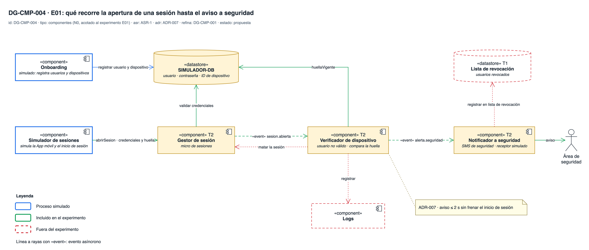
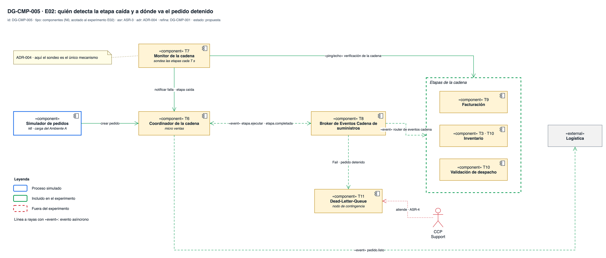

# Experimentos — E01, detección del dispositivo no registrado, y E02, detección y reacción ante el pedido detenido

Dos experimentos ponen a prueba dos ideas de diseño independientes, cada una
con su escenario de calidad y su decisión de arquitectura. Comparten el
prototipo, el stack, la carga y la forma de medir, que se describen una vez en
la primera sección.

| Experimento | Hipótesis | Escenario | Decisión que valida | Alcance |
|---|---|---|---|---|
| E01 — Seguridad | H1: el Verificador de dispositivo compara la huella apenas el micro de sesiones abre la sesión | ASR-1 | ADR-007 | La detección y el aviso a seguridad, que son toda la respuesta del escenario |
| E02 — Disponibilidad | H2: el Monitor de la cadena detecta el pedido detenido, el micro de ventas lo envía a la Dead-Letter-Queue y cada etapa idempotente aplica su efecto una sola vez | ASR-4, con ASR-3 como paso previo | ADR-005, con ADR-004 para la detección | Que el pedido detenido llegue a la Dead-Letter-Queue y que ninguna etapa duplique su efecto. La reanudación y la entrega a una persona quedan fuera |

Los escenarios están en [ASRs de disponibilidad y seguridad](quality-attributes.md),
y las decisiones, en el [registro de ADR](modelos/adrs-ccp-reto2.md). Cada
experimento se carga en Helix por separado, con su propia conclusión y su propia
decisión: una hipótesis puede caer sin arrastrar a la otra.

## El montaje común

### El prototipo

Cada experimento tiene su diagrama de componentes, acotado a lo que prueba:
DG-CMP-004 para E01 y DG-CMP-005 para E02. Los dos están en
[`modelos/drawio/experimentos.drawio`](https://github.com/MATI-MBIT/arqsoft-reto-2/blob/main/docs/modelos/drawio/experimentos.drawio)
y usan los mismos nombres, marcas y estilos del panorama DG-CMP-001 de la
[vista de componentes](modelos/vista-componentes.md). El azul es lo simulado, el
verde lo que entra al experimento y el rojo lo que queda fuera.

### El stack

Todo corre en local, en una sola máquina:

| Pieza | Qué se usa | Para qué | Experimento |
|---|---|---|---|
| Micros | Java 21 y Spring Boot 3, un proceso por micro. Spring Web para abrir sesiones, crear pedidos y sondear la salud de las etapas; Spring AMQP para los eventos, que pasan por el bróker como en DG-CMP-004 y DG-CMP-005 | Que el inyector pueda detener cada etapa por separado | Los dos |
| SIMULADOR-DB | PostgreSQL en Docker Compose | Usuarios, ID de dispositivo registrado y estado de cada pedido por etapa | Los dos |
| Carga | k6, con arribo aleatorio, como en el reto 1 | Reproducir el Ambiente A | Los dos |
| Observabilidad en vivo | Micrometer en cada micro, con Prometheus y Grafana en Docker Compose | Ver la ejecución mientras pasa y parar a tiempo una ejecución dañada | Los dos |
| Registro de eventos | Cada componente escribe una fila con el identificador, el evento y el instante en una tabla de PostgreSQL. Un script cruza las filas al final de cada ejecución | Probar uno a uno que cada salida corresponde a su falla. Prometheus no sirve para esto porque agrega los datos y pierde el identificador | Los dos |
| Monitor de la cadena | Un micro aparte con una tarea programada (`@Scheduled`) que sondea un punto de salud de cada etapa cada T segundos y cuenta los sondeos sin respuesta | Variar T y N en D4 sin tocar código | E02 |
| Bróker y Dead-Letter-Queue | RabbitMQ en Docker Compose: el bróker de la cadena, con una cola de mensajes fallidos durable, confirmación de publicación y Spring AMQP | Medir cero pedidos perdidos y cero duplicados | E02 |
| Inyección | Un inyector que detiene procesos y congela pedidos marcados | Las fases D2 y D3 | E02 |

Grafana sirve para mirar la ejecución; el veredicto de cada criterio sale del
registro de eventos, que conserva el identificador de cada operación y de cada
pedido.

### La carga

Toda la carga es la del Ambiente A, fijada en el supuesto S-4 de los
[ASR](quality-attributes.md): 1 pedido y 10 consultas por segundo, con arribo
aleatorio. Cada pedido recorre las tres etapas, y cada etapa tarda un tiempo
aleatorio, para que la detección conviva con la variación normal de la
operación.

Cada ejecución empieza con un calentamiento de 5 minutos que no entra en ningún
criterio. Las cifras de repeticiones y duraciones de las fases son una
propuesta del equipo; no salen del enunciado.

### Cómo se cruzan entradas y salidas

Cada operación y cada pedido llevan un identificador desde el simulador hasta el
final del recorrido. Un aviso o un mensaje en la cola cuenta solo cuando se
cruza, uno a uno, con la falla inyectada que lo causó. Contar avisos no basta:
hay que mostrar a qué entrada corresponde cada salida.

Todos los componentes corren en la misma máquina y leen el mismo reloj, así que
medir las diferencias de tiempo no exige sincronizar relojes.

### Las limitaciones comunes

- Una sola máquina y una red local: los experimentos validan las ideas de
  diseño, no el tamaño de la infraestructura.
- Solo se inyectan fallas de software, por el supuesto S-3. Las caídas de
  máquina, red o base quedan fuera.

### El esfuerzo y el calendario

Los dos experimentos suman unas 72 horas-persona, repartidas entre las cuatro
personas del equipo en una semana de calendario. Es una estimación del diseño,
no una cifra medida. El reparto por experimento está en cada uno.

Del día 1 al 3, cada persona construye su frente en paralelo. El día 4 se
integra todo, se corre E01 completo y se corren las fases D1 a D3 de E02; D4
corre esa noche sin supervisión. El día 5, el equipo completo analiza los
resultados y toma las dos decisiones.

---

## E01 — Seguridad: detección del dispositivo no registrado

### El título del experimento

**E01 — Validar la detección del dispositivo no registrado con el Verificador
de dispositivo.**

### La hipótesis de diseño

#### H1 — El Verificador de dispositivo detecta la huella de un dispositivo no registrado

**Creemos que** comparar en el Verificador de dispositivo la huella del
dispositivo con la registrada, **para** una sesión con credenciales correctas
desde un dispositivo no registrado ([ASR-1](quality-attributes.md)), **dará
como resultado** un aviso a seguridad con el vendedor, el dispositivo y la
hora, **lo cual se validará cuando** las 50 sesiones de S1 avisen en ≤ 2 s y
los 100 cambios legítimos de S2 disparen ≤ 1 aviso. El dispositivo registrado
es el que CCP le suministró al vendedor. Las 20 aperturas de S3, hechas menos
de 1 s después de registrar el dispositivo nuevo, no deben disparar ninguno.
Tampoco las sesiones desde un dispositivo que ya estaba registrado.

- **Variable independiente:** dónde y cuándo se compara la huella. Se compara
  en el Verificador de dispositivo, al recibir el evento `sesion.abierta` del
  micro de sesiones, contra el registro de la base y sin caché.
- **Variables dependientes:** la demora entre la apertura de la sesión y el
  aviso; los avisos falsos por cada 100 cambios legítimos de dispositivo, que
  ASR-1 limita a uno; y las aperturas desde un dispositivo no registrado que
  quedan sin aviso.

Fundamento: CCP le entrega el dispositivo a cada vendedor, de modo que el
sistema tiene contra qué comparar aunque las credenciales sean correctas. La
comparación es una sola lectura en la base y corre después de abrir la sesión,
así que cabe en los 2 s y no frena al vendedor legítimo.

El cambio legítimo de dispositivo no dispara el aviso porque se registra antes
del primer uso: en el prototipo, el micro Onboarding registra el dispositivo
nuevo.

Lo que la refutaría, cualquiera de tres casos:

- Una sesión abierta desde un dispositivo no registrado que no produce aviso, o
  que lo produce fuera de plazo.
- Avisos disparados por dispositivos nuevos ya registrados en más de uno de cada
  100 cambios legítimos.
- Un aviso que llega sin el vendedor, el dispositivo o la hora, que es lo que
  seguridad necesita para actuar.

El número que no conocemos: la tasa de aperturas de sesión por segundo a partir
de la cual el aviso empieza a atrasarse. Los 2 000 vendedores abren sesión
sobre todo al arrancar la jornada, y no sabemos cuánto margen queda por encima
de esa ráfaga.

### El escenario enlazado

| ASR | Nombre en Helix | Historia | Cobertura |
|---|---|---|---|
| ASR-1 | Security — Inicio de sesión desde el dispositivo suministrado | [HU-01](requirements.md) | Completa: la detección y el aviso a seguridad, que son toda la respuesta del escenario |

### Las tácticas y los patrones

La táctica es *detectar intrusiones*, con la huella del dispositivo como parte
de la identidad del vendedor. Es la decisión de
[ADR-007](modelos/adrs-ccp-reto2.md), tal como la dibujan DG-CMP-001 y
DG-CMP-002. El micro de sesiones (el Gestor de sesión) abre la sesión y publica
el evento `sesion.abierta`. El Verificador de dispositivo, que en el diagrama
del equipo se llama «usuario no válido», lo consume y compara la huella con la
registrada en la base, sin caché.

Si no coincide, el Verificador publica `alerta.seguridad` y el Notificador a
seguridad avisa al área, que es la táctica *informar a los actores*.
Matar la sesión y revocar al usuario son reacciones del área de seguridad,
fuera del sistema y fuera del escenario.

Las alternativas, las dos que ADR-007 descartó:

| Alternativa | Por qué no entra al prototipo |
|---|---|
| Verificar la huella dentro del inicio de sesión, antes de dejar entrar | El inicio de sesión espera la comparación, y un cambio legítimo sin registrar deja al vendedor por fuera |
| Revisar por lotes las aperturas de sesión | Cada segundo del periodo se suma a la demora, y los 2 s no dejan margen |

### El diseño del experimento

| En el diagrama del equipo | En DG-CMP-004 |
|---|---|
| Simulador de sesiones | Simulador de sesiones, en lugar de la App móvil |
| micro sesiones | Gestor de sesión (T2) |
| usuario no válido | Verificador de dispositivo (T2) |
| SMS seguridad | Notificador a seguridad (T2), con receptor simulado |
| Usuarios revocados | Lista de revocación (T1), fuera |

Tres decisiones de montaje que el diagrama no dice:

- **El inicio de sesión se simula.** El micro Onboarding carga los usuarios y sus
  dispositivos en la base, y el simulador abre las sesiones con esas
  credenciales sin un desafío de autenticación real. El experimento mide lo que
  pasa después del inicio de sesión, no el inicio mismo.
- **La huella es el ID de dispositivo que ya guarda la base.** El simulador
  envía el ID del dispositivo al abrir la sesión. Un dispositivo no registrado
  es uno cuyo ID no coincide con el registrado para ese vendedor. Un cambio
  legítimo de dispositivo se simula registrando el ID nuevo con el micro
  Onboarding.
- **El Notificador a seguridad entrega a un receptor simulado** que anota la
  hora de llegada de cada aviso. Un SMS real sumaría la demora del proveedor,
  que ningún componente del diseño controla.

| Fase | Qué se hace | Duración o repeticiones | Tipo |
|---|---|---|---|
| S1 — Sesión desde un dispositivo no registrado | Se abre una sesión con las credenciales correctas de un vendedor y un ID de dispositivo distinto al registrado, y la sesión opera | 50 aperturas en momentos aleatorios dentro de 30 min de carga normal | Con criterio |
| S2 — Cambio legítimo de dispositivo | Se registra el dispositivo nuevo de un vendedor, y ese vendedor abre sesión desde él | 100 cambios, para medir la tasa por cada 100 que fija el escenario | Con criterio |
| S3 — Registro y apertura casi simultáneos | El vendedor abre sesión desde el dispositivo nuevo menos de 1 s después de registrarlo | 20 repeticiones | Con criterio |
| S4 — Rampa de aperturas | Se sube la tasa de aperturas de sesión a 1, 3 y 5 veces la del Ambiente A, con aperturas desde dispositivos no registrados en cada nivel | 10 min por nivel | Exploratoria |

**Qué se mide.** El reloj arranca cuando el micro de sesiones registra la
apertura de la sesión y para cuando el receptor recibe el aviso. El cruce es por
identificador de la sesión. El tablero de Grafana muestra la demora del aviso
durante la ejecución.

**H1 se sostiene si se cumplen las cuatro condiciones:**

- En S1, las 50 aperturas desde un dispositivo no registrado producen su aviso
  en ≤ 2 s, cada uno con el vendedor, el dispositivo y la hora.
- En S2, hay ≤ 1 aviso en los 100 cambios legítimos.
- En S3, ninguna de las 20 aperturas produce aviso.
- En ninguna fase aparece un aviso por una sesión desde el dispositivo que el
  vendedor ya tenía registrado.

**Limitaciones propias**, además de las comunes:

- La reacción ante la sesión sospechosa queda fuera: no se corta la sesión, no
  se revoca al usuario y no se escriben registros (logs). ASR-1 deja esa
  reacción en manos del área de seguridad.
- La huella es un ID que el simulador envía. Quien copie el ID de un dispositivo
  registrado pasa la comparación, el mismo riesgo que el equipo anotó en ADR-007
  (R-007b).

### Recursos, elementos y esfuerzo

**Required resources.** Las piezas comunes del stack: micros en Spring Boot,
SIMULADOR-DB en PostgreSQL, k6, Prometheus y Grafana, y el registro de eventos.

**Architecture elements involved.**

- Incluidos: simulador de sesiones, Gestor de sesión (micro de sesiones),
  SIMULADOR-DB, Verificador de dispositivo (usuario no válido) y Notificador a
  seguridad, con su receptor simulado.
- Simulado: micro Onboarding.
- Fuera: matar la sesión, usuarios revocados y Logs.

**Estimated effort.** Unas 31 horas-persona y 2 horas de máquina.

| Frente | Horas-persona |
|---|---|
| Micros de seguridad: Gestor de sesión, Verificador de dispositivo, Notificador a seguridad, Onboarding y la base simulada | 12 |
| Simulador de sesiones y guiones de k6 para las aperturas | 4 |
| Mitad de la observabilidad y del registro de eventos, que comparte con E02 | 5 |
| Atención de las ejecuciones | 2 |
| Análisis, resultados y decisión | 8 |

### Resultados y análisis

Los campos `Results`, `Analysis of results` y `Links & evidence` se llenan con
las ejecuciones. Los resultados deben traer:

- **Fallas inyectadas:** aperturas desde dispositivos no registrados, cambios
  legítimos y aperturas pegadas al registro.
- **Detectadas:** avisos cruzados con su sesión.
- **Escapes:** aperturas desde dispositivos no registrados sin aviso, o con
  aviso fuera de los 2 s.
- **Falsas detecciones:** avisos por dispositivos registrados, contados por
  cada 100 cambios legítimos.
- **Demora:** mediana, percentil 95 y máximo.
- **Número desconocido:** la tasa de aperturas en la que el aviso se atrasa
  (S4).

### La decisión que sigue a cada resultado

El equipo fija antes de correr qué decisión toma con cada resultado. Así el
resultado no se acomoda después a la decisión.

| Resultado | Decisión de arquitectura |
|---|---|
| H1 se sostiene en S1, S2 y S3 | Aceptar ADR-007 tal como está: el Verificador de dispositivo compara la huella al recibir `sesion.abierta` |
| H1 falla en S1: hay aperturas sin aviso o con aviso fuera de los 2 s | Medir en qué tramo se pierde el tiempo o el evento: la publicación de `sesion.abierta`, la comparación o la entrega de la alerta, y reabrir ADR-007 en ese tramo |
| H1 falla en S2: más de 1 aviso por cada 100 cambios legítimos | Revisar el camino de registro previo del dispositivo nuevo, que ADR-007 dejó sin dueño |
| H1 falla en S3: avisa por dispositivos recién registrados | Revisar primero cuándo ve el Verificador de dispositivo el registro nuevo, antes de tocar otra pieza |
| H1 se atrasa en S4 por debajo de 3 veces la tasa del Ambiente A | Declarar la tasa medida como límite del diseño y llevarla a la decisión sobre cuántas instancias del Verificador de dispositivo correr |

---

## E02 — Disponibilidad: detección y reacción ante el pedido detenido

### El título del experimento

**E02 — Validar que el pedido detenido llegue a la Dead-Letter-Queue sin
efectos duplicados, con el Monitor de la cadena y etapas idempotentes.**

### La hipótesis de diseño

**H2 tiene dos versiones.** La primera probó un sondeo que solo comprueba si
la etapa está viva. Corrió el 7 de octubre de 2026 y cayó en D3: la etapa
respondía al sondeo con un pedido congelado dentro, y el Monitor no lo vio. El
12 de octubre el equipo la refinó con dos cambios: el punto de salud de cada
etapa informa qué pedidos lleva demasiado tiempo sin terminar, y cada etapa es
idempotente. Lo que sigue es la versión vigente; la primera queda al final de
esta sección.

#### H2 — El Monitor de la cadena detecta el pedido detenido, el micro de ventas lo envía a la Dead-Letter-Queue y ninguna etapa duplica su efecto

**Creemos que** un Monitor de la cadena que lee del punto de salud de cada
etapa los pedidos atascados por más de U s, y etapas idempotentes, **para** un
pedido detenido en una etapa ([ASR-4](quality-attributes.md)), **dará como
resultado** que el pedido llegue a la Dead-Letter-Queue sin efectos duplicados,
**lo cual se validará cuando** los pedidos de D2 y D3 lleguen una sola vez a la
cola en ≤ 30 s, cada uno con la etapa que falta y la causa. Ese plazo de detección es el de [ASR-3](quality-attributes.md).
En D2 se caen etapas, y en D3 se congelan 15 pedidos dentro de una etapa que
sigue viva. La media hora sin fallas de D1 no debe dar ninguna falsa
alarma. Ninguna de las 60 entregas repetidas de D5 puede duplicar la factura, el
descargue o la orden de despacho del mismo pedido.

«Pedido detenido» incluye el que se congela dentro de una etapa que sigue
respondiendo al sondeo. Es el caso que tumbó la primera versión, y la fase D3
lo vuelve a poner a prueba.

- **Variables independientes:** el sondeo enriquecido y la idempotencia por
  etapa. El Monitor sondea cada T segundos y le pide a cada etapa los pedidos
  con más de U segundos sin terminar. Avisa al micro de ventas cuando una etapa
  no responde N sondeos seguidos o cuando informa pedidos atascados, y el micro
  de ventas los envía a la Dead-Letter-Queue. Cada etapa guarda el recibo del
  pedido antes de confirmarlo al bróker, y aplica su efecto en la misma
  transacción que lo da por terminado.
- **Variables dependientes:** la demora entre la falla y la confirmación del
  pedido en la cola; las falsas alarmas por hora, que ASR-3 limita a una; los
  pedidos detenidos que no llegan a la cola o que llegan dos veces; los
  mensajes que no dicen qué etapa falta y por qué; y los efectos que una etapa
  aplica dos veces al mismo pedido.

Fundamento: el Monitor detecta la etapa caída contando los sondeos sin
respuesta, sin necesitar que la etapa le informe nada. Cuando la etapa sí
responde, el recibo que guarda para ser idempotente dice qué pedidos aceptó y no
ha terminado, aunque el hilo que los trabajaba ya no exista. El Monitor fija U
en cada sondeo, y el punto de salud le devuelve los pedidos que lo pasan. El
plazo alcanza porque N × T, para la etapa caída, y U + T, para el pedido
congelado, caben en los 30 s.

El micro de ventas arma, por cada pedido, un mensaje con el pedido, la etapa y
el tiempo transcurrido. Publicarlo en una cola durable cuesta milisegundos: la
reacción no se come el plazo de la detección, y el mensaje sobrevive aunque
nadie lo atienda todavía.

La idempotencia cubre la otra mitad de la hipótesis. Al llegar un pedido, la
etapa revisa su recibo, y aplica el efecto solo si el pedido sigue en curso, en
la misma transacción que lo da por terminado. Así, la etapa que recibe dos veces
el mismo pedido aplica el efecto una sola vez. Las facturas, los descargues y
las órdenes de despacho duplicados se quedan en cero.

Lo que la refutaría, cualquiera de tres casos:

- Un pedido congelado dentro de una etapa viva que no llega a la cola en
  ≤ 30 s. ASR-3 describe justo esa falla, sin señal de error.
- Más de una falsa alarma por hora: pedidos sanos pero lentos que el punto de
  salud informa como atascados porque U quedó corto.
- Un pedido detectado que no llega a la cola o llega dos veces, o una etapa que
  aplica dos veces su efecto al mismo pedido. Un efecto doble es una factura o
  un descargue duplicado, lo que ASR-4 prohíbe.

U sale del supuesto S-12: 15 s, porque en D1 de la primera versión ninguna
etapa tardó más de 13,7 s. Con un sondeo cada 2 s, el pedido llega a la cola
cerca de 17 s después de entrar a la etapa, dentro de los 30 s de ASR-3.

### El escenario enlazado

| ASR | Nombre en Helix | Historia | Cobertura |
|---|---|---|---|
| ASR-4 | Availability — Recepción del pedido escalado | [HU-14](requirements.md) | Parcial: los efectos duplicados, que deben ser cero. La reanudación en ≤ 5 s y la entrega a una persona quedan fuera, porque nadie consume la Dead-Letter-Queue |
| ASR-3 | Availability — Creación del pedido en la tienda | [HU-03](requirements.md) | Paso previo: H2 tiene que detectar el pedido detenido para poder ponerlo en la Dead-Letter-Queue |

H2 prueba ASR-4, pero el diseño la obliga a pasar antes por ASR-3. El
estímulo de ASR-4 es un pedido ya señalado como detenido, y esa señal es la
respuesta de ASR-3. Por eso las fases D1 a D3 miden la detección, y D5 mide el
efecto duplicado.

### Las tácticas y los patrones

La primera táctica es *monitor*, la misma que nombra
[ADR-004](modelos/adrs-ccp-reto2.md). El Monitor de la cadena (EL-17 en el
registro de ADR) sondea la salud de cada etapa cada T segundos. Su punto de
salud no se limita a «estoy viva»: informa la edad de los pedidos en curso,
como un monitoreo de condición. En la práctica, el plazo por pedido y etapa de
ADR-004 lo mide la etapa y lo lee el Monitor, en vez de revisarlo el
Coordinador.

La segunda es el *receptor idempotente* de [ADR-005](modelos/adrs-ccp-reto2.md).
Cada etapa guarda un recibo con la clave del pedido y la etapa antes de
confirmar el mensaje al bróker. Si el mensaje llega otra vez, la etapa ve el
recibo y no repite el efecto. Ese recibo es también lo que lee el punto de
salud.

La reacción sigue el panorama DG-CMP-001. El Monitor le notifica la falla al
Coordinador de la cadena, que en el prototipo es el micro de ventas y guarda el
estado de cada pedido por etapa. El micro de ventas toma los pedidos que tiene
pendientes en la etapa caída y los publica en el bróker de la cadena (T8), que
los deja en la Dead-Letter-Queue (T11): el nodo de contingencia del diagrama
del equipo.

Cada mensaje lleva como clave el pedido, la etapa y el intento, para que el
mismo pedido no entre dos veces, y dice la causa: `ETAPA_CAIDA` si la etapa
dejó de responder, o `PEDIDO_ATASCADO` si sigue viva y su punto de salud
informó el pedido. La Dead-Letter-Queue separa la detección de
quien atiende el pedido: reanudarlo o entregarlo a una persona es la parte de
ASR-4 que este experimento no cubre, y en el panorama lo atiende CCP Support. En este prototipo nadie la consume.

El registro de ADR dibuja otro camino: en ADR-004 y en DG-CMP-003 el Monitor
encola él mismo en una cola de reintentos (CN-36). El experimento sigue el
panorama DG-CMP-001, que es el que el equipo actualizó.

Las alternativas, las dos que estudió ADR-004:

| Alternativa | Por qué no entra al prototipo |
|---|---|
| Plazo vencido por pedido y etapa, con una revisión periódica de los plazos | Es la decisión que el equipo tomó en ADR-004. Si la fase D3, la del pedido congelado en una etapa viva, refuta H2, el diseño vuelve a ella |
| Temporizador en memoria, uno por pedido | Los temporizadores mueren si cae el proceso que los guarda |

### El diseño del experimento

| En el diagrama del equipo | En DG-CMP-005 |
|---|---|
| micro ventas | Coordinador de la cadena (T6) |
| Hearbeat | Monitor de la cadena (T7), con sondeo «ping/echo» |
| facturación · inventario · despacho | Etapas de la cadena: Facturación (T9), Inventario (T3 · T10), Validación de despacho (T10) |
| Nodo contingencia | Dead-Letter-Queue (T11), a la que llega lo fallido por el bróker (T8) |

Tres decisiones de montaje que el diagrama no dice:

- **La Dead-Letter-Queue es una cola durable** de RabbitMQ, y el micro de
  ventas espera la confirmación del bróker antes de dar el pedido por enviado.
  Un registrador lee la cola sin consumirla y anota la hora de llegada de cada
  mensaje.
- **El sondeo es «ping/echo» con datos.** El Monitor llama al punto de salud
  de cada etapa, cuenta las llamadas sin respuesta y lee los pedidos que la
  etapa lleva más de U segundos sin terminar.
- **Las tres etapas corren en paralelo**, como en el diagrama. ADR-003 las ordena
  en serie, pero el orden no cambia lo que H2 evalúa, que es si la parada se
  detecta y el pedido llega a la cola.

| Fase | Qué se hace | Duración o repeticiones | Tipo |
|---|---|---|---|
| D1 — Sin fallas | Carga normal sin ninguna falla inyectada | 30 min | Con criterio |
| D2 — Etapa caída | Se detiene el proceso de una etapa con pedidos en curso | 5 veces por etapa, 15 en total | Con criterio |
| D3 — Etapa viva, pedido congelado | La etapa sigue respondiendo al sondeo, pero un pedido se queda congelado dentro de ella: la etapa lo acepta y lo olvida | 5 veces por etapa, 15 en total | Con criterio: es la fase que tumbó la primera versión |
| D5 — Entrega repetida | El inyector le vuelve a entregar a una etapa un pedido que ya terminó, como lo haría el bróker tras una caída o quien reprocese la Dead-Letter-Queue | 20 veces por etapa, 60 en total | Con criterio |
| D4 — Combinaciones de T y N | Se combina un sondeo cada 1, 2 y 5 s con 1, 2, 3 y 5 sondeos sin respuesta | 12 combinaciones, con D1 y D2 en cada una | Exploratoria. Corrió el 8 de octubre con la primera versión; no se repite, porque la detección de la etapa caída no cambió |

**Tres niveles de ejecución.** Las ejecuciones de horas no dan retroalimentación a
tiempo, así que el plan tiene tres niveles. El humo, de unos 5 min, comprueba
que todo circula. El rápido, de unos 25 min, corre todas las fases en una sola
ejecución con 3 casos por etapa, para probar cada cambio. El de decisión, de cerca
de 1 h 30, corre las fases de la tabla y es el que entra a los resultados.

**Qué se mide.** El reloj arranca cuando el inyector detiene la etapa (D2) o
cuando el pedido congelado entra a la etapa (D3), y para cuando el bróker
confirma el mensaje del pedido en la cola. En D5 no hay reloj: se cuenta cuántas
veces aplicó la etapa su efecto a cada pedido. El cruce es por identificador del pedido y nombre de la etapa. El
tablero de Grafana muestra los sondeos sin respuesta y los mensajes en la cola.

Hay **falsa alarma** cuando el Monitor declara detenida una etapa que no cayó,
o cuando el punto de salud informa como atascado un pedido que no estaba
congelado ni detenido.

**H2 se sostiene si se cumplen las seis condiciones:**

- En D2, los pedidos detenidos llegan a la cola en ≤ 30 s, cada uno con el
  pedido, la etapa y el tiempo transcurrido.
- En D1, no hay ninguna falsa alarma. El techo de ASR-3, ≤ 1 por hora, equivale
  a 0,5 en media hora, y una sola alarma ya lo pasa.
- En D3, los 15 pedidos congelados también llegan a la cola en ≤ 30 s.
- En D5, ninguna etapa aplica dos veces su efecto al mismo pedido.
- En todas las fases, cada pedido detenido entra a la cola una sola vez: cero
  pedidos perdidos y cero duplicados.
- En todas las fases, cada mensaje dice qué etapa falta y por qué: la causa es
  `ETAPA_CAIDA` en D2 y `PEDIDO_ATASCADO` en D3. Es el estado exacto que ASR-4
  pide entregar.

**Limitaciones propias**, además de las comunes:

- Nadie consume la Dead-Letter-Queue: reanudar el pedido o entregarlo a una
  persona, y el plazo de ≤ 5 s que ASR-4 fija para eso, quedan sin medir. La caída del bróker es una falla de infraestructura y
  queda fuera por el supuesto S-3.
- El Monitor de la cadena es un solo proceso. Si cae, nadie detecta nada: es el
  mismo riesgo que el equipo anotó en ADR-004 (R-004a).
- Cero falsas alarmas en la media hora de D1 no prueba que la tasa real sea
  ≤ 1 por hora: solo muestra que no hubo evidencia en contra. Afirmarlo con
  confianza pide más horas de ejecución.
- El punto de salud lee el recibo de la base de la etapa. Si esa base no
  responde, la etapa tampoco responde al sondeo, y cuenta como etapa caída.
- La idempotencia se prueba en las etapas. La caída del bróker entre la
  confirmación y el recibo queda fuera, por el mismo supuesto S-3.

### Recursos, elementos y esfuerzo

**Required resources.** Las piezas comunes del stack, más el Monitor de la
cadena, el bróker con su Dead-Letter-Queue en RabbitMQ y el inyector de fallas.

**Architecture elements involved.**

- Incluidos: simulador de pedidos; Coordinador de la cadena (micro de ventas);
  Monitor de la cadena; bróker de la cadena; facturación, inventario y
  validación de despacho; Dead-Letter-Queue; y logística.
- Simulado: simulador de pedidos (k6).
- Fuera: CCP Support, que consume la Dead-Letter-Queue para reanudar el pedido o entregarlo a una persona.

**Estimated effort.** Unas 41 horas-persona y 20 horas de máquina, casi todas de
D4, que corre de noche sin supervisión.

| Frente | Horas-persona |
|---|---|
| Micros de la cadena: ventas, las tres etapas, el Monitor de la cadena, el bróker y la Dead-Letter-Queue | 16 |
| Guiones de k6 para los pedidos e inyector de fallas | 8 |
| Mitad de la observabilidad y del registro de eventos, que comparte con E01 | 5 |
| Atención de las ejecuciones | 4 |
| Análisis, resultados y decisión | 8 |

### Resultados y análisis

Los campos `Results`, `Analysis of results` y `Links & evidence` se llenan con
las ejecuciones. Los resultados deben traer:

- **Fallas inyectadas:** etapas detenidas y pedidos congelados.
- **Detectadas:** mensajes en la cola cruzados con su pedido y su etapa.
- **Escapes:** pedidos detenidos o congelados que no llegaron a la cola.
- **Duplicados:** pedidos que entraron a la cola más de una vez.
- **Falsas detecciones:** mensajes sobre pedidos que llegaron a logística o
  sobre etapas que nunca se detuvieron.
- **Demora:** mediana, percentil 95 y máximo.
- **Efectos duplicados:** veces que una etapa aplicó dos veces su efecto al
  mismo pedido (D5).
- **Número desconocido:** el menor N sin falsas alarmas, y su N × T (D4); y
  el margen entre U y la etapa más lenta de D1.

### La decisión que sigue a cada resultado

El equipo fija antes de correr qué decisión toma con cada resultado. Así el
resultado no se acomoda después a la decisión.

| Resultado | Decisión de arquitectura |
|---|---|
| H2 se sostiene en D1, D2, D3 y D5 | Adoptar el Monitor de la cadena con el punto de salud enriquecido como mecanismo de ASR-3, con la Dead-Letter-Queue como reacción. Actualizar ADR-004: el plazo por pedido y etapa lo mide la etapa y lo lee el Monitor. Actualizar ADR-005: el recibo se guarda antes de confirmar al bróker |
| H2 pasa D1, D2 y D5 pero falla D3 | Volver a ADR-004 tal como está: el plazo por pedido lo revisa el Coordinador, que sabe qué envió y no ha vuelto |
| H2 falla D1: pedidos sanos informados como atascados | Subir U con la etapa más lenta de D1, y verificar que U + T siga cabiendo en los 30 s |
| H2 falla D5: una etapa aplica dos veces su efecto | Revisar el orden entre el recibo, el efecto y la confirmación al bróker, y repetir D5 antes de aceptar ADR-005 |
| H2 falla D2: no detecta la etapa caída en ≤ 30 s | Buscar en D4 una combinación de T y N que quepa |
| H2 detecta a tiempo pero pierde o duplica pedidos en la cola | Revisar la clave de pedido, etapa e intento (NR-004a), y repetir D2 |

#### La primera versión de H2 y su resultado

**Creemos que** un Monitor de la cadena que sondea las etapas y, si una no
responde N sondeos seguidos, hace que el micro de ventas envíe sus pedidos a la
Dead-Letter-Queue, **para** un pedido cuya cadena se detiene sin error
([ASR-3](quality-attributes.md)), **dará como resultado** que todo pedido
detenido llegue a esa cola en ≤ 30 s, **lo cual se validará cuando** lo logren
los pedidos de D2 y D3. D1 era una hora sin fallas y debía dejar ≤ 1 falsa
alarma. D2 tumbaba etapas y D3 congelaba pedidos dentro de una etapa viva.

Corrió el 7 de octubre de 2026 con D1 de 1 h, 30 caídas y 30 congelamientos.
Pasó D1 y D2 y cayó en D3: 0 de 30 pedidos congelados llegaron a la cola,
porque el punto de salud respondía «estoy viva» con el pedido quieto dentro. Esa
fila de la tabla llevaba a confirmar ADR-004. El equipo prefirió refinar el
punto de salud antes de cerrar la decisión, y el detalle está en
[los resultados](results.md).
