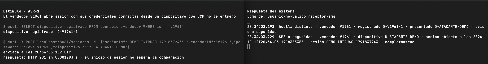
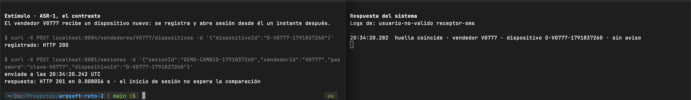
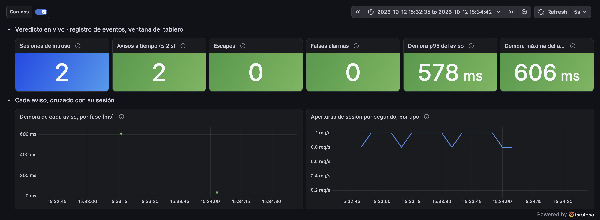
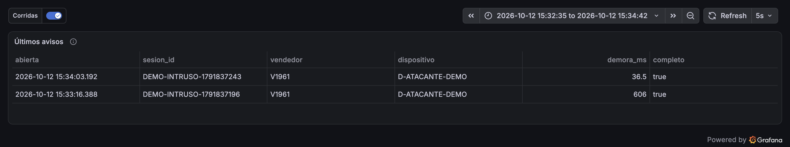
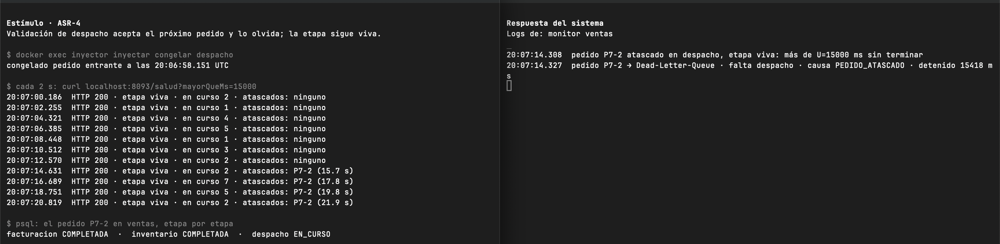
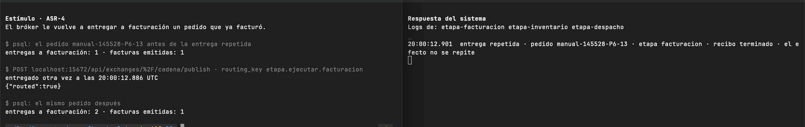
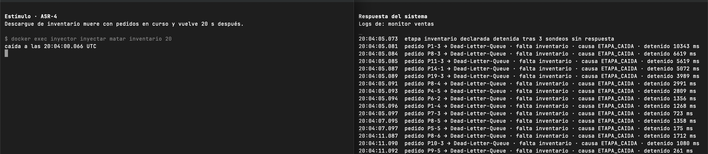
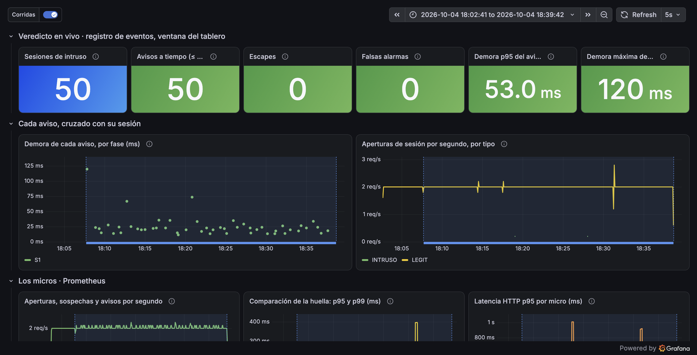
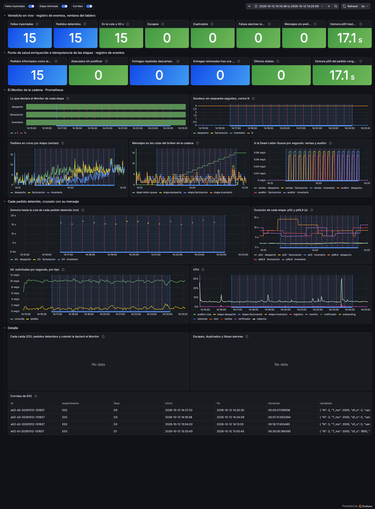

# Resultados de los experimentos E01 y E02

<!-- CIFRAS-E02: las de E02 son del ciclo 20261012-131837 y se cambian por las del ciclo 20261012-151148. -->

Este reporte presenta lo que salió de las corridas sobre el prototipo que
siguen DG-CMP-004 y DG-CMP-005. E01 corrió el 7 de octubre de 2026, entre las
18:17 y las 22:32. E02 corrió el 12 de octubre, de 13:18 a 14:33, con la
versión refinada de H2. La fase exploratoria D4 corrió la noche del 8 al 9 de
octubre, con la primera versión. El diseño de cada experimento, sus fases y su
tabla de decisiones están en [Experimentos E01 y E02](experiments.md).

**En resumen, H1 y H2 se sostienen.** El Verificador de dispositivo avisó a
seguridad en las 50 aperturas de sesión desde un dispositivo no registrado. El
aviso más lento tardó 115 ms, frente a un límite de 2 s. En 17 893 sesiones
desde el dispositivo que el vendedor ya tenía registrado no dio ninguna falsa
alarma.

La primera versión de H2 cayó: su sondeo solo comprobaba si la etapa estaba
viva, y no vio ninguno de los 30 pedidos congelados dentro de una etapa que
seguía respondiendo. El equipo la refinó con dos cambios. El punto de salud de
cada etapa ahora informa los pedidos que la etapa lleva más de 15 s sin
terminar, y cada etapa es idempotente.

Con esos cambios, ningún pedido detenido quedó sin llegar a la
Dead-Letter-Queue, y ninguna etapa duplicó su efecto. Los 362 pedidos de las 15
caídas de etapa llegaron a la cola en ≤ 6,4 s, y los 15 pedidos congelados en
una etapa viva, en ≤ 17,6 s. Ninguna de las 60 entregas repetidas repitió el
efecto de su etapa, y no hubo falsas alarmas.

| Experimento | Hipótesis | Escenario | Veredicto | Decisión |
|---|---|---|---|---|
| E01 — Seguridad | H1: el Verificador de dispositivo compara la huella apenas el micro de sesiones publica la apertura | ASR-1 | Se sostiene en S1, S2 y S3 | Aceptar ADR-007 tal como está |
| E02 — Disponibilidad | H2: el Monitor lee del punto de salud los pedidos atascados, el micro de ventas los envía a la Dead-Letter-Queue con su causa, y cada etapa es idempotente | ASR-4, con ASR-3 como paso previo | Se sostiene en D1, D2, D3 y D5 | Aceptar ADR-005 con un ajuste y actualizar ADR-004 |

## Cómo se midió

Corrimos los experimentos sobre el prototipo de este repositorio: doce micros
en Java 21 y Spring Boot 3, con PostgreSQL y RabbitMQ en Docker Compose, todo
en una sola máquina. Los eventos de E01 y de la cadena de E02 pasan por el
bróker, como en los dos diagramas. Durante cada corrida, k6 generó la carga del
Ambiente A: 1 pedido y 10 consultas por segundo, con llegadas aleatorias.

**Los números salen de una tabla de eventos, no del tablero.** Cada componente
anotó en esa tabla el identificador de la sesión o del pedido y la hora de cada
hecho. Una consulta SQL cruza esas filas una a una: cada falla inyectada contra
la salida que provocó. Prometheus y Grafana sirvieron para ver la corrida en
vivo, pero ninguna cifra de este reporte sale de ellos, porque agregan los datos
y pierden el identificador.

**Figura 1. Dónde corrió cada pieza de las pruebas (DG-DEP-002).** k6 generó
la carga desde el portátil, fuera de Docker. El inyector de fallas, los doce
micros, RabbitMQ y PostgreSQL corrieron como contenedores de Docker Compose. El
guion `load/experimento.sh` sacó el veredicto de la tabla `registro.evento` con
una consulta SQL. Prometheus y Grafana no aparecen porque ninguna cifra sale de
ellos.

Un guion, `load/experimento.sh`, lanzó las corridas de cada experimento una
tras otra, con `make e01` y `make e02`. Cada corrida empezó con un
calentamiento que no cuenta para ningún criterio: 5 minutos en E01 y 2 en
E02. Entre una corrida y la
siguiente se reiniciaron la base y las colas del bróker, para que un pedido
detenido en una no apareciera como pendiente en la otra.

**Todas las corridas citadas son válidas.** Al cerrar cada una, el guion
comprobó tres cosas: que la carga de fondo no tuviera un hueco de más de 30 s,
que el equipo no se hubiera suspendido y que k6 no pasara de 1 % de
solicitudes fallidas. Si una corrida no cumple, el ciclo entero se descarta y
vuelve a empezar. El hueco más largo fue de 10,8 s en E01, de 11,5 s en E02 y
de 11,0 s en D4, y k6 no tuvo ninguna solicitud fallida.

El enunciado no da algunas cifras que los experimentos necesitan. Las fijamos
como supuestos, y cada una se cambia con una variable, sin tocar el código:

| Supuesto | Valor | De dónde sale |
|---|---|---|
| S-10 · aperturas desde el dispositivo registrado | 2 por segundo | 2 000 vendedores que reabren sesión cada 15 min, al vencer el token (SUP-05): 2,2 por segundo, redondeado a 2 |
| S-11 · duración de cada etapa | Lognormal, mediana de 2 s, p99,9 cercano a 9 s, tope de 25 s | Variación normal por debajo de los 25 s de SUP-03 |
| T y N del Monitor | Sondeo cada 2 s; etapa detenida tras 3 sondeos sin respuesta | N × T = 6 s, dentro de los 30 s de ASR-3 |
| S-12 · umbral U | Pedido atascado tras 15 s sin terminar en una etapa viva | En D1 de las dos versiones, el pedido más lento en su etapa tardó 13,7 s. U, más un sondeo de 2 s y su espera de 500 ms, da 17,5 s, dentro de los 30 s de ASR-3 |
| Caída de una etapa (D2) | El proceso muere con SIGKILL durante 45 s y luego se reinicia | El trabajo que la etapa tenía sin terminar vuelve a su cola del bróker y se retoma al reiniciar |

**Dos clases de evidencia.** Las cifras salen de las corridas de decisión.
Las capturas de cada escenario salen de demostraciones aparte, hechas el 12 de
octubre de 2026 con el mismo prototipo y el guion `load/evidencias.sh`. Cada
captura de terminal muestra un solo caso: a la izquierda, lo que se le hizo al
sistema; a la derecha, lo que el sistema registró, con la hora en UTC. Debajo,
el tablero de Grafana o la consola del bróker muestran el mismo caso desde la
operación, con la hora de Bogotá.

Para la demostración se agregó a cinco micros una línea de log por hecho. Ese
cambio no altera lo que se mide, así que E01 no se repitió por él.

---

## E01 — ASR-1: aviso por la sesión desde un dispositivo no registrado

### Qué pide ASR-1 y qué probó E01

ASR-1 pide detectar en ≤ 2 s que una sesión abierta con credenciales correctas
la opera un dispositivo que no es el suministrado, y avisar a seguridad. E01
probó esa detección y ese aviso, y que el cambio legítimo de dispositivo no
dispare el aviso. Las fases S1 a S3 deciden la hipótesis; S4 es exploratoria y
busca a qué tasa empieza a atrasarse el aviso.

### Un caso de punta a punta

**Figura 2. Un intruso.** A la izquierda, el vendedor V1961 abre sesión con
sus credenciales correctas desde `D-ATACANTE-DEMO`, que no es su dispositivo
registrado (`D-V1961-1`). El inicio de sesión responde en 2 ms, sin esperar
la comparación. A la derecha, el Verificador ve la huella distinta 11 ms
después del envío, y el SMS llega a seguridad a los 47 ms con el vendedor, el
dispositivo y la hora de apertura.

**Figura 3. El contraste: un cambio legítimo de dispositivo.** El vendedor
V0777 registra un dispositivo nuevo y abre sesión desde él un instante
después. El Verificador compara la huella, ve que coincide con la que se acaba
de registrar y no avisa.

**Figura 4. Lo mismo en el tablero de E01.** Durante la demostración corrieron
75 sesiones legítimas de fondo, una por segundo, desde el dispositivo que cada
vendedor ya tenía registrado. El tablero cuenta 2 sesiones de intruso en la
ventana: la de la Figura 2 y un intento anterior de la misma captura. Las dos
tienen su aviso a tiempo, no hay escapes y no hay falsas alarmas. En «Demora de
cada aviso», cada punto es un intruso, y los dos quedan lejos de la línea de
2 s.

**Figura 5. Lo que recibió seguridad.** El panel «Últimos avisos» cruza cada
aviso con su sesión. Los dos llevan el vendedor V1961 y el dispositivo
`D-ATACANTE-DEMO`, están completos y llegaron en 36,5 ms y 606 ms.

### Lo que midieron las corridas

**Tabla 1. Criterios de H1.** Cada fila es un criterio de
[experiments.md](experiments.md), y los casos son las sesiones que se midieron
contra él.

| Fase | Casos | Cumplen | Fallan | Veredicto |
|---|---|---|---|---|
| S1 · aviso en ≤ 2 s, con vendedor, dispositivo y hora | 50 | 50 | 0 | **Pasa** |
| S2 · ≤ 1 aviso por cada 100 cambios legítimos | 100 | 100 | 0 | **Pasa**: 0 avisos |
| S3 · 0 avisos en aperturas a menos de 1 s del registro | 20 | 20 | 0 | **Pasa** |
| Las cuatro fases · 0 avisos por el dispositivo que el vendedor ya tenía registrado | 17 893 | 17 893 | 0 | **Pasa** |
| S4 · tasa a la que el aviso se atrasa | 30 | 30 | 0 | Exploratoria: no se atrasa hasta 10 aperturas por segundo |

**Tabla 2. Cuánto tardó el aviso.** Es el tiempo desde que el micro de sesiones
registró la apertura del intruso hasta que el aviso llegó al receptor del SMS.
El límite de ASR-1 es 2 s, es decir, 2 000 ms. El p95 es el tiempo dentro del
cual llegó el 95 % de los avisos.

| Demora del aviso | Desde dispositivo no registrado | Mediana | p95 | Máximo |
|---|---|---|---|---|
| S1, a la tasa normal | 50 | 15 ms | 26 ms | 115 ms |
| S4 a 1× (2 aperturas/s) | 10 | 16 ms | 28 ms | 31 ms |
| S4 a 3× (6 aperturas/s) | 10 | 17 ms | 23 ms | 23 ms |
| S4 a 5× (10 aperturas/s) | 10 | 17 ms | 34 ms | 38 ms |

**Figura 6. Recorrido de una apertura de sesión en E01 (DG-SEQ-001).** El
reloj arranca en t0, cuando el micro de sesiones (Gestor de sesión en el
diagrama) publica `sesion.abierta`, y se detiene en t1, cuando el aviso llega al
receptor del SMS. Si la huella coincide con la registrada, el Verificador
descarta el evento sin avisar: así se juzgan S2, S3 y las sesiones de fondo.

**Tabla 3. Por dónde pasó el aviso en S1.** El aviso recorre cuatro tramos, dos
de ellos por el bróker. Cada fila mide un tramo en las 50 sesiones de intruso.

| Tramo | Mediana | Máximo |
|---|---|---|
| Apertura de la sesión → comparación en el Verificador, por el bróker | 1,9 ms | 3,4 ms |
| Comparación → publicación de `alerta.seguridad` | 1,8 ms | 17 ms |
| Publicación → Notificador a seguridad, por el bróker | 3,3 ms | 36 ms |
| Notificador → receptor del SMS | 7,0 ms | 59 ms |

### Análisis de resultados

**El aviso llega muy por debajo del límite.** De las 80 sesiones de intruso que
probamos, sumando S1 y S4, el aviso más lento tardó 115 ms. Es menos de la
décima parte de los 2 s que permite ASR-1, aunque cada aviso cruza el bróker
dos veces. Ningún tramo pasó de 59 ms. El micro de sesiones publica el evento y
responde sin esperar la comparación. En S1, k6 midió las 3 771 aperturas de
sesión: el p95 fue de 8,1 ms y la más lenta tardó 26 ms. Ningún criterio de H1
fija un límite para esa cifra; se reporta como observación.

**No hubo una sola falsa alarma.** En S2, 100 vendedores registraron un
dispositivo nuevo y abrieron sesión desde él entre 6 y 60 s después. En S3,
otros 20 lo hicieron entre 66 y 903 ms después del registro. Ninguno disparó
aviso, y tampoco las 17 893 sesiones normales que corrieron de fondo. El
Verificador lee el dispositivo registrado directo de la base, sin caché, y ve
el cambio aunque el evento le llegue un instante después del registro.

**Con más carga el aviso no se atrasó, así que S4 no encontró su límite.** A 10
aperturas por segundo, cinco veces la tasa normal, el aviso más lento tardó
38 ms, frente a 31 ms a la tasa normal de esa misma corrida. El punto en que el diseño empieza a
atrasarse está por encima de lo que probamos, y la decisión no depende de él.

### La decisión

**Recomendamos aceptar ADR-007 tal como está.** H1 se sostiene en S1, S2 y S3,
y esa es la fila de la tabla de decisiones de E01 que lleva a aceptarlo. El
Verificador de dispositivo compara la huella al recibir `sesion.abierta`, como
lo describe el ADR. Ninguna otra fila aplica: no hubo avisos tarde ni falsos, y
en S4 la demora no creció a 3 ni a 5 veces la tasa normal.

---

## E02 — ASR-4: el pedido detenido, con destino y sin efectos duplicados

### Qué pide ASR-4 y qué probó E02

ASR-4 parte de un pedido señalado como detenido, con una o dos etapas ya
completadas y una pendiente. Pide reanudarlo desde la etapa que falló, o
entregarlo a una persona con el estado exacto, en ≤ 5 s desde la señal. Y pide
hacerlo sin duplicar la factura, el descargue ni la orden de despacho.

E02 probó la parte de ASR-4 que no depende de quién atienda el pedido: que
llegue una sola vez a la Dead-Letter-Queue, con la etapa que falta y la causa,
y que ninguna etapa duplique su efecto. La reanudación y la entrega a una
persona quedan fuera, porque nadie consume la cola.

La señal de la que parte ASR-4 es la respuesta de ASR-3: detectar el pedido
detenido en ≤ 30 s, con ≤ 1 falsa alarma por hora. Por eso E02 mide también la
detección.

Estos resultados son de la versión refinada de H2. Tiene dos cambios: el punto
de salud de cada etapa informa los pedidos que la etapa lleva más del umbral
U = 15 s sin terminar (S-12), y cada etapa es idempotente. A esos pedidos los
llamamos atascados. La primera versión, con un sondeo que solo comprobaba si la
etapa estaba viva, cayó en D3; su resultado está al final de esta sección.

### Tres casos de punta a punta

**Figura 7. Un pedido congelado en una etapa viva.** A la izquierda, validación
de despacho acepta el pedido P7-2 y lo olvida. La etapa responde HTTP 200 en
cada sondeo, y al final ventas muestra el estado del pedido: facturación e
inventario completados y despacho en curso, que es el estímulo de ASR-4. A la
derecha, el Monitor lo detecta como atascado, y 19 ms después ventas lo
confirma en la Dead-Letter-Queue con la etapa que falta y la causa
`PEDIDO_ATASCADO`.

**Figura 8. Una entrega repetida.** El bróker le vuelve a entregar a
facturación el pedido P6-13, que ya había facturado. Antes de la entrega, el
pedido tiene 1 entrega y 1 factura. La etapa encuentra su recibo terminado y no
repite el efecto. Después, el pedido tiene 2 entregas y sigue con 1 factura.

**Figura 9. Una etapa caída.** Descargue de inventario muere con pedidos en
curso. El Monitor la declara detenida 5,0 s después, al tercer sondeo sin
respuesta, y 8 ms más tarde ventas empieza a confirmar en la cola sus pedidos
pendientes. Cada uno lleva la etapa que falta y la causa `ETAPA_CAIDA`.

### Lo que midieron las corridas

Las cuatro corridas de decisión se hicieron el 12 de octubre, de 13:18 a
14:33. Fueron 30 min sin fallas (D1), 15 caídas de una etapa entera (D2), 15
pedidos congelados dentro de una etapa viva (D3) y 60 entregas repetidas de
pedidos que la etapa ya había terminado (D5).

**Tabla 4. Criterios de H2.** Cada fila es un criterio de
[experiments.md](experiments.md). Las dos últimas valen para todas las fases.

| Fase | Casos | Cumplen | Fallan | Veredicto |
|---|---|---|---|---|
| D1 · ninguna falsa alarma en 30 min sin fallas | 0 declaraciones y 0 pedidos informados como atascados | — | 0 | **Pasa** |
| D2 · los pedidos detenidos, en la Dead-Letter-Queue en ≤ 30 s | 362 | 362 | 0 | **Pasa**: demora máxima de 6,4 s |
| D3 · el pedido congelado en una etapa viva, en la Dead-Letter-Queue en ≤ 30 s | 15 | 15 | 0 | **Pasa**: demora máxima de 17,6 s |
| D5 · la entrega repetida no repite el efecto de la etapa | 60 | 60 | 0 | **Pasa**: 60 descartadas, un solo efecto cada una |
| Todas · cada pedido detenido que llegó a la Dead-Letter-Queue entró una sola vez | 377 | 377 | 0 | **Pasa**: 0 duplicados |
| Todas · cada mensaje dice qué etapa falta y por qué | ⟦CAUSA⟧ | ⟦CAUSA⟧ | 0 | **Pasa** |
| Todas · cada etapa aplicó su efecto una sola vez por pedido | 12 069 | 12 069 | 0 | **Pasa**: 0 efectos dobles |

**Qué es un pedido detenido.** Es el que no cerró su etapa dentro de los 30 s
de ASR-3. Con el bróker, el trabajo de una etapa caída espera en la cola de esa
etapa y se retoma cuando vuelve. Casi todos los pedidos terminan cerrando, así
que lo que importa es si estuvieron quietos más de 30 s. En D2 cuentan todos
los detenidos de cada caída: los que la etapa tenía en curso al caer y los que
ventas le siguió enviando mientras estaba caída.

**Tabla 5. Cuánto tardó cada pedido en llegar a la Dead-Letter-Queue.** El
límite es 30 s. En D2 el reloj arranca en la caída, o en el envío de ventas si
el pedido llegó con la etapa ya caída. En D3 arranca cuando el pedido congelado
entra a la etapa.

| Fase · etapa | Pedidos | Mediana | p95 | Máximo |
|---|---|---|---|---|
| D2 · validación de despacho | 115 | 1,2 s | 4,9 s | 5,6 s |
| D2 · facturación | 128 | 1,2 s | 5,8 s | 6,4 s |
| D2 · descargue de inventario | 119 | 1,4 s | 5,6 s | 6,0 s |
| D3 · validación de despacho | 5 | 16,1 s | 16,8 s | 17,0 s |
| D3 · facturación | 5 | 15,9 s | 16,9 s | 16,9 s |
| D3 · descargue de inventario | 5 | 16,3 s | 17,4 s | 17,6 s |

**Tabla 6. De la señal a la cola.** ASR-4 cuenta su plazo de ≤ 5 s desde la
señal de detención. En D3, la señal es el momento en que el Monitor detecta el
pedido atascado. En D2, es el momento en que declara detenida la etapa, y
cuentan solo los pedidos que ya estaban en ella. El reloj se detiene cuando el
bróker confirma el pedido en la Dead-Letter-Queue. La medida cubre la entrega a
la cola, no la reanudación ni la entrega a una persona; la consulta está en
[`analisis/e02-senal.sql`](https://github.com/MATI-MBIT/arqsoft-reto-2/blob/main/analisis/e02-senal.sql).

| Fase | Pedidos | Mediana | Máximo |
|---|---|---|---|
| D2 · etapa caída | ⟦S-D2-N⟧ | ⟦S-D2-MED⟧ ms | ⟦S-D2-MAX⟧ ms |
| D3 · pedido congelado en una etapa viva | ⟦S-D3-N⟧ | ⟦S-D3-MED⟧ ms | ⟦S-D3-MAX⟧ ms |

### Análisis de resultados

#### La idempotencia: ningún efecto duplicado

**Figura 10. Una entrega repetida en D5 (DG-SEQ-004).** El inyector toma un
pedido que la etapa ya terminó y se lo vuelve a entregar por el bróker. La
etapa busca el recibo, lo encuentra terminado y descarta la entrega sin repetir
el efecto. Vuelve a publicar `etapa.completada`, por si el aviso anterior se
perdió, y ventas ignora el cierre repetido.

**D5 pasa: ninguna entrega repetida repitió el efecto.** El inyector les volvió
a entregar 60 pedidos terminados a las etapas, 20 a cada una. Las tres vieron el
recibo terminado en los 60 casos, descartaron la entrega y dejaron el efecto en
una sola aplicación. Sumando las cuatro corridas, 12 069 pares de pedido y etapa
tienen exactamente un efecto, incluidas las 42 entregas que el bróker devolvió tras las
caídas de D2.

**La etapa idempotente retomó lo que el bróker le devolvió.** Cuando el
inyector mata una etapa, el bróker devuelve los mensajes que ella no alcanzó a
confirmar y se los entrega otra vez al reiniciarse. En D2 hubo 42 de esas
entregas. Cada etapa guarda un recibo de cada pedido antes de confirmarlo al
bróker, y en esas 42 entregas encontró el recibo en curso. Retomó el pedido y
aplicó su efecto una sola vez. Los 3 729 pares de pedido y etapa de la corrida
tienen exactamente un efecto.

**Los pedidos que se recuperan solos siguen llegando a la Dead-Letter-Queue.**
En D2 llegaron 415 mensajes de pedidos que entraron a la etapa ya caída, pero
que la etapa cerró antes de 30 s al volver. No son falsas alarmas, porque caen
dentro de una caída real de su etapa. Con la primera versión eran un riesgo
para ASR-4, que reprocesaría pedidos ya terminados. Ahora la etapa es
idempotente, y D5 muestra que una entrega repetida no repite el efecto.

#### La detección que lo precede (ASR-3)

**Figura 11. Un pedido congelado en D3 (DG-SEQ-003).** El inyector le pide a la
etapa que acepte el próximo pedido y lo olvide sin terminarlo. La etapa guarda
el recibo antes de confirmar el mensaje al bróker, así que el pedido queda en
curso en su tabla. En cada sondeo, el punto de salud lee esa tabla y responde
los pedidos con más de U = 15 s. El Monitor se los pasa al Coordinador, que los
envía a la Dead-Letter-Queue.

**D3 ya pasa: el punto de salud informó los 15 pedidos congelados.** Cada uno
apareció como atascado entre 15,1 y 17,4 s después de entrar a la etapa, y
llegó a la Dead-Letter-Queue a lo sumo 114 ms después. La mediana fue de
16,1 s y el máximo de 17,6 s. El informe cae donde predice el diseño: antes del
umbral U = 15 s más un sondeo de 2 s y su espera de 500 ms, es decir, 17,5 s.
Sobran 12 s de los 30 de ASR-3.

La etapa siguió viva y respondiendo todo el tiempo: el Monitor no la declaró
detenida ni una vez. La diferencia con la primera versión está en lo que
responde el punto de salud. Antes decía «estoy viva»; ahora dice qué pedidos
lleva demasiado tiempo sin terminar, y lo lee del recibo que la etapa guardó
antes de confirmar el mensaje. Por eso ve también el pedido que la etapa aceptó
y olvidó.

**Figura 12. Una caída de etapa en D2 (DG-SEQ-002).** El inyector mata la etapa,
y el Monitor la declara detenida al tercer sondeo sin respuesta. Desde ahí avisa
en cada ciclo al Coordinador, que es el micro de ventas como en DG-CMP-005, y
este publica cada pedido pendiente de esa etapa como `pedido.detenido`. El
bróker lo deja en la Dead-Letter-Queue. El reloj se detiene en t1, la
publicación confirmada. Al reiniciarse la etapa, el bróker le entrega el
trabajo que esperaba en su cola.

**El sondeo sigue detectando bien la etapa caída.** En cada una de las 15
caídas de D2, el Monitor declaró detenida la etapa con una mediana de 5,4 s y
un máximo de 6,4 s. Es lo que predice el diseño: 3 sondeos sin respuesta, uno
cada 2 s, suman 6 s. Ventas envió los 362 pedidos detenidos a la
Dead-Letter-Queue en el aviso siguiente del Monitor, cada uno una sola vez.

**Sin fallas, el Monitor no dio falsas alarmas.** D1 fue media hora de carga
normal con 1 814 pedidos. Ningún sondeo quedó sin respuesta, ninguna etapa fue
declarada detenida y el punto de salud no informó ningún pedido como atascado.

**El umbral U tiene poco margen sobre el pedido más lento.** En D1, el 99,9 %
de los pedidos terminó cada etapa en 8,5 s o menos en validación de despacho y
en facturación. En descargue de inventario lo hizo en 10,0 s. El pedido más
lento en su etapa tardó 13,7 s, a 1,3 s del umbral U. Con la distribución de S-11, un pedido sano pasa de 15 s unas tres
veces cada diez horas, por debajo de una falsa alarma por hora. Estas duraciones
salen del supuesto S-11, no de etapas reales, y así deben leerse.

### La primera versión de H2: el sondeo de solo vida

La primera versión corrió el 7 de octubre, con D1 de 1 h, 30 caídas y 30
congelamientos. Su punto de salud respondía `ok` sin mirar nada por dentro.
Pasó D1 sin falsas alarmas y D2 con 655 de 655 pedidos detenidos en la
Dead-Letter-Queue en ≤ 6,4 s. Cayó en D3: 0 de 30 pedidos congelados llegaron a
la cola, porque la etapa respondía «estoy viva» con el pedido quieto dentro.

Ese resultado no fue un error de la implementación. La etapa congelada seguía
viva, y un sondeo que solo pregunta «¿estás viva?» no puede ver un pedido que no
avanza. Por eso el equipo refinó el punto de salud en vez de cerrar la decisión.

#### D4: las doce combinaciones de T y N

D4 corrió con la primera versión, la noche del 8 al 9 de octubre, y sigue
valiendo: la detección de la etapa caída no cambió. Busca el número que
[experiments.md](experiments.md) dejó abierto: el menor N de sondeos sin
respuesta que no dispara falsas alarmas, y su N × T. Cada combinación corrió
20 min sin fallas y luego 15 caídas de 45 s, cinco por etapa.

**Tabla 7. Resultado de cada combinación.** «Declarada tras» es el tiempo desde
la caída hasta que el Monitor declaró detenida la etapa.

| T | N | N × T | Declarada tras (mediana / máximo) | Detenidos en la Dead-Letter-Queue en ≤ 30 s | Demora máxima | Declaraciones sin caída |
|---|---|---|---|---|---|---|
| 1 s | 1 | 1 s | 1,0 s / 1,5 s | 318 de 318 | 1,5 s | 0 |
| 1 s | 2 | 2 s | 2,1 s / 2,5 s | 309 de 309 | 2,5 s | 0 |
| 1 s | 3 | 3 s | 2,9 s / 3,5 s | 329 de 329 | 3,5 s | 0 |
| 1 s | 5 | 5 s | 4,9 s / 5,4 s | 334 de 334 | 5,4 s | 0 |
| 2 s | 1 | 2 s | 1,2 s / 2,4 s | 309 de 309 | 2,4 s | 0 |
| 2 s | 2 | 4 s | 3,6 s / 4,3 s | 301 de 301 | 4,4 s | 0 |
| 2 s | 3 | 6 s | 5,4 s / 6,4 s | 337 de 337 | 6,4 s | 0 |
| 2 s | 5 | 10 s | 9,2 s / 10,3 s | 313 de 313 | 10,3 s | 0 |
| 5 s | 1 | 5 s | 3,0 s / 5,1 s | 350 de 350 | 5,3 s | 0 |
| 5 s | 2 | 10 s | 8,1 s / 10,1 s | 291 de 291 | 10,1 s | 0 |
| 5 s | 3 | 15 s | 12,5 s / 14,7 s | 349 de 349 | 14,7 s | 0 |
| 5 s | 5 | 25 s | 22,5 s / 24,6 s | 334 de 334 | 24,7 s | 0 |

**El menor N sin falsas alarmas es 1, y su N × T es 1 s.** Ninguna de las 12
combinaciones declaró detenida una etapa sin caída. Antes de la primera caída
de cada corrida, ningún sondeo quedó sin respuesta. La etapa quedó declarada
entre (N − 1) × T y N × T después de la caída, más la espera de 500 ms del
último sondeo, y el pedido llegó a la Dead-Letter-Queue justo después. Las 12
combinaciones caben en los 30 s de ASR-3.

**Ese N = 1 vale para esta máquina, no para producción.** En una sola máquina,
las etapas sanas respondieron siempre el sondeo dentro de su espera de 500 ms.
Con red real, un sondeo suelto que falle ya sería una falsa alarma con N = 1.
El N de producción se fija con sondeos sobre la red real (S-13).

### La decisión

**Recomendamos aceptar ADR-005 con un ajuste, y actualizar ADR-004.** H2 se
sostiene en D1, D2, D3 y D5, y esa es la fila de la tabla de decisiones de E02
que lleva a adoptar el Monitor con el punto de salud enriquecido y la
Dead-Letter-Queue como reacción. La decisión pide cambiar dos ADR:

- **ADR-005:** el recibo de la etapa se guarda antes de confirmar el mensaje al
  bróker, y el efecto se aplica en la misma transacción que lo cierra. Ese
  recibo es el que alimenta el punto de salud.
- **ADR-004:** el plazo por pedido y etapa se mantiene como el umbral U, pero
  lo mide la etapa sobre su recibo y lo lee el Monitor en cada sondeo, en vez
  de revisarlo el Coordinador. El sondeo de vida sigue detectando la etapa
  caída. El mensaje del pedido detenido lleva la etapa que falta y la causa,
  que es el estado exacto que ASR-4 pide entregar.

## Dónde la medición se apartó de experiments.md

Cuatro reglas de medición de [experiments.md](experiments.md) no estaban
escritas, no se podían aplicar al pie de la letra o se acortaron para que D4
cupiera en una noche. Las resolvimos como dice el
[plan de implementación](https://github.com/MATI-MBIT/arqsoft-reto-2/blob/main/notas/plan-implementacion-experimentos.md),
y ninguna cambia una decisión.

| Tema | `experiments.md` | Lo que se midió | Efecto |
|---|---|---|---|
| Pedido detenido | No lo define | El que no cierra su etapa dentro de los 30 s de ASR-3 | Con el bróker casi todos los pedidos terminan cerrando: «nunca cerró» no serviría |
| Reloj de D2 | Arranca cuando el inyector detiene la etapa | Para el pedido que llega con la etapa ya caída, arranca cuando ventas se lo envía | Medido desde la caída, un pedido que llega tarde a una caída de 45 s contaría una espera que no fue suya |
| Duración de D4 | D1 y D2 completos en cada combinación: 1 h sin fallas y 30 caídas | 20 min sin fallas y 15 caídas, cinco por etapa | Las 12 combinaciones caben en una noche. Con menos minutos sin fallas, una falsa alarma rara se ve menos |
| Tasa de aperturas de S4 | 1, 3 y 5 veces la del Ambiente A, que no la fija | S-10: 2 aperturas por segundo | El límite de H1 queda por encima de 10 aperturas por segundo |

---

## Lo que estos resultados no cubren

- **Una sola máquina.** Los experimentos validan las ideas de diseño, no el
  tamaño de la infraestructura. Con red y base reales, las demoras de E01
  serían mayores, y estas corridas no dicen cuánto.
- **Duraciones supuestas.** Las etapas duran lo que fija S-11, así que el
  umbral U de S-12 sale de duraciones simuladas, y deja 1,3 s de margen sobre
  el pedido más lento en su etapa en D1. Con duraciones reales se recalibra con
  la regla de S-12: el pedido más lento observado más 10 %, sin superar 25 s.
- **El N de producción.** D4 dio N = 1 sin falsas alarmas en una sola
  máquina, donde ningún sondeo sano se perdió. S-13 propone un N con margen
  para la red real, y la forma de medir ese ruido.
- **La base de cada etapa.** El punto de salud lee el recibo de la base de la
  etapa. Si esa base no responde, la etapa tampoco responde al sondeo y cuenta
  como etapa caída. Esa falla no se inyectó.
- **Nadie consume la Dead-Letter-Queue.** La reanudación desde la etapa que
  falló, la entrega a una persona y su plazo de ≤ 5 s, que completan ASR-4,
  quedan sin medir. Quien consuma la cola recibirá también los pedidos que se
  recuperaron solos, pero D5 muestra que reentregarlos a la etapa no repite su
  efecto.

### Supuestos para lo que falta

Estos dos supuestos responden lo que los resultados dejan abierto con lo que
midieron D1, D2, D3 y D4. Son propuestas del grupo 1, que se encarga de los dos.
Cada uno dice de dónde sale, cuándo se resuelve y qué lo cambiaría.

| Supuesto | Valor propuesto | De dónde sale | Cuándo se resuelve | Qué lo cambia |
|---|---|---|---|---|
| S-12 · el umbral U, el plazo por pedido y etapa de ADR-004 | 15 s por etapa, ya en uso en el punto de salud de E02 | En D1, el pedido más lento en su etapa tardó 13,7 s, y el p99,9 no pasó de 10,0 s. En D3, los pedidos congelados llegaron a la Dead-Letter-Queue en ≤ 17,6 s | Al recibir duraciones reales de las tres etapas | Las duraciones reales: el plazo pasa a ser la más lenta observada más 10 %, sin superar 25 s |
| S-13 · T y N del sondeo de apoyo en producción | T = 1 s y N = 3 | Con N = 3, dos sondeos perdidos seguidos no declaran la caída. En D4, esa combinación declaró la etapa en 3,5 s como máximo | Antes de desplegar el Monitor sobre la red real | Contar los sondeos perdidos durante 24 h sobre la red real, con las etapas sanas. Si tres seguidos ocurren más de una vez por hora, se sube N mientras N × T quepa en 30 s |

---

## Anexo: veredictos y tableros de cada corrida

### E01

Cada fase de E01 corrió por separado y dejó dos piezas de evidencia. Las cifras
de este reporte salen solo de la primera; la segunda sirve para ver la corrida,
no para juzgarla.

- **`veredicto.txt`** es la salida de la consulta SQL que cruza la tabla de
  eventos, sesión por sesión. Trae la validez de la corrida, los criterios de H1
  con sus casos y su veredicto, la demora de cada aviso y la lista de intrusos
  sin aviso y de falsas alarmas. Cada archivo cubre solo su fase, así que los
  criterios de las otras fases aparecen como «NO APLICA».
- **La captura** es el tablero de Grafana en la ventana de la corrida. Muestra
  los mismos conteos y las métricas de los micros y del bróker desde
  Prometheus.

| Fase | Qué probó | Resultado | Veredicto | Tablero |
|---|---|---|---|---|
| S1 | 50 aperturas desde un dispositivo no registrado, a la tasa normal | 50 avisos a tiempo; el más lento tardó 115 ms | [veredicto.txt](https://github.com/MATI-MBIT/arqsoft-reto-2/blob/main/analisis/resultados/e01-s1-20261007-181235/veredicto.txt) | [captura](assets/resultados/e01-s1-tablero.png) |
| S2 | 100 cambios legítimos de dispositivo, con la sesión abierta entre 6 y 60 s después del registro | 0 avisos | [veredicto.txt](https://github.com/MATI-MBIT/arqsoft-reto-2/blob/main/analisis/resultados/e01-s2-20261007-181235/veredicto.txt) | [captura](assets/resultados/e01-s2-tablero.png) |
| S3 | 20 aperturas a menos de 1 s del registro del dispositivo nuevo | 0 avisos | [veredicto.txt](https://github.com/MATI-MBIT/arqsoft-reto-2/blob/main/analisis/resultados/e01-s3-20261007-181235/veredicto.txt) | [captura](assets/resultados/e01-s3-tablero.png) |
| S4 | 30 aperturas desde un dispositivo no registrado, a 1, 3 y 5 veces la tasa normal | La demora no creció; el más lento tardó 38 ms | [veredicto.txt](https://github.com/MATI-MBIT/arqsoft-reto-2/blob/main/analisis/resultados/e01-s4-20261007-181235/veredicto.txt) | [captura](assets/resultados/e01-s4-tablero.png) |

La captura de S1 se muestra abajo porque es la fase que prueba el umbral de
ASR-1. La fila superior da los conteos de la corrida: 50 sesiones de intruso,
50 avisos dentro de los 2 s, 0 intrusos sin aviso («Escapes»), 0 falsas
alarmas, y la demora del aviso en p95 y en el máximo. El panel «Demora de cada
aviso» pone un punto por aviso, y todos quedan muy por debajo de la línea de
2 s. El panel «Mensajes esperando en las colas de E01» muestra que los eventos
no se acumularon en el bróker.

### E02

Cada fase dejó dos piezas: el `veredicto.txt`, de donde salen las cifras, y la
captura del tablero de Grafana en la ventana de la corrida. Las corridas de la
primera versión que siguen citadas aquí conservan solo su `veredicto.txt`.

| Fase | Qué probó | Resultado | Veredicto | Tablero |
|---|---|---|---|---|
| D1 | 30 min de carga normal sin fallas | 0 falsas alarmas | [veredicto.txt](https://github.com/MATI-MBIT/arqsoft-reto-2/blob/main/analisis/resultados/e02-d1-20261012-131837/veredicto.txt) | [captura](assets/resultados/e02-d1-tablero.png) |
| D2 | 15 caídas de 45 s, 5 por etapa | 362 de 362 detenidos a tiempo; 42 entregas retomadas sin efecto doble | [veredicto.txt](https://github.com/MATI-MBIT/arqsoft-reto-2/blob/main/analisis/resultados/e02-d2-20261012-131837/veredicto.txt) | [captura](assets/resultados/e02-d2-tablero.png) |
| D3 | 15 pedidos congelados, 5 por etapa, en una etapa viva | 15 de 15 en la Dead-Letter-Queue; demora máxima de 17,6 s | [veredicto.txt](https://github.com/MATI-MBIT/arqsoft-reto-2/blob/main/analisis/resultados/e02-d3-20261012-131837/veredicto.txt) | [captura](assets/resultados/e02-d3-tablero.png) |
| D5 | 60 entregas repetidas, 20 por etapa | 60 de 60 descartadas; 0 efectos dobles | [veredicto.txt](https://github.com/MATI-MBIT/arqsoft-reto-2/blob/main/analisis/resultados/e02-d5-20261012-131837/veredicto.txt) | [captura](assets/resultados/e02-d5-tablero.png) |
| D3 de la primera versión | 30 pedidos congelados con el sondeo de solo vida | 0 de 30 llegaron a la Dead-Letter-Queue | [veredicto.txt](https://github.com/MATI-MBIT/arqsoft-reto-2/blob/main/analisis/resultados/e02-d3-20261007-181235/veredicto.txt) | — |
| D4 | 12 combinaciones de T y N | 0 declaraciones sin caída; todos los detenidos a tiempo | Un `veredicto.txt` por combinación, en las carpetas [`d4-*-20261008-210507`](https://github.com/MATI-MBIT/arqsoft-reto-2/tree/main/analisis/resultados) | — |

La captura de D3 se muestra abajo porque es la fase que tumbó la primera
versión. La fila superior da los conteos: 15 congelamientos, 15 pedidos
detenidos, 15 en la Dead-Letter-Queue a tiempo, 0 escapes, 0 duplicados y
0 falsas alarmas. La segunda fila es la nueva: 15 pedidos informados como
atascados por el punto de salud, ninguno sin justificar, 0 efectos dobles y una
demora p95 de 17,1 s. El panel «Lo que declara el Monitor de cada etapa» queda
en verde toda la corrida: ninguna etapa cayó, y aun así los 15 pedidos llegaron
a la cola.

