# Resultados de los experimentos E01 y E02

El presente reporte expone los resultados de las ejecuciones realizadas sobre el prototipo que implementa los diagramas de componentes DG-CMP-004 y DG-CMP-005. Los experimentos E01 y E02 se ejecutaron en paralelo el 12 de octubre de 2026, entre las 19:07 y las 20:28. Se incorporan, además, dos fases exploratorias de ejecuciones previas que conservan su vigencia: S4 de E01, ejecutada el 7 de octubre, y D4 de E02, ejecutada la noche del 8 al 9 de octubre. El diseño de cada experimento, sus fases y su tabla de decisiones se documentan en [Experimentos E01 y E02](experiments.md).

**En resumen, las dos hipótesis se sostienen.** La hipótesis H1 establecía que el Verificador de dispositivo detecta, dentro de la ventana de ASR-1, toda sesión abierta desde un dispositivo no registrado. El resultado confirma la hipótesis: el Verificador notificó a seguridad las 50 aperturas de este tipo con un tiempo máximo de 140 ms, frente al límite admisible de 2 s. En las 7 081 sesiones legítimas —originadas desde el dispositivo registrado por el usuario— no se generó ninguna falsa alarma.

La hipótesis H2 establecía que todo pedido detenido (aquel que no completa su etapa dentro de los 30 s definidos en ASR-3) llega a la Dead-Letter-Queue sin que ninguna etapa duplique su efecto. Su versión inicial no se sostuvo: el sondeo del Monitor de la cadena verificaba únicamente que la etapa estuviera activa y, por tanto, no detectó ninguno de los 30 pedidos congelados dentro de una etapa que continuaba respondiendo. La versión refinada incorpora dos modificaciones clave: la primera es que el punto de salud de cada etapa informa explícitamente los pedidos que permanecen más de 5 s sin finalizar (denominados *atascados*); la segunda es que cada etapa implementa un comportamiento idempotente.

Con estas modificaciones, H2 se sostuvo en las cuatro fases de decisión. En D2, los 291 pedidos correspondientes a las 15 caídas de etapa llegaron a la Dead-Letter-Queue con un tiempo máximo de 6,3 s. En D3, los 15 pedidos congelados en una etapa activa llegaron con un tiempo máximo de 7,0 s, indicando en ambos casos la etapa pendiente y la causa de la detención. En D5, ninguna de las 60 entregas repetidas duplicó el efecto de su respectiva etapa. En D1, tras 30 minutos de operación continua sin fallas, el Monitor no generó falsas alarmas.

| Experimento | Hipótesis | Escenario | Veredicto | Decisión |
|---|---|---|---|---|
| E01 — Seguridad | H1: el Verificador de dispositivo compara la huella apenas el micro de sesiones publica la apertura | ASR-1 | Se sostiene en S1, S2 y S3 | Aceptar ADR-007 tal como está |
| E02 — Disponibilidad | H2: el Monitor lee del punto de salud los pedidos atascados, el micro de ventas los envía a la Dead-Letter-Queue con su causa, y cada etapa es idempotente | ASR-4, con ASR-3 como paso previo | Se sostiene en D1, D2, D3 y D5 | Aceptar ADR-005 con un ajuste y actualizar ADR-004 |

**El veredicto, escenario por escenario.** Cada fila contrasta la métrica obtenida frente al umbral del escenario. El margen compara el caso más desfavorable (lento) con el umbral, expresando la proporción o la holgura temporal remanente.

| Escenario | Criterio | Umbral | Medido | Margen | Veredicto |
|---|---|---|---|---|---|
| ASR-1 · seguridad | Aviso a seguridad por la sesión desde un dispositivo no registrado | ≤ 2 s | 50 de 50, máximo 140 ms | 14 veces menor | **Pasa** |
| ASR-1 · seguridad | Avisos por cambios legítimos de dispositivo | ≤ 1 por cada 100 | 0 en 100 (S2) y 0 en 20 (S3) | — | **Pasa** |
| ASR-3 · disponibilidad | Pedido detenido, detectado y en la Dead-Letter-Queue | ≤ 30 s | 306 de 306, máximo 7,0 s | 23,0 s por debajo | **Pasa** |
| ASR-3 · disponibilidad | Falsas alarmas | ≤ 1 por hora | 0 en los 30 min de D1 | — | **Pasa** |
| ASR-4 · disponibilidad | De la señal de detención a la Dead-Letter-Queue | ≤ 5 s | 119 de 119 (los 104 que estaban en la etapa al declararla caída, y los 15 de D3), máximo 33 ms | 151 veces menor | **Pasa** en el envío a la Dead-Letter-Queue. La reanudación no se midió |
| ASR-4 · disponibilidad | Estado exacto: qué etapa falta y por qué | En cada mensaje | 306 de 306 pedidos detenidos con su causa | — | **Pasa** |
| ASR-4 · disponibilidad | Facturas, descargues u órdenes de despacho duplicados | 0 | 0 en 12 047 pares de pedido y etapa | — | **Pasa** |

## Metodología de medición

Los experimentos se ejecutaron sobre el prototipo de este repositorio: doce microservicios desarrollados en Java 21 y Spring Boot 3, junto con PostgreSQL y RabbitMQ desplegados mediante Docker Compose en un único nodo de pruebas. Los eventos de E01 y de la cadena de E02 circulan a través del agente de mensajes, replicando la topología de los diagramas de arquitectura. Durante las ejecuciones, k6 generó la carga correspondiente al Ambiente A: 1 pedido y 10 consultas por segundo, con tasas de llegada estocásticas.

**Las cifras analíticas provienen de la tabla de eventos transaccionales, no del tablero de monitoreo.** Cada componente registró en dicha tabla el identificador de la sesión o del pedido junto con la marca de tiempo de cada hito. Una consulta SQL especializada cruza estos registros de forma determinista para contrastar cada anomalía inyectada con la salida producida. Si bien Prometheus y Grafana se emplearon para la observabilidad en tiempo real, se prescindió de sus métricas agregadas para los veredictos definitivos debido a la pérdida del identificador unívoco en las agregaciones.

**Figura 1. Topología de despliegue y ejecución (DG-DEP-002).** El entorno se concentró en un único servidor de pruebas. La herramienta k6 y el orquestador automatizado operaron de forma nativa. El orquestador gestionó el ciclo de vida de cada ejecución, solicitó la inyección programada de fallas y computó el veredicto mediante la ejecución de consultas SQL sobre la entidad transaccional. El inyector de fallas, los doce microservicios, RabbitMQ y PostgreSQL se ejecutaron como contenedores aislados en Docker Compose.

**E01 y E02 se ejecutaron concurrentemente.** Cada experimento opera con sus propias hipótesis, esquemas de bases de datos y colas; el orquestador los dispara en paralelo mediante automatización. Al inicializar cada fase, se restablecen exclusivamente los recursos asociados al experimento en cuestión, evitando interferencias cruzadas. El único recurso compartido es la carga de solicitudes de pedidos: E01 reutiliza la traza de carga de E02 para evitar la duplicación innecesaria del Ambiente A. E01 inició con un desfase de 4 minutos respecto a E02 para distanciar temporalmente las trazas de observación visual.

Cada fase de experimentación se precedió de un período de calentamiento excluido del cómputo métrico: 5 minutos para E01 y 2 minutos para E02.

**La validez de las ejecuciones fue estrictamente verificada.** Al finalizar cada corrida, el orquestador evaluó tres precondiciones de integridad: ausencia de huecos superiores a 30 s en la carga de fondo, estabilidad operativa del servidor anfitrión y una tasa de fallas en k6 inferior al 1 %. El incumplimiento de cualquiera de estas condiciones invalidaba el ciclo completo de fases del experimento, forzando su reejecución. El hueco máximo registrado fue de 11,1 s en E01, 8,7 s en E02 y 11,0 s en D4, sin reportar solicitudes fallidas por parte de k6.

Dado que E02 interrumpe brevemente la generación de pedidos entre fases, el orquestador emitió un pedido de relleno sintético cada vez que transcurrían 10 s sin actividad para preservar la continuidad de la carga de fondo en E01. Esto ocurrió en 41 ocasiones (3 veces entre transiciones de fases de E02 y 38 veces tras la culminación de E02, mientras E01 completaba la fase S3 y su respectivo minuto de gracia). El *minuto de gracia* corresponde al intervalo posterior a la ventana de medición durante el cual el orquestador recolecta eventos rezagados.

Ciertos parámetros operativos requeridos por los modelos experimentales se establecieron como supuestos fijos parametrizables:

| Supuesto | Valor | Origen |
|---|---|---|
| S-10 · aperturas desde el dispositivo registrado | 2 por segundo | Estimación basada en 2 000 usuarios corporativos que reabren sesión cada 15 minutos tras expirar el token: 2,2 peticiones/s, redondeadas al entero superior |
| S-11 · duración de cada etapa | Distribución lognormal (mediana de 1 s, percentil 99 cercano a 3 s, límite superior de 25 s) | Variabilidad operacional nominal por debajo del umbral de tolerancia U de S-12 (5 s). El límite superior deriva de los parámetros de diseño del sistema: la duración máxima por etapa es ≤ 25 s. Hasta el 12 de octubre la mediana era de 2 s, la que usaron la primera versión y D4; se acortó cuando el equipo fijó U = 5 s |
| T y N del Monitor | Intervalo de sondeo T = 2 s; declaración de etapa caída tras N = 3 sondeos consecutivos sin respuesta | El producto N × T = 6 s se mantiene holgadamente dentro del límite de 30 s establecido en ASR-3 |
| S-12 · umbral U | Clasificación de pedido atascado tras transcurrir > 5 s sin finalizar en una etapa activa | Parámetro fijado por el equipo de arquitectura (versiones previas operaban con 15 s). Con un tiempo de procesamiento máximo observado de 3,3 s en D1, la suma de U, el sondeo de 2 s y una holgura de 500 ms totaliza 7,5 s, cumpliendo con ASR-3 |
| Fallo de etapa (D2) | Terminación abrupta del proceso mediante la señal `SIGKILL` durante 45 s, seguida de autorrecuperación | El estado transaccional pendiente es devuelto a la cola del agente de mensajes para su reencocolamiento y reanudación posterior |

**La base probatoria se fundamenta en las ejecuciones de decisión** realizadas el 12 de octubre, complementadas por las fases exploratorias S4 y D4 (cuya única excepción es la evidencia visual de la Figura 4, derivada de una corrida de validación de S3). La instrumentación de cada escenario se documenta a través de tres artefactos:

- **Gráficas de margen:** Representación analítica de la distribución de casos frente al umbral, generada mediante scripts analíticos a partir de la traza de eventos (`analisis/graficas.py`).
- **Casos de prueba testigo anotados:** Capturas de ejecución en vivo que correlacionan el estímulo del orquestador, los registros (*logs*) de los microservicios, el panel de observabilidad en Grafana y el estado del agente de mensajes, respaldados por clips de video de 50 s.
- **Respaldo integral por fase:** Anexos con la totalidad de trazas de ejecución, veredictos SQL y validaciones de tableros.

Las marcas temporales de los registros se expresan en tiempo coordinador universal (UTC), mientras que los paneles de Grafana operan en la hora local de Bogotá (-5 UTC). Para fines de trazabilidad forense, se incorporó una línea adicional de registro estructurado en cinco microservicios sin alterar la latencia de medición.

### Cronograma y volumetría de ejecuciones

**Las ejecuciones orientadas a la decisión de las hipótesis requirieron un tiempo efectivo acumulado de 1 hora y 21 minutos; la exploración de D4 demandó una jornada nocturna completa.**

El corpus analítico comprende 22 ejecuciones formalizadas en el plan operativo. Cada ejecución sigue un protocolo estandarizado: acondicionamiento y purga de bases de datos/colas, período de calentamiento, ventana de medición formal, minuto de gracia para eventos tardíos y cómputo automatizado del veredicto mediante scripts SQL.

Siete ejecuciones corresponden estrictamente al ciclo de decisión del 12 de octubre: E02 arrancó a las 19:07 y E01 a las 19:11. La Tabla A detalla la duración de la ventana de medición frente al tiempo operativo total (que incluye preparación y calentamiento).

**Tabla A. Ejecuciones de decisión del 12 de octubre.**

| Ejecución | Qué valida | Estímulo | Medición | Total | Horario |
|---|---|---|---|---|---|
| E02 · D1 | ASR-3: ≤ 1 falsa alarma por hora sin fallas | 30 min de carga normal, 1 865 pedidos | 30 min | 33 min | 19:07–19:40 |
| E02 · D2 | ASR-3 y ASR-4: los pedidos de una etapa caída, en la Dead-Letter-Queue en ≤ 30 s, una sola vez y con su causa | 15 caídas de 45 s, 5 por etapa | 19 min | 23 min | 19:40–20:03 |
| E02 · D3 | ASR-3 y ASR-4: el pedido congelado en una etapa viva, en la Dead-Letter-Queue en ≤ 30 s y con su causa | 15 congelamientos, uno cada 30 s, 5 por etapa | 8 min | 11 min | 20:03–20:14 |
| E02 · D5 | ASR-4: la entrega repetida no repite el efecto de la etapa | 60 entregas repetidas, una cada 5 s, 20 por etapa | 5 min | 8 min | 20:14–20:22 |
| E01 · S1 | ASR-1: aviso en ≤ 2 s por la sesión desde un dispositivo no registrado | 50 intrusos (aperturas desde un dispositivo no registrado) entre 3 721 sesiones legítimas | 31 min | 37 min | 19:11–19:48 |
| E01 · S2 | ASR-1: ≤ 1 aviso por cada 100 cambios legítimos de dispositivo | 100 cambios, con la sesión abierta de 6 a 60 s después del registro | 22 min | 28 min | 19:48–20:16 |
| E01 · S3 | ASR-1: ningún aviso, aunque la sesión se abra menos de 1 s después del registro | 20 aperturas a menos de 1 s del registro | 6 min | 12 min | 20:16–20:28 |

E02 tomó 1 h 15 min y E01, 1 h 17 min. El tiempo total de operación paralela abarcó desde las 19:07 hasta las 20:28. La Figura A ilustra esquemáticamente la planificación temporal de estas ejecuciones.

**Figura A. Planificación temporal de ejecución (12 de octubre).**

Cada barra es una ejecución, desde que el orquestador la prepara hasta que calcula su veredicto. Los dos experimentos corren en paralelo, y cada uno encadena sus fases en orden. La última barra de E01 es la repetición de S3, media hora después.

```mermaid
gantt
    dateFormat HH:mm
    axisFormat %H:%M
    section E02
    D1 sin fallas       :19:07, 33m
    D2 etapas caídas    :19:40, 23m
    D3 pedidos congelados :20:03, 11m
    D5 entregas repetidas :20:14, 8m
    section E01
    S1 intrusos         :19:11, 37m
    S2 cambios legítimos :19:48, 28m
    S3 aperturas posteriores al registro :20:16, 12m
    S3 repetición       :20:58, 12m
```

Las 15 ejecuciones restantes sustentan el análisis exploratorio y de sensibilidad del diseño. La repetición de S3 solo aporta la captura en vivo de la Figura 4. Las demás son de fases exploratorias o de la primera versión de H2.

**Tabla B. Ejecuciones complementarias de carácter exploratorio.**

| Ejecución | Fecha y horario | Qué valida | Medición | Total |
|---|---|---|---|---|
| E01 · S3, repetición | 12 de octubre, 20:58–21:10 | Replicación de S3 para evidencia visual (Figura 4) | 6 min | 12 min |
| E01 · S4 | 7 de octubre, 19:30–20:06 | Sensibilidad al caudal de aperturas (30 intrusos a 1×, 3× y 5× la tasa base) | 30 min | 36 min |
| E02 · D3 (versión preliminar) | 7 de octubre, 21:57–22:34 | Comportamiento del sondeo de estado binario frente a 30 pedidos congelados | 30 min | 36 min |
| E02 · D4 (12 corridas) | 8-9 de octubre, 21:05–06:11 | Optimización del parámetro N y T del sondeo sin falsas alarmas (20 min sin fallas + 15 caídas por corrida) | 39 min/c.u. | 9 h 6 min (total) |

---

## E01 — ASR-1: Detección y notificación de acceso no autorizado

### Especificación del requisito y alcance experimental

El requerimiento ASR-1 estipula la detección en un intervalo ≤ 2 s de sesiones operadas desde terminales no asociadas al perfil verificado, emitiendo una alerta temprana hacia seguridad. Las fases S1 a S3 validan directamente la hipótesis H1, mientras que S4 evalúa los límites de saturación del mecanismo.

### Análisis visual de resultados

**Figura 2. Distribución de latencias en ASR-1 frente al umbral crítico.**

*Cómo leerla.* Cada punto azul es un intruso de S1 (una apertura de sesión
desde un dispositivo no registrado), ubicado según lo que tardó
su aviso en llegar a seguridad. Cuanto más a la izquierda se ubica, menor fue la demora.
La línea punteada es el umbral de ASR-1, 2 s. El eje es logarítmico: cada marca equivale a diez veces la anterior.

*Qué muestra.* 49 de los 50 puntos caen entre 5 y 33 ms. El punto aislado de la derecha, 140 ms, es el primer intruso de la fase, que llegó 3 s después de
empezar. La franja azul es el margen: el espacio vacío entre el aviso más lento
y el umbral.

**Figura 3. Trazabilidad de un evento de intrusión desde la apertura hasta la notificación SMS.**

*Cómo leerla.* Arriba a la izquierda está lo que hace el orquestador. Arriba a
la derecha, lo que responden los micros en sus logs. Abajo, el tablero de
Grafana. Los números marcan los datos del caso, y las horas de los logs están
en UTC; las del tablero, en la hora de Bogotá, cinco horas menos. La terminal
de la izquierda, al abrirse, muestra también los hechos de aproximadamente 30 s previos;
la de la derecha, solo los logs desde que se abrió. Grafana refresca cada 5 s.

*Qué ocurre.* ① A las 00:40:42.893, el orquestador abre la sesión del vendedor
V1897 desde `D-ATACANTE-840515`, un dispositivo que no es el suyo. ② 2 ms
después, el Verificador compara la huella con la registrada, `D-V1897-1`, y no
coincide. ③ El SMS llega a seguridad con el vendedor, el dispositivo y la hora
de la apertura. ④ En la tabla de últimos avisos, la fila de V1897 marca 21,4 ms
de demora, medida por la tabla de eventos. ⑤ El tablero lleva 9 intrusos en los
últimos 5 minutos: 9 avisos a tiempo, 0 escapes (intrusos sin aviso) y 0
falsas alarmas.

*El clip (50 s).* A los 3 s aparece V1897 a la izquierda y, de inmediato, su
huella distinta y su SMS a la derecha. A los 21 s pasa lo mismo con el
siguiente intruso, V1806. El tablero suma los dos al refrescar, y el resto del
clip muestra el sistema en espera.

▶ Ver el clip (50 s)

<video controls preload="none" width="100%" src="assets/resultados/clips/asr1-intruso.mp4"></video>

**Figura 4. Inexistencia de falsas alarmas en modificaciones legítimas inmediatas de dispositivos (S3).**

*Cómo leerla.* La pantalla se lee como la de la Figura 3. Un diálogo del
sistema operativo ocultó la captura de S3 del ciclo de las 19:11. Por eso se
repitió solo S3, aparte del ciclo, a las 20:58, y esta captura es de esa repetición, que también se cumplió: 0
avisos en 20 aperturas. Aquí lo que importa es lo que no aparece: ningún SMS.
La izquierda muestra cinco aperturas y la derecha cuatro, porque V1201 abrió
sesión antes de que se iniciara la terminal de la derecha.

*Qué ocurre.* ① En S3, cada vendedor registra un dispositivo nuevo y abre sesión
desde él menos de 1 s después. Es el caso más difícil para el Verificador,
porque el registro acaba de hacerse. ② El Verificador lee ese registro, verifica que la huella coincide y escribe «sin aviso». ③ El tablero sigue en 0 falsas
alarmas.

*El clip (50 s).* Llegan aperturas a menos de 1 s del registro, una cada 10 a 20
segundos. Cada una produce a la derecha una línea «huella coincide», y en todo el
clip no se emite ningún SMS.

▶ Ver el clip (50 s)

<video controls preload="none" width="100%" src="assets/resultados/clips/asr1-pegado.mp4"></video>

### Métricas cuantitativas de ejecución

**Tabla 1. Criterios de aceptación para H1.**

| Fase | Casos | Cumplen | Fallan | Veredicto |
|---|---|---|---|---|
| S1 · aviso en ≤ 2 s, con vendedor, dispositivo y hora | 50 | 50 | 0 | **Pasa** |
| S2 · ≤ 1 aviso por cada 100 cambios legítimos | 100 | 100 | 0 | **Pasa**: 0 avisos |
| S3 · 0 avisos en aperturas a menos de 1 s del registro | 20 | 20 | 0 | **Pasa** |
| S1 a S3 · 0 avisos por el dispositivo que el vendedor ya tenía registrado | 7 081 | 7 081 | 0 | **Pasa** |
| S4 · tasa a la que el aviso se atrasa | 30 | 30 | 0 | Exploratoria: no se atrasa hasta 10 aperturas por segundo |

**Tabla 2. Desglose temporal de la latencia de notificación.**

**Definición antes de leer la tabla, ¿Qué es "Demora de aviso"?** Es el tiempo desde que el micro de sesiones publicó la apertura del intruso hasta que el aviso llegó al receptor del SMS. El límite de ASR-1 es 2 s, es decir, 2 000 ms. El p95 es el tiempo dentro del cual llegó el 95 % de los avisos.

| Demora del aviso | Aperturas desde dispositivo no registrado | Mediana | p95 | Máximo |
|---|---|---|---|---|
| S1, a la tasa normal | 50 | 13 ms | 25 ms | 140 ms |
| S4 a 1× (2 aperturas/s), 7 de octubre | 10 | 16 ms | 28 ms | 31 ms |
| S4 a 3× (6 aperturas/s), 7 de octubre | 10 | 17 ms | 23 ms | 23 ms |
| S4 a 5× (10 aperturas/s), 7 de octubre | 10 | 17 ms | 34 ms | 38 ms |

**Figura 5. Diagrama de secuencia del flujo transaccional en E01 (DG-SEQ-001).**

**¿Cómo es el recorrido de una apertura de sesión?** Cuando el micro de sesiones (Gestor de sesión en el diagrama) publica la señal "sesion.abierta", y se detiene en t1, cuando el aviso llega al receptor del SMS. Si la huella coincide con la registrada, el Verificador descarta el evento sin avisar: así se juzgan S2, S3 y las sesiones legítimas.

**Tabla 3. Desglose de latencia por tramo en S1.**

**¿Cómo es el recorrido del aviso en S1?** El aviso recorre cuatro tramos, dos de ellos por el bróker. Cada fila mide un tramo en las 50 sesiones de intruso.

| Tramo | Mediana | Máximo |
|---|---|---|
| Apertura de la sesión → comparación en el Verificador, por el bróker | 1,4 ms | 3,3 ms |
| Comparación → publicación de `alerta.seguridad` | 2,8 ms | 22,2 ms |
| Publicación → Notificador a seguridad, por el bróker | 2,6 ms | 36,8 ms |
| Notificador → receptor del SMS | 6,0 ms | 78,9 ms |

### Discusión y evaluación de resultados

**Eficiencia temporal ampliamente superior al umbral crítico.** El tiempo máximo observado de 140 ms representa apenas el 7 % del límite superior de 2 s estipulado por ASR-1, a pesar de que cada notificación atraviesa en dos ocasiones el intermediario de mensajes.

**Desacoplamiento operacional del inicio de sesión.** El microservicio de sesiones emite el evento de apertura y responde de inmediato al cliente sin bloquearse de forma síncrona por la validación de seguridad (p95 de 5,2 ms en 3 771 peticiones).

**Robustez frente a falsos positivos.** El Verificador consulta de forma directa y transaccional el estado del dispositivo registrado sin intermediación de cachés locales, garantizando la correcta correlación temporal incluso en solicitudes emitidas milisegundos después del registro (S3).

**Degradación estable bajo alta concurrencia (S4).** Al triplicar y quintuplicar la tasa de solicitudes de intrusión, el incremento en la latencia fue marginal (máximo de 38 ms a 10 req/s), demostrando que el límite de saturación de la arquitectura supera ampliamente los escenarios nominales evaluados.

#### Datos complementarios del análisis de E01

**El aviso llega muy por debajo del límite.** De las 50 sesiones de intruso de
S1, el aviso más lento tardó 140 ms. Fue el del primer intruso, 3 s después de
empezar la fase, y su demora se repartió entre los cuatro tramos: de ahí
provienen los máximos de la Tabla 3. Los otros 49 llegaron en ≤ 33 ms. Incluso
el más lento es la catorceava parte de los 2 s que permite ASR-1, pese a que
cada aviso cruza el bróker dos veces.

**El inicio de sesión no espera la comparación.** El micro de sesiones publica
el evento y responde de inmediato. En S1, k6 midió las 3 771 aperturas de sesión:
el p95 fue de 5,2 ms y la más lenta tardó 103 ms. Ningún criterio de H1 fija
un límite para esa cifra.

**No se registró ninguna falsa alarma.** En S2, 100 vendedores registraron un
dispositivo nuevo y abrieron sesión desde él entre 6 y 60 s después. En S3,
otros 20 lo hicieron entre 28 y 883 ms después del registro. Ninguno generó
aviso, y tampoco las 7 081 sesiones legítimas que se ejecutaron de fondo en las
tres fases. El Verificador lee el dispositivo registrado directamente de la
base, sin caché, por lo que detecta el cambio aunque el evento llegue
inmediatamente después del registro.

**Con más carga el aviso varió poco, por lo que S4 no encontró su límite.**
En la ejecución del 7 de octubre, S4 subió a 10 aperturas por segundo, cinco
veces la tasa normal. El aviso más lento pasó de 31 ms a 38 ms. El punto en que
el diseño empieza a atrasarse está por encima de lo que se probó, y la decisión
no depende de él. Por esa razón el equipo no repitió S4.

### Dictamen de decisión

**Se recomienda la adopción incondicional de la propuesta ADR-007.** La validación empírica en S1, S2 y S3 confirma la idoneidad del Verificador de dispositivos basado en el consumo asíncrono del evento `sesion.abierta`.

---

## E02 — ASR-4: Gestión transaccional de pedidos detenidos y prevención de duplicidades

### Especificación del requisito y alcance experimental

El escenario ASR-4 asume un pedido bloqueado que ha completado etapas previas y requiere un mecanismo de reanudación o derivación con estado exacto en ≤ 5 s, garantizando la inmutabilidad transaccional ante facturación, descargues de inventario u órdenes de despacho. E02 valida el enrutamiento hacia la Dead-Letter-Queue con diagnóstico causal y la propiedad de idempotencia.

### Análisis visual de resultados

**Figura 6. Validación de ASR-3: Margen temporal de detección y enrutamiento a la Dead-Letter-Queue.**

*Cómo leerla.* Cada punto azul es un pedido detenido, ubicado según lo que
tardó en llegar a la Dead-Letter-Queue. La fila de arriba son los 291 pedidos
de las caídas de etapa (D2); la de abajo, los 15 congelados en una etapa viva
(D3). La línea punteada es el umbral de ASR-3, 30 s. En D2, el reloj se inicia
en la caída, o cuando ventas envía el pedido si llegó con la etapa ya caída. En
D3, se inicia cuando el pedido entra a la etapa. Se detiene cuando el bróker
confirma el pedido en la Dead-Letter-Queue, por lo que incluye la detección y el envío.

*Qué muestra.* Los de D2 llegaron entre 0 y 6,3 s. Los más rápidos llegaron con
la etapa ya caída, y el más lento esperó los tres sondeos sin respuesta que
necesita el Monitor para declarar la caída. Los de D3 llegaron entre 5,1 y
7,0 s, porque el punto de salud solo los informa cuando pasan de U = 5 s sin
terminar. Ninguno se acerca al umbral, y la franja azul marca el margen que
queda.

**Figura 7. Validación de ASR-4: Latencia transaccional desde la señal de detección hasta el almacenamiento en la Dead-Letter-Queue.**

*Cómo leerla.* Aquí el reloj se inicia en la señal de detención y se detiene
cuando el bróker confirma el pedido en la Dead-Letter-Queue. Cada punto es un
pedido. Arriba están los 104 pedidos de D2 que ya estaban en la etapa cuando el
Monitor la declaró caída; abajo, los 15 de D3. La línea punteada es el umbral
de ASR-4, 5 s, y el eje es logarítmico.

*Qué muestra.* Los 119 puntos caen entre 3 y 33 ms: el más lento es 151 veces
menor que el umbral, y entre él y la línea queda la franja azul. ASR-4 pide además reanudar el
pedido o entregarlo a una persona. En este prototipo ningún componente consume la Dead-Letter-Queue, así
que eso no se midió.

**Figura 8. Detección y enrutamiento autónomo de un pedido congelado en una etapa con operatividad nominal (D3).**

*Cómo leerla.* Arriba a la izquierda está lo que hace el orquestador. Arriba a
la derecha, los logs del Monitor y de ventas. Abajo, el tablero de Grafana y la
consola de RabbitMQ. La captura se realizó 4 s después del envío a la Dead-Letter-Queue. En la captura se ocultó una notificación del sistema operativo que cubría la esquina
superior derecha; no ocultaba ningún log.

*Qué ocurre.* ① A las 01:06:01.970, el orquestador le ordena a facturación
aceptar su próximo pedido y no terminarlo. ② A las 01:06:03.138, el pedido P4-9
entra y no avanza. ③ 5,5 s después de esa entrada, el punto de salud de
la etapa lo informa y el Monitor lo marca como atascado: «más de U=5000 ms sin
terminar». ④ 21 ms más tarde, el micro de ventas lo envía a la Dead-Letter-Queue y el
bróker lo confirma. El mensaje lleva la etapa que falta (facturación), la causa
`PEDIDO_ATASCADO` y el tiempo que estuvo detenido, 5 543 ms. ⑤ Durante toda la
espera, el Monitor registra las tres etapas en verde: la etapa nunca dejó de
responder. La franja roja del borde izquierdo es el final de la última caída
de D2. Los indicadores registran 3 pedidos atascados y 3 en la Dead-Letter-Queue: P4-9 y los dos
congelados anteriores, que siguen dentro de la ventana de 5 minutos.

*El clip (50 s).* Al abrir, la izquierda ya muestra el congelamiento. A los 7 s
aparecen juntas, a la derecha, la detección y la llegada a la Dead-Letter-Queue, y los indicadores aumentan al actualizarse el tablero. A los 31 s el orquestador congela el siguiente
pedido, P6-8, y a los 37 s el ciclo se repite. En los primeros segundos se observa arriba a la derecha la notificación del sistema operativo, ajena a la prueba.

▶ Ver el clip (50 s)

<video controls preload="none" width="100%" src="assets/resultados/clips/asr4-congelado.mp4"></video>

**Figura 9. Comportamiento ante fallas catastróficas: Detección de etapa caída y disposición masiva de pedidos afectados (D2).**

*Cómo leerla.* La pantalla se lee como la de la Figura 8. Abajo a la derecha,
la consola de RabbitMQ cuenta los mensajes de la Dead-Letter-Queue.

*Qué ocurre.* ① A las 00:46:23.071, el orquestador detiene la etapa de descargue de
inventario por 45 s. ② 4,5 s después, al tercer sondeo sin respuesta, el Monitor la
declara caída, y desde las 00:46:27.613 ventas envía a la Dead-Letter-Queue los pedidos
que tenía en esa etapa. Cada mensaje indica la etapa que falta, la causa
`ETAPA_CAIDA` y cuánto llevaba detenido el pedido. La línea de la declaración
quedó inmediatamente por encima de la primera línea visible de la terminal; es visible en el clip. ③ En el tablero,
inventario aparece en rojo en cada una de sus caídas: las tres anteriores de
D2 y, en el borde derecho, el comienzo de esta. ④ El indicador registra 70 pedidos
detenidos que llegaron a la Dead-Letter-Queue en ≤ 30 s en los últimos 5 minutos. ⑤ RabbitMQ
muestra 157 mensajes acumulados en la Dead-Letter-Queue desde el inicio de D2, porque ningún componente la consume. Son más que los pedidos detenidos porque incluyen los que se
recuperaron solos, como explica el análisis.

*El clip (50 s).* Al segundo 1 la etapa se detiene. Hacia el 5 aparece la declaración
y, a continuación, la lista de pedidos que se envían hacia la Dead-Letter-Queue. Mientras la etapa
sigue caída, se envían más pedidos en cada ciclo del Monitor, y aumenta el contador de la Dead-Letter-Queue en
RabbitMQ.

▶ Ver el clip (50 s)

<video controls preload="none" width="100%" src="assets/resultados/clips/asr4-caida.mp4"></video>

**Figura 10. Garantía de idempotencia operacional ante reintentos de entrega (D5).**

*Cómo leerla.* La pantalla se lee como la de la Figura 3: el orquestador a la
izquierda, los logs de las etapas a la derecha y el tablero abajo. La izquierda
muestra siete entregas y la derecha cinco, porque las dos primeras ocurrieron
antes de abrir las terminales.

*Qué ocurre.* ① Cada 5 s, el orquestador le vuelve a entregar a facturación un
pedido que ya facturó; aquí, P18-6, a las 01:16:15.182. ② 9 ms después,
facturación encuentra el recibo de ese pedido marcado como terminado y escribe
«el efecto no se repite». ③ El tablero cuenta 6 entregas repetidas
descartadas ④ y 0 efectos dobles. Presenta una entrega de retraso respecto de la izquierda,
porque refresca cada 5 s. Los indicadores de pedidos atascados (2) y en la Dead-Letter-Queue (2) registran los últimos pedidos congelados de D3, que siguen dentro de la
ventana de 5 minutos.

*El clip (50 s).* Llega una entrega repetida cada 5 s, unas diez en total, y
cada una tiene su respuesta a la derecha: recibo terminado, el efecto no se
repite. Las entregas descartadas aumentan en el tablero, y los efectos dobles
se mantienen en 0.

▶ Ver el clip (50 s)

<video controls preload="none" width="100%" src="assets/resultados/clips/asr4-repetida.mp4"></video>

### Métricas cuantitativas de ejecución

**Tabla 4. Matriz de cumplimiento para los criterios de H2.**

| Fase | Casos | Cumplen | Fallan | Veredicto |
|---|---|---|---|---|
| D1 · ninguna falsa alarma en 30 min sin fallas | 0 declaraciones y 0 pedidos informados como atascados | — | 0 | **Pasa** |
| D2 · los pedidos detenidos, en la Dead-Letter-Queue en ≤ 30 s | 291 | 291 | 0 | **Pasa**: demora máxima de 6,3 s |
| D3 · el pedido congelado en una etapa viva, en la Dead-Letter-Queue en ≤ 30 s | 15 | 15 | 0 | **Pasa**: demora máxima de 7,0 s |
| D5 · la entrega repetida no repite el efecto de la etapa | 60 | 60 | 0 | **Pasa**: 60 descartadas, un solo efecto cada una |
| Todas · cada pedido detenido que llegó a la Dead-Letter-Queue entró una sola vez | 306 | 306 | 0 | **Pasa**: 0 duplicados |
| Todas · cada mensaje indica qué etapa falta y por qué | 306 | 306 | 0 | **Pasa**: `ETAPA_CAIDA` en D2 y `PEDIDO_ATASCADO` en D3 |
| Todas · cada etapa aplicó su efecto una sola vez por pedido | 12 047 | 12 047 | 0 | **Pasa**: 0 efectos dobles |

**Qué es un pedido detenido.** Es el que no cerró su etapa dentro de los 30 s de
ASR-3. Con el bróker, el trabajo de una etapa caída espera en la cola del bróker
de esa etapa y se retoma cuando la etapa vuelve. La mayoría de los pedidos
termina cerrándose, de modo que lo relevante es si permanecieron detenidos más
de 30 s. En D2 se cuentan todos los detenidos de cada caída: los que la etapa
tenía en curso al caer y los que ventas siguió enviándole mientras estaba caída.

**Tabla 5. Latencia acumulada hasta el depósito en la Dead-Letter-Queue.**

El
límite es 30 s. En D2 el reloj se inicia en la caída, o en el envío de ventas si
el pedido llegó con la etapa ya caída. En D3 se inicia cuando el pedido congelado
entra a la etapa.

| Fase · etapa | Pedidos | Mediana | p95 | Máximo |
|---|---|---|---|---|
| D2 · validación de despacho | 111 | 1,2 s | 4,5 s | 5,4 s |
| D2 · facturación | 93 | 1,3 s | 5,7 s | 6,3 s |
| D2 · descargue de inventario | 87 | 1,5 s | 5,3 s | 5,9 s |
| D3 · validación de despacho | 5 | 5,3 s | 6,0 s | 6,0 s |
| D3 · facturación | 5 | 5,5 s | 6,4 s | 6,5 s |
| D3 · descargue de inventario | 5 | 5,8 s | 7,0 s | 7,0 s |

**Tabla 6. Desglose de latencia post-detección (ASR-4).**

ASR-4 cuenta su plazo de ≤ 5 s
desde la señal de detención. En D3, la señal es el momento en que el Monitor
detecta el pedido atascado. En D2, es el momento en que declara caída la etapa,
y cuentan solo los pedidos que ya estaban en ella. El reloj se detiene cuando el
bróker confirma el pedido en la Dead-Letter-Queue. La medida cubre el envío a la
Dead-Letter-Queue, no la reanudación ni la entrega a una persona; la consulta
está en
[`analisis/e02-senal.sql`](https://github.com/MATI-MBIT/arqsoft-reto-2/blob/main/analisis/e02-senal.sql).

| Fase | Pedidos | Mediana | Máximo |
|---|---|---|---|
| D2 · etapa caída | 104 | 14 ms | 33 ms |
| D3 · pedido congelado en una etapa viva | 15 | 6 ms | 23 ms |

### Análisis técnico y discusión arquitectónica

#### Garantía de Idempotencia y Prevención de Efectos Duplicados

**Figura 11. Mecanismo de control de idempotencia transaccional (DG-SEQ-004).**

**Validación exitosa en D5 y recuperación ante fallas de red (D2).** El diseño garantiza que la persistencia del recibo transaccional ocurra de forma atómica previa a la confirmación (*acknowledgment*) del mensaje en el bróker. Ante reintentos de entrega provocados por la recuperación de nodos caídos (16 casos en D2) o inyecciones deliberadas de mensajes duplicados (60 casos en D5), los microservicios validan el estado previo del recibo, descartando la ejecución duplicada y asegurando consistencia estricta a lo largo de 12 047 pares de procesamiento analizados.

**D5 se cumple: ninguna entrega repetida repitió el efecto.** El inyector volvió
a entregar 60 pedidos terminados a las etapas, 20 a cada una. Las tres
encontraron el recibo terminado en los 60 casos, descartaron la entrega y
dejaron el efecto en una sola aplicación.

**La etapa idempotente retomó lo que el bróker le devolvió.** Cuando el
inyector detiene una etapa, el bróker devuelve los mensajes que ella no alcanzó a
confirmar y se los entrega otra vez al reiniciarse. En D2 hubo 16 de esas
entregas. Cada etapa guarda un recibo de cada pedido antes de confirmarlo al
bróker, y en esas 16 entregas encontró el recibo en curso. Retomó el pedido y
aplicó su efecto una sola vez. Sumando las cuatro ejecuciones, 12 047 pares de
pedido y etapa tienen exactamente un efecto.

**Los pedidos que se recuperan solos siguen llegando a la Dead-Letter-Queue.**
En D2 llegaron 461 mensajes de pedidos que entraron a la etapa ya caída, pero
que la etapa cerró antes de 30 s al volver. No son falsas alarmas, porque caen
dentro de una caída real de su etapa. Con la primera versión eran un riesgo:
quien consumiera la Dead-Letter-Queue para cumplir ASR-4 reprocesaría pedidos ya
terminados. Ahora la etapa es idempotente, y D5 muestra que una entrega
repetida no repite el efecto.

#### Mecanismo de Detección de Anomalías (ASR-3)

**Figura 12. Arquitectura de sondeo de salud orientado a estado interno (DG-SEQ-003).**

**¿Cómo funciona el flujo?**  El inyector le pide a la etapa que acepte el próximo pedido y lo deje sin terminar. La etapa guarda el recibo antes de confirmar el mensaje al bróker, por lo que el pedido queda en curso en su tabla. En cada sondeo, el punto de salud lee esa tabla y responde los pedidos con más de U = 5 s. El Monitor se los pasa al Coordinador, que en el prototipo es el micro de ventas, y este los envía a la Dead-Letter-Queue.

**Efectividad del sondeo enriquecido (D3).** Al evolucionar desde un modelo de disponibilidad binaria ("vivo/muerto") hacia un esquema basado en inspección de registros pendientes de cierre por más de U = 5 s, el sistema logró identificar el 100 % de los bloqueos internos en etapas con plena salud operativa, con un tiempo máximo de enrutamiento de 7 s (muy por debajo del límite de 30 s).

**D3 se cumple: el punto de salud informó los 15 pedidos congelados.** Cada uno
apareció como atascado entre 5,1 y 7,0 s después de entrar a la etapa, y llegó a
la Dead-Letter-Queue a lo sumo 23 ms más tarde. La mediana de la detección fue
de 5,7 s. El informe se produce en el rango que predice el diseño: entre U = 5 s
y U más un sondeo de 2 s y su espera de 500 ms, es decir, 7,5 s. Quedan 23 s de
margen respecto de los 30 de ASR-3.

La etapa siguió viva y respondiendo todo el tiempo: el Monitor no la declaró
caída ni una vez. La diferencia con la primera versión está en lo que responde
el punto de salud. Antes decía «estoy viva»; ahora indica qué pedidos lleva
demasiado tiempo sin terminar, y lo lee del recibo que la etapa guardó antes de
confirmar el mensaje. Por eso detecta también el pedido que la etapa aceptó y
dejó sin terminar.

**Figura 13. Detección basada en sondeos periódicos ante fallas sistémicas (DG-SEQ-002).**

**¿Cómo funciona el flujo?** El inyector detiene la etapa, y el Monitor la declara caída al tercer sondeo sin respuesta. Desde ahí avisa en cada ciclo al Coordinador, que es el micro de ventas como en DG-CMP-005, y este publica cada pedido pendiente de esa etapa como pedido.detenido. El bróker lo deja en la Dead-Letter-Queue. El reloj se detiene en t1, la publicación confirmada. Al reiniciarse la etapa, el bróker le entrega el trabajo que esperaba en su cola.

**Estabilidad operativa en régimen estacionario (D1).** Durante la ejecución continua sin fallas, no se registraron falsos positivos de indisponibilidad ni declaraciones erróneas de atasco. El análisis estadístico demuestra que con una carga nominal de 3 600 pedidos por hora, la probabilidad de que un pedido legítimo supere el umbral U de 5 s ocurre de manera extremadamente infrecuente (~1 vez cada 43 horas), garantizando el cumplimiento de la restricción de falsas alarmas (< 1 por hora).

**El sondeo sigue detectando bien la etapa caída.** En cada una de las 15
caídas de D2, el Monitor declaró caída la etapa con una mediana de 5,2 s y
un máximo de 6,3 s. Es lo que predice el diseño: 3 sondeos sin respuesta, uno
cada 2 s, más la espera de 500 ms del último, dan como máximo 6,5 s. Ventas
envió los 291 pedidos detenidos a la Dead-Letter-Queue en los avisos del
Monitor, cada uno una sola vez.

**Sin fallas, el Monitor no dio falsas alarmas.** D1 fue media hora de carga
normal con 1 865 pedidos. Ningún sondeo quedó sin respuesta, ninguna etapa fue
declarada caída y el punto de salud no informó ningún pedido como atascado.

**El umbral U deja 1,7 s sobre el pedido más lento.** En D1, el p99 de la
duración fue de 2,6 s en facturación, 2,7 s en descargue de inventario y 3,1 s
en validación de despacho. El pedido más lento en su etapa tardó 3,3 s, a 1,7 s
del umbral U. La carga del Ambiente A es de 3 600 pedidos por hora, y cada uno
cruza tres etapas. Con esa carga y la distribución de S-11, un pedido sano
supera los 5 s en una etapa aproximadamente una vez cada 43 horas, lo que queda
por debajo del límite de una falsa alarma por hora. Estas duraciones provienen
del supuesto S-11 y no de etapas reales, y así deben interpretarse.

### Evolución conceptual: Del sondeo binario al sondeo de estado interno

La experimentación preliminar del 7 de octubre evidenció una limitación fundamental en el diseño inicial: un sondeo que evalúa únicamente la disponibilidad general del proceso (*liveness probe*) es ciego ante fallos de lógica interna donde el hilo de ejecución se congela manteniendo la interfaz HTTP o de mensajería activa. La reingeniería del punto de salud mediante la consulta directa de los recibos transaccionales pendientes resolvió esta deficiencia, validando rigurosamente la hipótesis H2.

**Resultado de la primera versión de H2.** La primera versión corrió el 7 de octubre, con D1 de 1 h, 30 caídas y 30
congelamientos. Su punto de salud respondía `ok` sin examinar su estado interno.
Pasó D1 sin falsas alarmas y D2 con 655 de 655 pedidos detenidos en la
Dead-Letter-Queue en ≤ 6,4 s. No se sostuvo en D3: 0 de 30 pedidos congelados llegaron a
la Dead-Letter-Queue, porque la etapa respondía «estoy viva» con el pedido detenido dentro.

Ese resultado no fue un error de la implementación. La etapa congelada seguía
viva, y un sondeo que solo pregunta «¿estás viva?» no puede ver un pedido que no
avanza. Por eso el equipo refinó el punto de salud en vez de cerrar la decisión.

#### Análisis paramétrico del ciclo de sondeo (T y N) en D4

**Tabla 7. Evaluación de sensibilidad de combinaciones T y N.**

| T | N | N × T | Declarada tras (mediana / máximo) | Detenidos en la Dead-Letter-Queue en ≤ 30 s | Demora máxima | Declaraciones sin caída |
|---|---|---|---|---|---|---|
| 1 s | 1 | 1 s | 1,0 s / 1,5 s | 318 de 318 | 1,5 s | 0 |
| 1 s | 2 | 2 s | 2,1 s / 2,5 s | 309 de 309 | 2,5 s | 0 |
| 1 s | 3 | 3 s | 2,9 s / 3,5 s | 329 de 329 | 3,5 s | 0 |
| 1 s | 5 | 5 s | 4,9 s / 5,4 s | 334 de 334 | 5,4 s | 0 |
| 2 s | 1 | 2 s | 1,2 s / 2,4 s | 309 de 309 | 2,4 s | 0 |
| 2 s | 2 | 4 s | 3,6 s / 4,3 s | 301 de 301 | 4,4 s | 0 |
| 2 s | 3 | 6 s | 5,4 s / 6,4 s | 337 de 337 | 6,4 s | 0 |
| 2 s | 5 | 10 s | 9,2 s / 10,3 s | 313 de 313 | 10,3 s | 0 |
| 5 s | 1 | 5 s | 3,0 s / 5,1 s | 350 de 350 | 5,3 s | 0 |
| 5 s | 2 | 10 s | 8,1 s / 10,1 s | 291 de 291 | 10,1 s | 0 |
| 5 s | 3 | 15 s | 12,5 s / 14,7 s | 349 de 349 | 14,7 s | 0 |
| 5 s | 5 | 25 s | 22,5 s / 24,6 s | 334 de 334 | 24,7 s | 0 |

Los resultados confirman que el parámetro óptimo en entornos controlados corresponde a N = 1 (N × T = 1 s); sin embargo, se reconoce que en arquitecturas desplegadas sobre redes de producción sujetas a fluctuaciones de latencia, se requerirá incrementar N (por ejemplo, N = 3) para mitigar falsos positivos por pérdida transitoria de paquetes.

**El menor N sin falsas alarmas es 1, y su N × T es 1 s.** Ninguna de las 12
combinaciones declaró caída una etapa sin caída. Antes de la primera caída
de cada ejecución, ningún sondeo quedó sin respuesta. La etapa quedó declarada
entre (N − 1) × T y N × T después de la caída, más la espera de 500 ms del
último sondeo, y el pedido llegó a la Dead-Letter-Queue justo después. Las 12
combinaciones caben en los 30 s de ASR-3.

### Dictamen de decisión arquitectónica

**Se recomienda la aprobación de la propuesta ADR-005 incorporando los ajustes derivados, así como la actualización formal de ADR-004.**

- **ADR-005:** Formaliza la persistencia atómica del recibo transaccional previo a la confirmación de mensajes, constituyéndose como la fuente de verdad para los puntos de salud.
- **ADR-004:** Establece el umbral de etapa U evaluado localmente a partir de los recibos transaccionales y consultado periódicamente por el Monitor, manteniendo el mecanismo de enrutamiento causal hacia la Dead-Letter-Queue.

---

## Desviaciones metodológicas respecto a la especificación original

Criterios menores de medición descritos en la especificación que sufrieron ajustes operativos justificados y sin impacto analítico:

| Tema | Especificación original | Ajuste aplicado | Consecuencia metodológica |
|---|---|---|---|
| Criterio de pedido detenido | Sin definición formal explícita | Todo pedido que no concluya su etapa en ≤ 30 s (ASR-3) | Adaptación necesaria debido al reencocolamiento automático en brókeres de mensajes |
| Referencia temporal en D2 | Inicio de conteo en la inyección de parada de etapa | Inicio condicionado al envío por parte del microservicio de ventas para pedidos rezagados | Evita penalizar artificialmente la métrica con tiempos de espera previos al ingreso del pedido |
| Duración de fases en D4 | Ciclos íntegros de 1 h sin fallas y 30 caídas por combinación | Reducción a 20 min sin fallas y 15 caídas por combinación | Viabiliza la ejecución del espacio paramétrico en una ventana nocturna |
| Tasa sintética en S4 | Tasas relativas no acotadas (1×, 3×, 5×) | Normalización a S-10 (2 req/s base) | Establece una cota inferior clara para el punto de saturación |
| Reejecución de S4 | Incluida en la corrida del 12 de octubre | Reutilización de la corrida del 7 de octubre | Justificada por la equivalencia estricta del código de verificación. Entre las dos ejecuciones solo cambió una línea de log en el Verificador y en el receptor del SMS |
| Aprovisionamiento de carga en E01 | Generación de tráfico independiente por E01 | Reutilización de la carga de E02 con inyección de eventos de relleno | Evita duplicar el tráfico nominal del Ambiente A. E02 terminó 28 s después de empezar S3, por lo que en casi toda S3 la carga de pedidos bajó a uno cada 10 s; las sesiones de E01, que son lo que S3 mide, siguieron a su tasa |
| Período de calentamiento en E02 | 5 minutos por ejecución | Ajustado a 2 minutos en el plan operativo | Suficiente para estabilizar el pipeline de microservicios con estados heredados. Lo fija `load/plan.tsv` para E02, y los 2 min no entran a ningún criterio |

---

## Alcance y limitaciones analíticas

- **Restricción de topología mononodo:** Los experimentos validan la viabilidad conceptual del diseño y las propiedades de concurrencia, mas no cuantifican la degradación por latencias de red en topologías multizona distribuidas geográficamente.
- **Validez basada en modelos estocásticos (S-11):** Las duraciones de etapa se basan en distribuciones simuladas. Se requiere calibración empírica en producción empleando la regla del percentil superior adaptativo.
- **Calibración de resiliencia en red real (S-13):** El valor óptimo de N obtenido en entorno local debe reevaluarse frente al factor de ruido e inestabilidad de la red de producción.
- **Suposición de integridad del almacenamiento persistente:** Se asume la disponibilidad nominal de las bases de datos transaccionales locales de cada microservicio; fallas de almacenamiento a nivel de infraestructura no fueron inyectadas.
- **Ausencia de consumidores en Dead-Letter-Queue:** El alcance actual valida el depósito correcto y la preservación semántica, mas no la fase subsiguiente de intervención humana o reanudación automatizada.

### Propuesta de supuestos para fases de producción

| Supuesto | Valor propuesto | Origen | Cuándo se resuelve | Criterio de modificación |
|---|---|---|---|---|
| S-12 · Umbral de etapa U (ADR-004) | 5 s por etapa (adoptado en puntos de salud de E02) | Validación empírica en D1 (máx. 3,3 s) y D3 (demora ≤ 7,0 s) | Durante la puesta en producción inicial | Ajuste al valor máximo observado más un margen del 10 %, con un tope estricto de 25 s |
| S-13 · Parámetros de sondeo (T = 1 s, N = 3) | Intervalo de 1 s con tolerancia de 3 reintentos | Optimización analítica en D4 combinada con tolerancia a pérdidas transitorias | Fase de pruebas de integración sobre infraestructura real | Monitoreo continuo de falsos positivos durante 24 h; incremento de N si la frecuencia supera 1 evento/hora |

---

## Anexo A: Respaldo visual y trazas de cierre transaccional

Se presentan las capturas en vivo sin anotar de S1 a S3, D2, D3 y D5, para
consultar la pantalla completa de cada una. También se incluyen las capturas de
cierre de las siete fases de decisión: el resultado de la consulta SQL encima
del tablero de toda la ventana de la fase. Cada bloque se abre con un clic, y
cada imagen se amplía con su botón «Ampliar».

E01 · las capturas en vivo de S1, S2 y S3

<strong>S1, un intruso.</strong> Es la captura de la Figura 3, sin las marcas.

<strong>S2, ocho cambios legítimos de dispositivo.</strong> A la izquierda,
ocho vendedores, entre V1002 y V1011, abren sesión desde un dispositivo que acaban
de registrar. A la derecha, el Verificador verifica que cada huella coincide y
escribe «sin aviso»; la respuesta a V1003, el primero, llegó antes de que se iniciara la terminal. No se emite ningún SMS, y el tablero sigue en 0 falsas alarmas.

<strong>S3, aperturas a menos de 1 s del registro.</strong> Es la captura de la Figura 4,
sin las marcas, de la repetición de S3 de las 20:58.

E01 · las capturas de cierre de S1, S2 y S3

En cada captura, arriba está el veredicto que calculó la consulta SQL al cerrar
la fase, y abajo, el tablero de E01 de toda la ventana de la fase. Los dos
deben decir lo mismo.

<strong>S1.</strong> 50 de 50 intrusos con aviso a tiempo, y ningún aviso en
3 721 sesiones legítimas. En el tablero, cada punto de «Demora de cada aviso» es
un intruso, y todos están en ≤ 140 ms.

<strong>S2.</strong> Ningún aviso en los 100 cambios legítimos ni en las
2 640 sesiones legítimas de fondo.

<strong>S3.</strong> Ningún aviso en las 20 aperturas a menos de 1 s del registro ni
en las 720 sesiones legítimas de fondo.

E02 · las capturas en vivo de D2, D3 y D5

<strong>D2, una etapa caída.</strong> Es la captura de la Figura 9, sin las
marcas.

<strong>D3, un pedido congelado.</strong> Es la captura de la Figura 8, sin las
marcas.

<strong>D5, entregas repetidas.</strong> Es la captura de la Figura 10, sin las
marcas. Los pedidos atascados que aparecen en el tablero son los últimos de D3,
que siguen dentro de su ventana de 5 minutos.

E02 · las capturas de cierre de D1, D2, D3 y D5

En cada captura, arriba está el veredicto que calculó la consulta SQL al cerrar
la fase, y abajo, el tablero de E02 de toda la ventana de la fase. Los dos
deben decir lo mismo.

<strong>D1.</strong> En 30 minutos sin fallas, ninguna etapa se declaró
caída y ningún pedido sano se informó como atascado. Todos los contadores de
fallas del tablero quedaron en cero. Los 5 808 pares de pedido y etapa con un solo
efecto incluyen los pedidos que cerraron en el minuto de gracia.

<strong>D2.</strong> Se cumplieron los cinco criterios de D2. Son estos: todo pedido
detenido en la Dead-Letter-Queue en ≤ 30 s, ninguna falsa alarma, cada pedido una sola vez
en la Dead-Letter-Queue, un solo efecto por etapa y la causa en cada mensaje. El tablero cuenta
15 caídas, 291 pedidos detenidos y los mismos 291 en la Dead-Letter-Queue a tiempo, sin
pedidos perdidos ni duplicados. Las 16 entregas retomadas son las que el
bróker devolvió a la etapa al reiniciarse. Los 461 «mensajes sin pedido
detenido» son de pedidos que se recuperaron solos, como explica el análisis de
la idempotencia.

<strong>D3.</strong> Los 15 pedidos congelados llegaron a la Dead-Letter-Queue en ≤ 30 s,
una sola vez y con la causa <code>PEDIDO_ATASCADO</code>. Los 15 pedidos que
el punto de salud informó como atascados fueron los 15 congelados: ninguno fue
una falsa alarma.

<strong>D5.</strong> Las 60 entregas repetidas, 20 por etapa, se detectaron
todas, y ningún pedido quedó con un efecto doble.

---

## Anexo B: Resumen de registros de veredicto por ejecución

Cada ejecución dejó un `veredicto.txt`, la salida de la consulta SQL que cruza la
tabla de eventos caso por caso. Trae la validez de la ejecución, los criterios con
sus casos y su veredicto, y el detalle de cada caso. Cada archivo cubre solo su
fase, por lo que los criterios de las otras fases aparecen como «NO APLICA». Las
capturas de cierre del anexo A muestran el veredicto de cada fase de decisión
junto a su tablero.

| Fase | Qué probó | Resultado | Veredicto |
|---|---|---|---|
| E01 · S1 | 50 aperturas desde un dispositivo no registrado, a la tasa normal | 50 avisos a tiempo; el más lento tardó 140 ms | [veredicto.txt](https://github.com/MATI-MBIT/arqsoft-reto-2/blob/main/analisis/resultados/e01-s1-20261012-191106/veredicto.txt) |
| E01 · S2 | 100 cambios legítimos de dispositivo, con la sesión abierta entre 6 y 60 s después del registro | 0 avisos | [veredicto.txt](https://github.com/MATI-MBIT/arqsoft-reto-2/blob/main/analisis/resultados/e01-s2-20261012-191106/veredicto.txt) |
| E01 · S3 | 20 aperturas a menos de 1 s del registro del dispositivo nuevo | 0 avisos | [veredicto.txt](https://github.com/MATI-MBIT/arqsoft-reto-2/blob/main/analisis/resultados/e01-s3-20261012-191106/veredicto.txt) |
| E01 · S3, repetición de las 20:58 | Las 20 aperturas de S3, repetidas para la captura de la Figura 4 | 0 avisos | [veredicto.txt](https://github.com/MATI-MBIT/arqsoft-reto-2/blob/main/analisis/resultados/e01-s3-20261012-205833/veredicto.txt) |
| E01 · S4, 7 de octubre | 30 aperturas desde un dispositivo no registrado, a 1, 3 y 5 veces la tasa normal | La demora no creció; el más lento tardó 38 ms | [veredicto.txt](https://github.com/MATI-MBIT/arqsoft-reto-2/blob/main/analisis/resultados/e01-s4-20261007-181235/veredicto.txt) |
| E02 · D1 | 30 min de carga normal sin fallas | 0 falsas alarmas | [veredicto.txt](https://github.com/MATI-MBIT/arqsoft-reto-2/blob/main/analisis/resultados/e02-d1-20261012-190706/veredicto.txt) |
| E02 · D2 | 15 caídas de 45 s, 5 por etapa | 291 de 291 detenidos a tiempo y con su causa; 16 entregas retomadas sin efecto doble | [veredicto.txt](https://github.com/MATI-MBIT/arqsoft-reto-2/blob/main/analisis/resultados/e02-d2-20261012-190706/veredicto.txt) |
| E02 · D3 | 15 pedidos congelados, 5 por etapa, en una etapa viva | 15 de 15 en la Dead-Letter-Queue con su causa; demora máxima de 7,0 s | [veredicto.txt](https://github.com/MATI-MBIT/arqsoft-reto-2/blob/main/analisis/resultados/e02-d3-20261012-190706/veredicto.txt) |
| E02 · D5 | 60 entregas repetidas, 20 por etapa | 60 de 60 descartadas; 0 efectos dobles | [veredicto.txt](https://github.com/MATI-MBIT/arqsoft-reto-2/blob/main/analisis/resultados/e02-d5-20261012-190706/veredicto.txt) |
| E02 · D3 de la primera versión | 30 pedidos congelados con el sondeo de solo vida | 0 de 30 llegaron a la Dead-Letter-Queue | [veredicto.txt](https://github.com/MATI-MBIT/arqsoft-reto-2/blob/main/analisis/resultados/e02-d3-20261007-181235/veredicto.txt) |
| E02 · D4 | 12 combinaciones de T y N | 0 declaraciones sin caída; todos los detenidos a tiempo | Un `veredicto.txt` por combinación, en las carpetas [`d4-*-20261008-210507`](https://github.com/MATI-MBIT/arqsoft-reto-2/tree/main/analisis/resultados) |
