# Resultados de los experimentos E01 y E02

E01 y E02 corrieron en paralelo el 12 de octubre de 2026, entre las 16:08 y
las 17:28. El prototipo sobre el que corrieron sigue los diagramas de
componentes de E01 (DG-CMP-004) y de E02 (DG-CMP-005). Dos fases exploratorias vienen de
ejecuciones anteriores y siguen valiendo: S4 de E01, del 7 de octubre, y D4 de E02,
de la noche del 8 al 9 de octubre. El diseño de cada experimento, sus fases y
su tabla de decisiones están en [Experimentos E01 y E02](experiments.md).

**En resumen, las dos hipótesis se sostienen.** H1 dice que el Verificador de
dispositivo detecta a tiempo la sesión abierta desde un dispositivo no
registrado. El Verificador avisó a seguridad en las 50 aperturas de ese tipo, y
el aviso más lento tardó 52 ms, frente a un límite de 2 s. En 7 081 sesiones legítimas,
desde el dispositivo que el vendedor ya tenía registrado, no dio ninguna falsa
alarma.

H2 dice que el pedido detenido llega a la Dead-Letter-Queue sin que ninguna
etapa duplique su efecto. Su primera versión cayó. Su sondeo solo comprobaba si
la etapa estaba viva, y no vio ninguno de los 30 pedidos congelados dentro de
una etapa que seguía respondiendo. El equipo la refinó con dos cambios. El
punto de salud de cada etapa ahora informa los pedidos que la etapa lleva más
de 15 s sin terminar, y cada etapa es idempotente.

Con esos cambios, ningún pedido detenido quedó sin llegar a la
Dead-Letter-Queue, y ninguna etapa duplicó su efecto. Los 329 pedidos de las 15
caídas de etapa llegaron a la cola en ≤ 6,2 s, y los 15 pedidos congelados en
una etapa viva, en ≤ 17,0 s. Cada mensaje dice qué etapa falta y por qué.
Ninguna de las 60 entregas repetidas repitió el efecto de su etapa, y no hubo
falsas alarmas.

| Experimento | Hipótesis | Escenario | Veredicto | Decisión |
|---|---|---|---|---|
| E01 — Seguridad | H1: el Verificador de dispositivo compara la huella apenas el micro de sesiones publica la apertura | ASR-1 | Se sostiene en S1, S2 y S3 | Aceptar ADR-007 tal como está |
| E02 — Disponibilidad | H2: el Monitor lee del punto de salud los pedidos atascados, el micro de ventas los envía a la Dead-Letter-Queue con su causa, y cada etapa es idempotente | ASR-4, con ASR-3 como paso previo | Se sostiene en D1, D2, D3 y D5 | Aceptar ADR-005 con un ajuste y actualizar ADR-004 |

**El veredicto, escenario por escenario.** Cada fila compara lo medido con el
umbral del escenario. El margen compara el caso más lento con el umbral: cuántas
veces menor es, o cuántos segundos le sobran.

| Escenario | Criterio | Umbral | Medido | Margen | Veredicto |
|---|---|---|---|---|---|
| ASR-1 · seguridad | Aviso a seguridad por la sesión desde un dispositivo no registrado | ≤ 2 s | 50 de 50, máximo 52 ms | 38 veces menor | **Pasa** |
| ASR-1 · seguridad | Avisos por cambios legítimos de dispositivo | ≤ 1 por cada 100 | 0 en 100 (S2) y 0 en 20 (S3) | — | **Pasa** |
| ASR-3 · disponibilidad | Pedido detenido, detectado y en la Dead-Letter-Queue | ≤ 30 s | 344 de 344, máximo 17,0 s | 13,0 s por debajo | **Pasa** |
| ASR-3 · disponibilidad | Falsas alarmas | ≤ 1 por hora | 0 en los 30 min de D1 | — | **Pasa** |
| ASR-4 · disponibilidad | De la señal de detención a la Dead-Letter-Queue | ≤ 5 s | 139 de 139 (los que estaban en la etapa al declararla detenida, y los 15 de D3), máximo 111 ms | 45 veces menor | **Pasa** en el envío a la cola. La reanudación no se midió |
| ASR-4 · disponibilidad | Estado exacto: qué etapa falta y por qué | En cada mensaje | 344 de 344 con su causa | — | **Pasa** |
| ASR-4 · disponibilidad | Facturas, descargues u órdenes de despacho duplicados | 0 | 0 en 11 641 pares de pedido y etapa | — | **Pasa** |

## Cómo se midió

Corrimos los experimentos sobre el prototipo de este repositorio: doce micros
en Java 21 y Spring Boot 3, con PostgreSQL y RabbitMQ en Docker Compose, todo
en una sola máquina. Los eventos de E01 y de la cadena de E02 pasan por el
bróker, como en los dos diagramas. Durante las ejecuciones, k6 generó la carga del
Ambiente A: 1 pedido y 10 consultas por segundo, con llegadas aleatorias.

**Los números salen de la tabla de eventos, no del tablero.** Cada componente
anotó en esa tabla el identificador de la sesión o del pedido y la hora de cada
hecho. Una consulta SQL cruza esas filas una a una: cada falla inyectada contra
la salida que provocó. Prometheus y Grafana sirven para ver la ejecución, pero
ninguna cifra de este reporte sale de ellos, porque agregan los datos y pierden
el identificador.

**Figura 1. Dónde corrió cada pieza de las pruebas (DG-DEP-002).** k6 generó
la carga desde el portátil, fuera de Docker. El inyector de fallas, los doce
micros, RabbitMQ y PostgreSQL corrieron como contenedores de Docker Compose. El
orquestador `load/experimento.sh` sacó el veredicto de la tabla `registro.evento` con
una consulta SQL. Prometheus y Grafana no aparecen porque ninguna cifra sale de
ellos. El orquestador lanza cada ejecución y le pide cada falla al inyector.

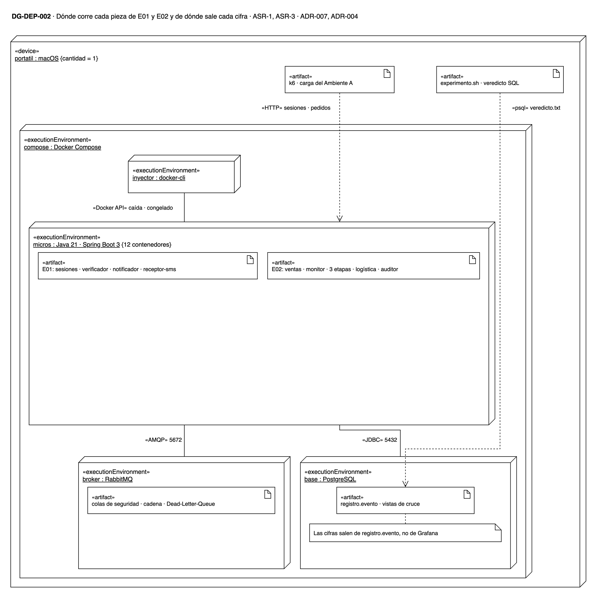

**E01 y E02 corrieron a la vez.** Tienen hipótesis, tablas y colas propias,
y el orquestador los corre en paralelo con `make paralelo`. Al empezar cada
fase, reinicia solo las tablas y las colas de su experimento, sin tocar las del
otro. Así, un pedido detenido en una fase no aparece como pendiente en la
siguiente. Lo único que comparten es la carga de pedidos: E01 usa la de E02, en
vez de lanzar la suya, para no duplicar el Ambiente A.

Cada fase empieza con un calentamiento que no cuenta para ningún criterio: 5
minutos en E01 y 2 en E02.

**Todas las ejecuciones citadas son válidas.** Al cerrar cada una, el
orquestador comprobó tres cosas. La carga de fondo no tuvo un hueco de más de
30 s, el portátil no se suspendió y k6 no pasó de 1 % de solicitudes fallidas.
Si una ejecución no cumple, el ciclo entero, es decir, todas las fases del
experimento, se descarta y vuelve a empezar. El hueco más largo fue de 10,8 s en E01, de 10,3 s en E02 y de 11,0 s
en D4, y k6 no tuvo ninguna solicitud fallida.

E02 detiene su carga de pedidos unos segundos entre una fase y la siguiente.
Para que ese corte no dejara un hueco en la carga de fondo de E01, un relleno
creó un pedido cada vez que pasaban 10 s sin uno. Actuó 18 veces: 1 dentro de
D1, cuando la carga de E02 pasó 10 s sin un pedido, y 4 entre fases de E02. Las
otras 13 fueron después de que E02 terminó, mientras E01 cerraba S3 y su minuto
de gracia. El minuto de gracia es el que sigue a cada ventana, en el que el
orquestador todavía recoge las salidas tardías.

El enunciado no da algunas cifras que los experimentos necesitan. Las fijamos
como supuestos, y cada una se cambia con una variable, sin tocar el código:

| Supuesto | Valor | De dónde sale |
|---|---|---|
| S-10 · aperturas desde el dispositivo registrado | 2 por segundo | 2 000 vendedores que reabren sesión cada 15 min, al vencer el token (SUP-05): 2,2 por segundo, redondeado a 2 |
| S-11 · duración de cada etapa | Lognormal, mediana de 2 s, p99,9 cercano a 9 s, tope de 25 s | Variación normal por debajo de los 25 s de SUP-03 |
| T y N del Monitor | Sondeo cada 2 s; etapa detenida tras 3 sondeos sin respuesta | N × T = 6 s, dentro de los 30 s de ASR-3 |
| S-12 · umbral U | Pedido atascado tras 15 s sin terminar en una etapa viva | En D1 de las dos versiones, el pedido más lento en su etapa tardó a lo sumo 13,7 s. U, más un sondeo de 2 s y su espera de 500 ms, da 17,5 s, dentro de los 30 s de ASR-3 |
| Caída de una etapa (D2) | El proceso muere con SIGKILL durante 45 s y luego se reinicia | El trabajo que la etapa tenía sin terminar vuelve a su cola del bróker y se retoma al reiniciar |

**La evidencia viene de las ejecuciones de decisión**, las del 12 de octubre
que deciden H1 y H2, y no de las exploratorias S4 y D4. Cada escenario se
muestra en tres capas:

- **Una gráfica de margen.** Cada caso es un punto y el umbral del escenario,
  una línea. La genera `analisis/graficas.py` desde la tabla de eventos.
- **Un caso testigo anotado.** Es una toma en vivo de la ejecución, con las
  piezas del caso numeradas. Esas piezas son el estímulo que el orquestador le
  aplica por medio del inyector, la respuesta en los logs y el
  tablero de Grafana o la consola de RabbitMQ. Debajo va un clip de 15 s, que se
  abre con un clic, con el momento del hecho.
- **El respaldo por fase, en el anexo A.** Son las tomas en vivo sin anotar y las
  tomas de lote: el veredicto de cada fase sobre el tablero completo de su
  ventana.

Las horas de los logs están en UTC y las del tablero, en la hora de Bogotá.
Para la evidencia en vivo se agregó a cinco micros una línea de log por hecho,
que no altera lo que se mide.

---

## E01 — ASR-1: aviso por la sesión desde un dispositivo no registrado

### Qué pide ASR-1 y qué probó E01

ASR-1 pide detectar en ≤ 2 s que una sesión abierta con credenciales correctas
la opera un dispositivo que no es el suministrado, y avisar a seguridad. E01
probó esa detección y ese aviso, y que el cambio legítimo de dispositivo no
dispare el aviso. Las fases S1 a S3 deciden la hipótesis; S4 es exploratoria y
busca a qué tasa empieza a atrasarse el aviso.

### El resultado de un vistazo

**Figura 2. ASR-1 se cumple: el aviso más lento es 38 veces menor que el umbral.**

*Cómo leerla.* Cada punto azul es un intruso de S1, ubicado según lo que tardó
su aviso en llegar a seguridad. Mientras más a la izquierda, más rápido llegó.
La línea punteada es el umbral de ASR-1, 2 s. El eje es logarítmico: cada marca
vale diez veces la anterior.

*Qué muestra.* Los 50 puntos caen entre 10 y 52 ms. La franja azul es el margen:
el espacio vacío entre el aviso más lento y el umbral.

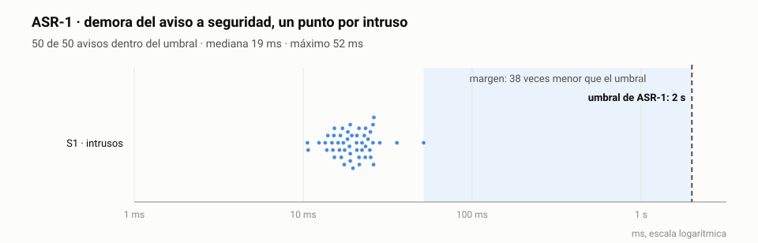

**Figura 3. Un intruso, de la apertura de sesión al SMS de seguridad.**

*Cómo leerla.* Arriba a la izquierda está lo que hace el orquestador. Arriba a
la derecha, lo que responden los micros en sus logs. Abajo, el tablero de
Grafana. Los números marcan el orden de los hechos, y las horas de los logs
están en UTC. La terminal de la izquierda, al abrirse, muestra también los
hechos de unos 30 s previos; la de la derecha, solo los logs desde que se
abrió. Grafana refresca cada 10 s.

*Qué pasa.* ① A las 21:42:31.893, el orquestador abre la sesión del vendedor
V1722 desde `D-ATACANTE-647209`, un dispositivo que no es el suyo. ② Un
milisegundo después, el Verificador compara la huella con la registrada,
`D-V1722-1`, y no coincide. ③ El SMS llega a seguridad con el vendedor, el
dispositivo y la hora. La tabla de eventos le mide 52 ms de demora. El log del
receptor se escribe un instante más tarde: su hora, 21:42:31.947, queda a 54 ms
de la apertura. ④ El tablero lleva 8
intrusos en los últimos 5 minutos: 8 avisos a tiempo, 0 escapes (intrusos sin
aviso) y 0 falsas alarmas.

*El clip.* Se ve aparecer la línea del intruso a la izquierda y, casi al mismo
tiempo, la huella distinta y el SMS a la derecha.

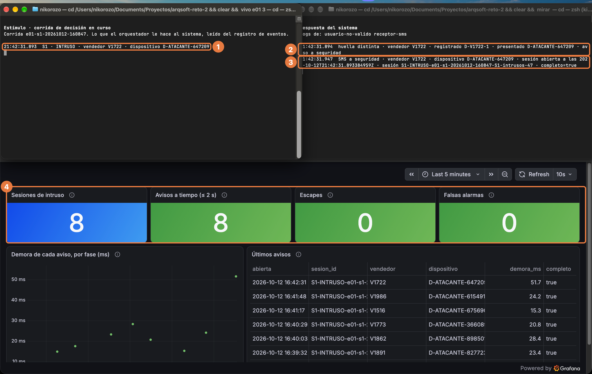

▶ Ver el momento (15 s)

<video controls preload="none" width="100%" src="assets/resultados/clips/asr1-intruso.mp4"></video>

**Figura 4. El cambio legítimo de dispositivo no dispara aviso, ni siquiera un instante después del registro.**

*Cómo leerla.* La pantalla se lee como la de la Figura 3. Aquí lo que importa
es lo que no aparece: ningún SMS. La izquierda muestra cinco aperturas y la
derecha solo tres, porque V1201 y V1202 abrieron sesión antes de que se abrieran
las terminales.

*Qué pasa.* ① En S3, cada vendedor registra un dispositivo nuevo y abre sesión
desde él menos de 1 s después. Es el caso más difícil para el Verificador,
porque el registro acaba de hacerse. ② El Verificador lee ese registro, ve que
la huella coincide y escribe «sin aviso». ③ El tablero sigue en 0 falsas
alarmas.

*El clip.* Llega una apertura más; su huella coincide y a la derecha no sale
ningún SMS.

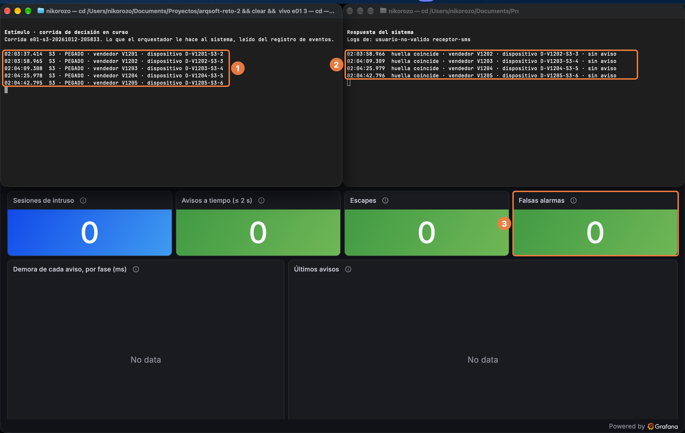

▶ Ver el momento (15 s)

<video controls preload="none" width="100%" src="assets/resultados/clips/asr1-pegado.mp4"></video>

### Lo que midieron las ejecuciones

**Tabla 1. Criterios de H1.** Cada fila es un criterio de
[experiments.md](experiments.md), y los casos son las sesiones que se midieron
contra él. S4 es la ejecución del 7 de octubre.

| Fase | Casos | Cumplen | Fallan | Veredicto |
|---|---|---|---|---|
| S1 · aviso en ≤ 2 s, con vendedor, dispositivo y hora | 50 | 50 | 0 | **Pasa** |
| S2 · ≤ 1 aviso por cada 100 cambios legítimos | 100 | 100 | 0 | **Pasa**: 0 avisos |
| S3 · 0 avisos en aperturas a menos de 1 s del registro | 20 | 20 | 0 | **Pasa** |
| S1 a S3 · 0 avisos por el dispositivo que el vendedor ya tenía registrado | 7 081 | 7 081 | 0 | **Pasa** |
| S4 · tasa a la que el aviso se atrasa | 30 | 30 | 0 | Exploratoria: no se atrasa hasta 10 aperturas por segundo |

**Tabla 2. Cuánto tardó el aviso.** Es el tiempo desde que el micro de sesiones
registró la apertura del intruso hasta que el aviso llegó al receptor del SMS.
El límite de ASR-1 es 2 s, es decir, 2 000 ms. El p95 es el tiempo dentro del
cual llegó el 95 % de los avisos.

| Demora del aviso | Desde dispositivo no registrado | Mediana | p95 | Máximo |
|---|---|---|---|---|
| S1, a la tasa normal | 50 | 19 ms | 27 ms | 52 ms |
| S4 a 1× (2 aperturas/s), 7 de octubre | 10 | 16 ms | 28 ms | 31 ms |
| S4 a 3× (6 aperturas/s), 7 de octubre | 10 | 17 ms | 23 ms | 23 ms |
| S4 a 5× (10 aperturas/s), 7 de octubre | 10 | 17 ms | 34 ms | 38 ms |

**Figura 5. Recorrido de una apertura de sesión en E01 (DG-SEQ-001).** El
reloj arranca en t0, cuando el micro de sesiones (Gestor de sesión en el
diagrama) publica `sesion.abierta`, y se detiene en t1, cuando el aviso llega al
receptor del SMS. Si la huella coincide con la registrada, el Verificador
descarta el evento sin avisar: así se juzgan S2, S3 y las sesiones legítimas.

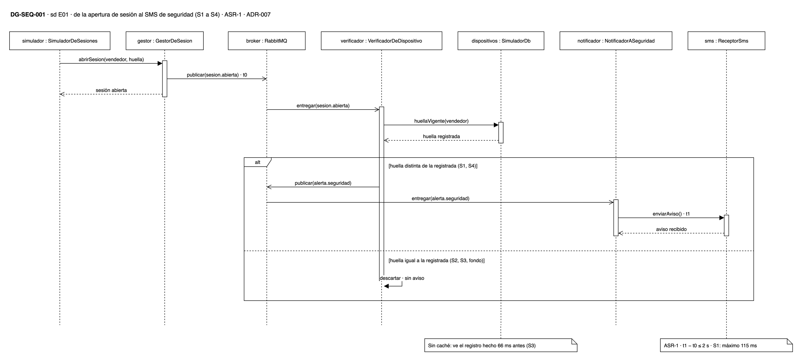

**Tabla 3. Por dónde pasó el aviso en S1.** El aviso recorre cuatro tramos, dos
de ellos por el bróker. Cada fila mide un tramo en las 50 sesiones de intruso.

| Tramo | Mediana | Máximo |
|---|---|---|
| Apertura de la sesión → comparación en el Verificador, por el bróker | 1,5 ms | 6,1 ms |
| Comparación → publicación de `alerta.seguridad` | 3,3 ms | 10,6 ms |
| Publicación → Notificador a seguridad, por el bróker | 4,4 ms | 10,7 ms |
| Notificador → receptor del SMS | 9,7 ms | 29,4 ms |

### Análisis de resultados

**El aviso llega muy por debajo del límite.** De las 50 sesiones de intruso de
S1, el aviso más lento tardó 52 ms. Es menos de la trigésima parte de los 2 s
que permite ASR-1, aunque cada aviso cruza el bróker dos veces. Ningún tramo
pasó de 30 ms.

**El inicio de sesión no espera la comparación.** El micro de sesiones publica
el evento y responde enseguida. En S1, k6 midió las 3 770 aperturas de sesión:
el p95 fue de 6,2 ms y la más lenta tardó 210 ms. Ningún criterio de H1 fija
un límite para esa cifra.

**No hubo una sola falsa alarma.** En S2, 100 vendedores registraron un
dispositivo nuevo y abrieron sesión desde él entre 6 y 60 s después. En S3,
otros 20 lo hicieron entre 25 y 905 ms después del registro. Ninguno disparó
aviso, y tampoco las 7 081 sesiones legítimas que corrieron de fondo en las
tres fases. El Verificador lee el dispositivo registrado directo de la base,
sin caché, y ve el cambio aunque el evento le llegue apenas un instante después
del registro.

**Con más carga el aviso apenas se movió, así que S4 no encontró su límite.**
En la ejecución del 7 de octubre, S4 subió a 10 aperturas por segundo, cinco
veces la tasa normal. El aviso más lento pasó de 31 ms a 38 ms. El punto en que
el diseño empieza a atrasarse está por encima de lo que probamos, y la decisión
no depende de él. Por eso el equipo no repitió S4.

### La decisión

**Recomendamos aceptar ADR-007 tal como está.** H1 se sostiene en S1, S2 y S3,
y esa es la fila de la tabla de decisiones de E01 que lleva a aceptarlo. El
Verificador de dispositivo compara la huella al recibir `sesion.abierta`, como
lo describe el ADR. Ninguna otra fila aplica: no hubo avisos tarde ni falsos, y
en S4 la demora máxima solo pasó de 31 ms a 38 ms a 5 veces la tasa normal.

---

## E02 — ASR-4: el pedido detenido, con destino y sin efectos duplicados

### Qué pide ASR-4 y qué probó E02

ASR-4 parte de un pedido señalado como detenido, con una o dos etapas ya
completadas y una pendiente. Pide reanudarlo desde la etapa que falló, o
entregarlo a una persona con el estado exacto, en ≤ 5 s desde la señal. Y pide
hacerlo sin duplicar la factura, el descargue ni la orden de despacho.

E02 probó la parte de ASR-4 que no depende de quién atienda el pedido: que
llegue una sola vez a la Dead-Letter-Queue, con la etapa que falta y la causa,
y que ninguna etapa duplique su efecto. La reanudación y la entrega a una
persona quedan fuera, porque nadie consume la cola.

La señal de la que parte ASR-4 es la respuesta de ASR-3: detectar el pedido
detenido en ≤ 30 s, con ≤ 1 falsa alarma por hora. Por eso E02 mide también la
detección.

Estos resultados son de la versión refinada de H2. Tiene dos cambios: el punto
de salud de cada etapa informa los pedidos que la etapa lleva más del umbral
U = 15 s sin terminar (S-12), y cada etapa es idempotente. A esos pedidos los
llamamos atascados. El punto de salud y la idempotencia salen del mismo dato: el
recibo que la etapa guarda por cada pedido antes de confirmar el mensaje al
bróker. La primera versión, con un sondeo que solo comprobaba si la
etapa estaba viva, cayó en D3; su resultado está al final de esta sección.

### El resultado de un vistazo

**Figura 6. ASR-3 se cumple: el pedido detenido más lento llegó a la cola 13,0 s antes del umbral.**

*Cómo leerla.* Cada punto azul es un pedido detenido, ubicado según lo que
tardó en llegar a la Dead-Letter-Queue. La fila de arriba son los 329 pedidos
de las caídas de etapa (D2); la de abajo, los 15 congelados en una etapa viva
(D3). La línea punteada es el umbral de ASR-3, 30 s. En D2, el reloj arranca
en la caída, o cuando ventas envía el pedido si llegó con la etapa ya caída. En
D3, arranca cuando el pedido entra a la etapa. Se detiene cuando el bróker
confirma el pedido en la cola, así que incluye la detección y el envío.

*Qué muestra.* Los de D2 llegan entre 0 y 6,2 s. Los más rápidos llegaron con
la etapa ya caída, y el más lento esperó los tres sondeos sin respuesta que
necesita el Monitor para declarar la caída. Los de D3 llegan entre 15,3 y
17,0 s, porque el punto de salud solo los informa cuando pasan de 15 s sin
terminar. Ninguno se acerca al umbral, y la franja azul marca el margen que
queda.

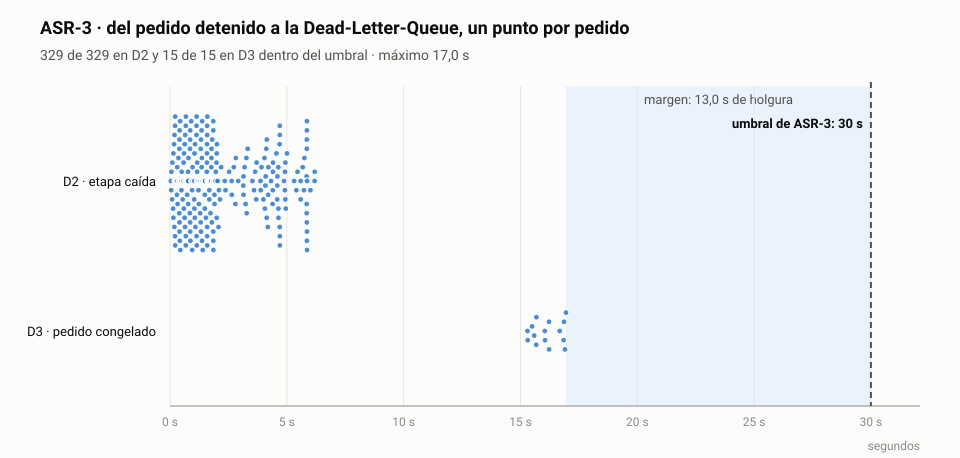

**Figura 7. ASR-4: una vez detectado, el pedido detenido llega a la cola en ≤ 111 ms.**

*Cómo leerla.* Cada punto es un pedido, ubicado según lo que tardó desde la
señal de detención hasta que el bróker lo confirmó en la Dead-Letter-Queue. La
fila de arriba son los 124 pedidos de D2 que ya estaban en la etapa cuando el
Monitor la declaró detenida; la de abajo, los 15 de D3. La línea punteada es el
umbral de ASR-4, 5 s, y el eje es logarítmico.

*Qué muestra.* Los 139 puntos caen entre 3 y 111 ms. El más lento es 45 veces
menor que el umbral, y la franja azul marca ese margen. ASR-4 pide además reanudar el
pedido o entregarlo a una persona. En este prototipo nadie consume la cola, así
que eso no se midió.

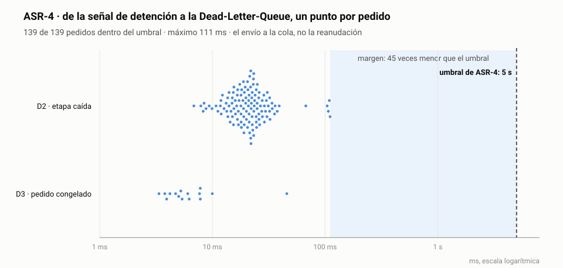

**Figura 8. Un pedido congelado en una etapa que sigue viva: se detecta y llega a la cola con su causa.**

*Cómo leerla.* Arriba a la izquierda está lo que hace el orquestador. Arriba a
la derecha, los logs del Monitor y de ventas. Abajo, el tablero de Grafana y la
consola de RabbitMQ. La toma se hizo unos 2 s después del envío a la cola. Por
eso las tarjetas de Grafana, que refrescan cada 10 s, y RabbitMQ, que refresca
cada 5 s, todavía no lo cuentan; en el clip se ve el cambio.

*Qué pasa.* ① A las 22:06:55.646, el orquestador le ordena a validación de
despacho aceptar su próximo pedido y olvidarlo. A las 22:06:55.901, el pedido
P7-7 entra y se queda quieto. ② 16,9 s después de esa entrada, el punto de
salud de la etapa lo informa y el Monitor lo marca como atascado. ③ 46 ms más tarde, ventas lo envía a la
Dead-Letter-Queue y el bróker lo confirma, con la etapa que falta (despacho) y
la causa `PEDIDO_ATASCADO`. ④ Durante toda la espera, de 17:06:55 a 17:07:12
en el eje del tablero, el Monitor ve las tres etapas en verde: la etapa nunca
dejó de responder. La franja roja de la izquierda es la última caída de D2.

*El clip.* Muestra los últimos segundos de la espera y el momento en que
aparecen, juntas, la detección y la llegada a la cola.

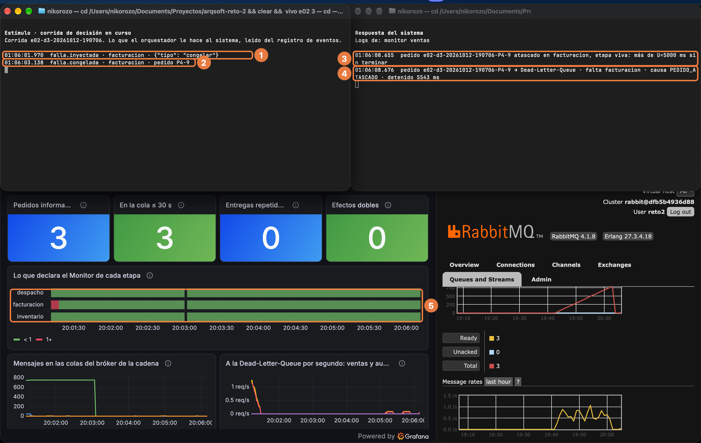

▶ Ver el momento (15 s)

<video controls preload="none" width="100%" src="assets/resultados/clips/asr4-congelado.mp4"></video>

**Figura 9. Una etapa que cae: el Monitor la declara detenida y sus pedidos salen hacia la cola.**

*Cómo leerla.* La pantalla se lee como la de la Figura 8. Abajo a la derecha,
la consola de RabbitMQ cuenta los mensajes de la Dead-Letter-Queue.

*Qué pasa.* ① A las 22:01:01.210, el orquestador mata validación de despacho.
② 5,8 s después, al tercer sondeo sin respuesta, el Monitor la declara
detenida. ③ 12 ms más tarde, ventas empieza a enviar a la cola los pedidos que
tenía en esa etapa, cada uno con la causa `ETAPA_CAIDA`. ④ En el tablero,
despacho aparece en rojo en cada una de sus caídas; el rojo de la izquierda es
la caída anterior, la de inventario. ⑤ RabbitMQ muestra 670 mensajes acumulados
en la cola desde el inicio de D2, porque nadie la consume. Son más que los
pedidos detenidos porque incluyen los que se recuperaron solos, como explica el
análisis.

*El clip.* Se ve la declaración y, enseguida, la lista de pedidos que salen
hacia la cola, uno tras otro.

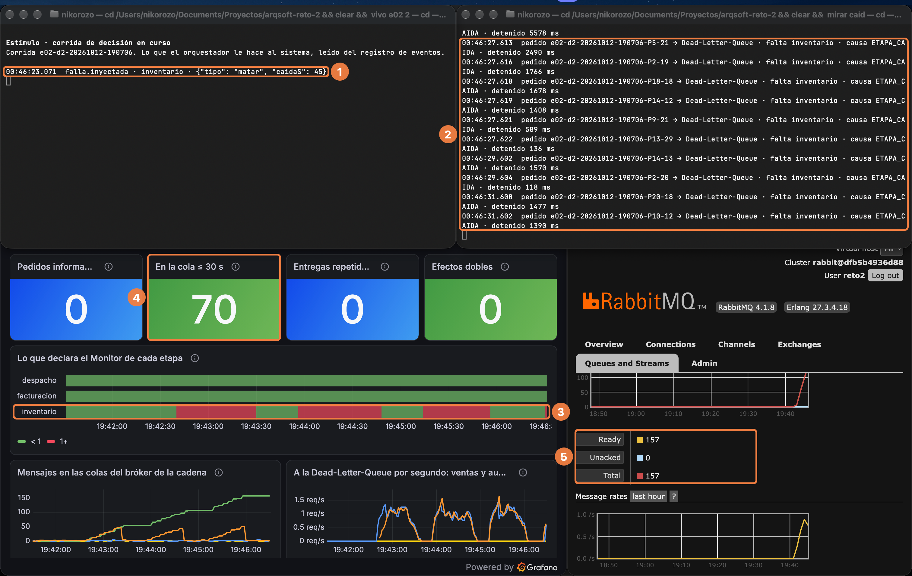

▶ Ver el momento (15 s)

<video controls preload="none" width="100%" src="assets/resultados/clips/asr4-caida.mp4"></video>

**Figura 10. Sin efectos duplicados: la etapa recibe dos veces el mismo pedido y lo factura una sola vez.**

*Cómo leerla.* La pantalla se lee como la de la Figura 3: el orquestador a la
izquierda, los logs de las etapas a la derecha y el tablero abajo. La izquierda
muestra seis entregas y la derecha cuatro, porque las dos primeras ocurrieron
antes de abrir las terminales.

*Qué pasa.* ① Cada 5 s, el orquestador le vuelve a entregar a facturación un
pedido que ya facturó; aquí, P19-4. ② 9 ms después, facturación encuentra el
recibo de ese pedido marcado como terminado y escribe «el efecto no se
repite». ③ El tablero cuenta 5 entregas repetidas descartadas y 0 efectos
dobles. Las tarjetas de pedidos atascados (3) y en la cola (2) cuentan los
últimos pedidos congelados de D3, que siguen dentro de la ventana de 5
minutos.

*El clip.* Llegan varias entregas repetidas, cada una con su respuesta a la
derecha.

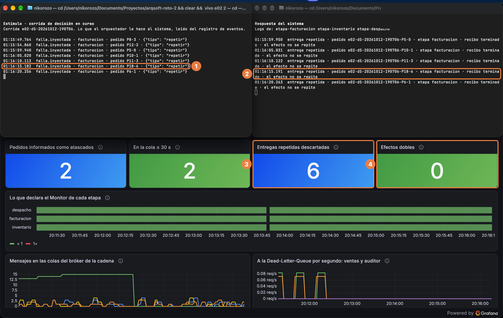

▶ Ver el momento (15 s)

<video controls preload="none" width="100%" src="assets/resultados/clips/asr4-repetida.mp4"></video>

### Lo que midieron las ejecuciones

Las cuatro ejecuciones de decisión fueron 30 min sin fallas (D1), 15 caídas de una
etapa entera (D2), 15 pedidos congelados dentro de una etapa viva (D3) y 60
entregas repetidas de pedidos que la etapa ya había terminado (D5).

**Tabla 4. Criterios de H2.** Cada fila es un criterio de
[experiments.md](experiments.md). Las tres últimas valen para todas las fases.

| Fase | Casos | Cumplen | Fallan | Veredicto |
|---|---|---|---|---|
| D1 · ninguna falsa alarma en 30 min sin fallas | 0 declaraciones y 0 pedidos informados como atascados | — | 0 | **Pasa** |
| D2 · los pedidos detenidos, en la Dead-Letter-Queue en ≤ 30 s | 329 | 329 | 0 | **Pasa**: demora máxima de 6,2 s |
| D3 · el pedido congelado en una etapa viva, en la Dead-Letter-Queue en ≤ 30 s | 15 | 15 | 0 | **Pasa**: demora máxima de 17,0 s |
| D5 · la entrega repetida no repite el efecto de la etapa | 60 | 60 | 0 | **Pasa**: 60 descartadas, un solo efecto cada una |
| Todas · cada pedido detenido que llegó a la Dead-Letter-Queue entró una sola vez | 344 | 344 | 0 | **Pasa**: 0 duplicados |
| Todas · cada mensaje dice qué etapa falta y por qué | 344 | 344 | 0 | **Pasa**: `ETAPA_CAIDA` en D2 y `PEDIDO_ATASCADO` en D3 |
| Todas · cada etapa aplicó su efecto una sola vez por pedido | 11 641 | 11 641 | 0 | **Pasa**: 0 efectos dobles |

**Qué es un pedido detenido.** Es el que no cerró su etapa dentro de los 30 s
de ASR-3. Con el bróker, el trabajo de una etapa caída espera en la cola de esa
etapa y se retoma cuando vuelve. Casi todos los pedidos terminan cerrando, así
que lo que importa es si estuvieron quietos más de 30 s. En D2 cuentan todos
los detenidos de cada caída: los que la etapa tenía en curso al caer y los que
ventas le siguió enviando mientras estaba caída.

**Tabla 5. Cuánto tardó cada pedido en llegar a la Dead-Letter-Queue.** El
límite es 30 s. En D2 el reloj arranca en la caída, o en el envío de ventas si
el pedido llegó con la etapa ya caída. En D3 arranca cuando el pedido congelado
entra a la etapa.

| Fase · etapa | Pedidos | Mediana | p95 | Máximo |
|---|---|---|---|---|
| D2 · validación de despacho | 114 | 1,3 s | 5,6 s | 6,2 s |
| D2 · facturación | 98 | 1,5 s | 5,9 s | 5,9 s |
| D2 · descargue de inventario | 117 | 1,4 s | 4,7 s | 5,8 s |
| D3 · validación de despacho | 5 | 16,8 s | 16,9 s | 17,0 s |
| D3 · facturación | 5 | 15,7 s | 16,2 s | 16,2 s |
| D3 · descargue de inventario | 5 | 16,0 s | 16,8 s | 16,9 s |

**Tabla 6. De la señal a la cola.** ASR-4 cuenta su plazo de ≤ 5 s desde la
señal de detención. En D3, la señal es el momento en que el Monitor detecta el
pedido atascado. En D2, es el momento en que declara detenida la etapa, y
cuentan solo los pedidos que ya estaban en ella. El reloj se detiene cuando el
bróker confirma el pedido en la Dead-Letter-Queue. La medida cubre la entrega a
la cola, no la reanudación ni la entrega a una persona; la consulta está en
[`analisis/e02-senal.sql`](https://github.com/MATI-MBIT/arqsoft-reto-2/blob/main/analisis/e02-senal.sql).

| Fase | Pedidos | Mediana | Máximo |
|---|---|---|---|
| D2 · etapa caída | 124 | 21 ms | 111 ms |
| D3 · pedido congelado en una etapa viva | 15 | 5 ms | 46 ms |

### Análisis de resultados

#### La idempotencia: ningún efecto duplicado

**Figura 11. Una entrega repetida en D5 (DG-SEQ-004).** El inyector toma un
pedido que la etapa ya terminó y se lo vuelve a entregar por el bróker. La
etapa busca el recibo, lo encuentra terminado y descarta la entrega sin repetir
el efecto. Vuelve a publicar `etapa.completada`, por si el aviso anterior se
perdió, y ventas ignora el cierre repetido.

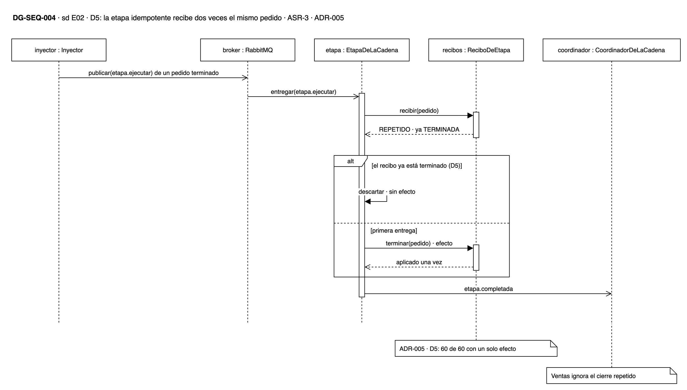

**D5 pasa: ninguna entrega repetida repitió el efecto.** El inyector les volvió
a entregar 60 pedidos terminados a las etapas, 20 a cada una. Las tres vieron el
recibo terminado en los 60 casos, descartaron la entrega y dejaron el efecto en
una sola aplicación.

**La etapa idempotente retomó lo que el bróker le devolvió.** Cuando el
inyector mata una etapa, el bróker devuelve los mensajes que ella no alcanzó a
confirmar y se los entrega otra vez al reiniciarse. En D2 hubo 38 de esas
entregas. Cada etapa guarda un recibo de cada pedido antes de confirmarlo al
bróker, y en esas 38 entregas encontró el recibo en curso. Retomó el pedido y
aplicó su efecto una sola vez. Sumando las cuatro ejecuciones, 11 641 pares de
pedido y etapa tienen exactamente un efecto.

**Los pedidos que se recuperan solos siguen llegando a la Dead-Letter-Queue.**
En D2 llegaron 447 mensajes de pedidos que entraron a la etapa ya caída, pero
que la etapa cerró antes de 30 s al volver. No son falsas alarmas, porque caen
dentro de una caída real de su etapa. Con la primera versión eran un riesgo:
quien consumiera la cola para cumplir ASR-4 reprocesaría pedidos ya
terminados. Ahora la etapa es idempotente, y D5 muestra que una entrega
repetida no repite el efecto.

#### La detección que lo precede (ASR-3)

**Figura 12. Un pedido congelado en D3 (DG-SEQ-003).** El inyector le pide a la
etapa que acepte el próximo pedido y lo olvide sin terminarlo. La etapa guarda
el recibo antes de confirmar el mensaje al bróker, así que el pedido queda en
curso en su tabla. En cada sondeo, el punto de salud lee esa tabla y responde
los pedidos con más de U = 15 s. El Monitor se los pasa al Coordinador, que en
el prototipo es el micro de ventas, y este los envía a la Dead-Letter-Queue.

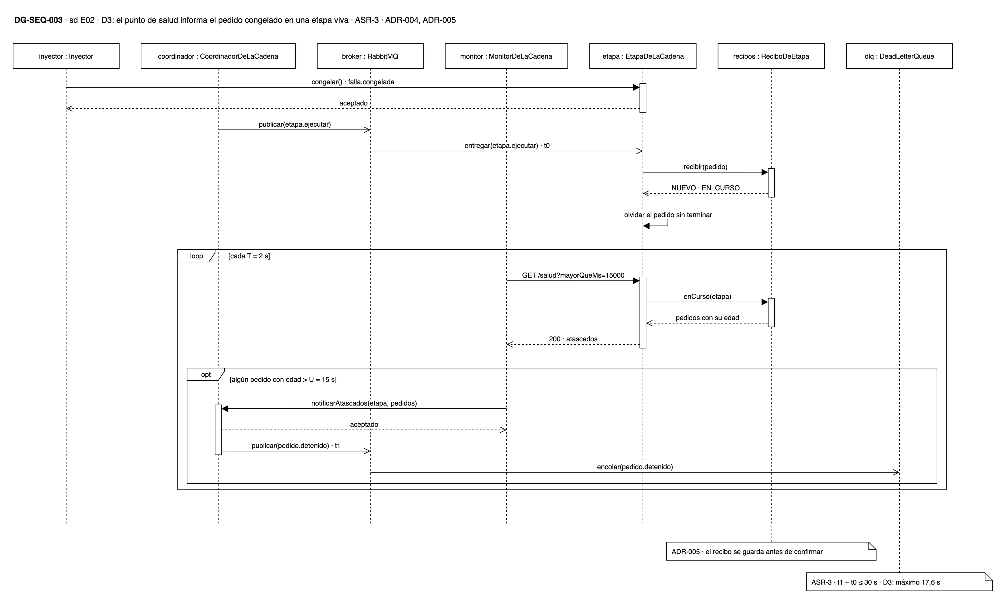

**D3 pasa: el punto de salud informó los 15 pedidos congelados.** Cada uno
apareció como atascado entre 15,3 y 16,9 s después de entrar a la etapa, y
llegó a la Dead-Letter-Queue a lo sumo 46 ms después. La mediana fue de 16,0 s
y el máximo de 17,0 s. El informe cae donde predice el diseño: antes del umbral
U = 15 s más un sondeo de 2 s y su espera de 500 ms, es decir, 17,5 s. Sobran
13 s de los 30 de ASR-3.

La etapa siguió viva y respondiendo todo el tiempo: el Monitor no la declaró
detenida ni una vez. La diferencia con la primera versión está en lo que
responde el punto de salud. Antes decía «estoy viva»; ahora dice qué pedidos
lleva demasiado tiempo sin terminar, y lo lee del recibo que la etapa guardó
antes de confirmar el mensaje. Por eso ve también el pedido que la etapa aceptó
y olvidó.

**Figura 13. Una caída de etapa en D2 (DG-SEQ-002).** El inyector mata la etapa,
y el Monitor la declara detenida al tercer sondeo sin respuesta. Desde ahí avisa
en cada ciclo al Coordinador, que es el micro de ventas como en DG-CMP-005, y
este publica cada pedido pendiente de esa etapa como `pedido.detenido`. El
bróker lo deja en la Dead-Letter-Queue. El reloj se detiene en t1, la
publicación confirmada. Al reiniciarse la etapa, el bróker le entrega el
trabajo que esperaba en su cola.

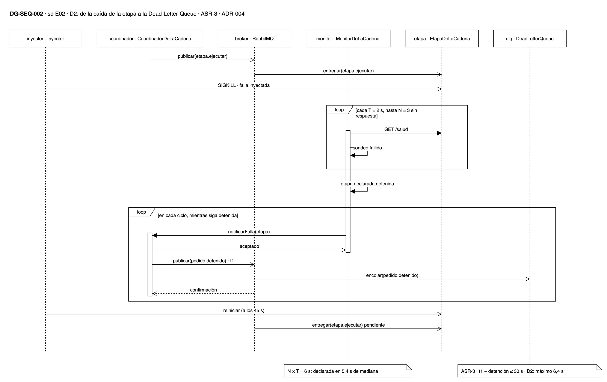

**El sondeo sigue detectando bien la etapa caída.** En cada una de las 15
caídas de D2, el Monitor declaró detenida la etapa con una mediana de 5,2 s y
un máximo de 6,2 s. Es lo que predice el diseño: 3 sondeos sin respuesta, uno
cada 2 s, más la espera de 500 ms del último, dan como máximo 6,5 s. Ventas
envió los 329 pedidos detenidos a la Dead-Letter-Queue en los avisos del
Monitor, cada uno una sola vez.

**Sin fallas, el Monitor no dio falsas alarmas.** D1 fue media hora de carga
normal con 1 739 pedidos. Ningún sondeo quedó sin respuesta, ninguna etapa fue
declarada detenida y el punto de salud no informó ningún pedido como atascado.

**El umbral U tiene poco margen sobre el pedido más lento.** En D1, el 99,9 %
de los pedidos terminó cada etapa en 8,3 s o menos en facturación, en 8,6 s en
validación de despacho y en 9,1 s en descargue de inventario. El pedido más
lento en su etapa tardó 13,1 s, a 1,9 s del umbral U. Con la distribución de
S-11, un pedido sano pasa de 15 s unas tres veces cada diez horas, por debajo
de una falsa alarma por hora. Estas duraciones salen del supuesto S-11, no de
etapas reales, y así deben leerse.

### La primera versión de H2: el sondeo de solo vida

La primera versión corrió el 7 de octubre, con D1 de 1 h, 30 caídas y 30
congelamientos. Su punto de salud respondía `ok` sin mirar nada por dentro.
Pasó D1 sin falsas alarmas y D2 con 655 de 655 pedidos detenidos en la
Dead-Letter-Queue en ≤ 6,4 s. Cayó en D3: 0 de 30 pedidos congelados llegaron a
la cola, porque la etapa respondía «estoy viva» con el pedido quieto dentro.

Ese resultado no fue un error de la implementación. La etapa congelada seguía
viva, y un sondeo que solo pregunta «¿estás viva?» no puede ver un pedido que no
avanza. Por eso el equipo refinó el punto de salud en vez de cerrar la decisión.

#### D4: las doce combinaciones de T y N

D4 corrió con la primera versión, la noche del 8 al 9 de octubre, y sigue
valiendo: la detección de la etapa caída no cambió. Busca el número que
[experiments.md](experiments.md) dejó abierto: el menor N de sondeos sin
respuesta que no dispara falsas alarmas, y su N × T. Cada combinación corrió
20 min sin fallas y luego 15 caídas de 45 s, cinco por etapa.

**Tabla 7. Resultado de cada combinación.** «Declarada tras» es el tiempo desde
la caída hasta que el Monitor declaró detenida la etapa.

| T | N | N × T | Declarada tras (mediana / máximo) | Detenidos en la Dead-Letter-Queue en ≤ 30 s | Demora máxima | Declaraciones sin caída |
|---|---|---|---|---|---|---|
| 1 s | 1 | 1 s | 1,0 s / 1,5 s | 318 de 318 | 1,5 s | 0 |
| 1 s | 2 | 2 s | 2,1 s / 2,5 s | 309 de 309 | 2,5 s | 0 |
| 1 s | 3 | 3 s | 2,9 s / 3,5 s | 329 de 329 | 3,5 s | 0 |
| 1 s | 5 | 5 s | 4,9 s / 5,4 s | 334 de 334 | 5,4 s | 0 |
| 2 s | 1 | 2 s | 1,2 s / 2,4 s | 309 de 309 | 2,4 s | 0 |
| 2 s | 2 | 4 s | 3,6 s / 4,3 s | 301 de 301 | 4,4 s | 0 |
| 2 s | 3 | 6 s | 5,4 s / 6,4 s | 337 de 337 | 6,4 s | 0 |
| 2 s | 5 | 10 s | 9,2 s / 10,3 s | 313 de 313 | 10,3 s | 0 |
| 5 s | 1 | 5 s | 3,0 s / 5,1 s | 350 de 350 | 5,3 s | 0 |
| 5 s | 2 | 10 s | 8,1 s / 10,1 s | 291 de 291 | 10,1 s | 0 |
| 5 s | 3 | 15 s | 12,5 s / 14,7 s | 349 de 349 | 14,7 s | 0 |
| 5 s | 5 | 25 s | 22,5 s / 24,6 s | 334 de 334 | 24,7 s | 0 |

**El menor N sin falsas alarmas es 1, y su N × T es 1 s.** Ninguna de las 12
combinaciones declaró detenida una etapa sin caída. Antes de la primera caída
de cada ejecución, ningún sondeo quedó sin respuesta. La etapa quedó declarada
entre (N − 1) × T y N × T después de la caída, más la espera de 500 ms del
último sondeo, y el pedido llegó a la Dead-Letter-Queue justo después. Las 12
combinaciones caben en los 30 s de ASR-3.

**Ese N = 1 vale para esta máquina, no para producción.** En una sola máquina,
las etapas sanas respondieron siempre el sondeo dentro de su espera de 500 ms.
Con red real, un sondeo suelto que falle ya sería una falsa alarma con N = 1.
El N de producción se fija con sondeos sobre la red real (S-13).

### La decisión

**Recomendamos aceptar ADR-005 con un ajuste, y actualizar ADR-004.** H2 se
sostiene en D1, D2, D3 y D5, y esa es la fila de la tabla de decisiones de E02
que lleva a adoptar el Monitor con el punto de salud enriquecido y la
Dead-Letter-Queue como reacción. La decisión pide cambiar dos ADR:

- **ADR-005:** el recibo de la etapa se guarda antes de confirmar el mensaje al
  bróker, y el efecto se aplica en la misma transacción que lo cierra. Ese
  recibo es el que alimenta el punto de salud.
- **ADR-004:** el plazo por pedido y etapa se mantiene como el umbral U, pero
  lo mide la etapa sobre su recibo y lo lee el Monitor en cada sondeo, en vez
  de revisarlo el Coordinador. El sondeo de vida sigue detectando la etapa
  caída. El mensaje del pedido detenido lleva la etapa que falta y la causa,
  que es el estado exacto que ASR-4 pide entregar.

## Dónde la medición se apartó de experiments.md

Siete reglas de medición de [experiments.md](experiments.md) no estaban
escritas, no se podían aplicar al pie de la letra o se cambiaron para ahorrar
tiempo. Las resolvimos como dice el
[plan de implementación](https://github.com/MATI-MBIT/arqsoft-reto-2/blob/main/notas/plan-implementacion-experimentos.md)
o como se explica aquí, y ninguna cambia una decisión.

| Tema | `experiments.md` | Lo que se midió | Efecto |
|---|---|---|---|
| Pedido detenido | No lo define | El que no cierra su etapa dentro de los 30 s de ASR-3 | Con el bróker casi todos los pedidos terminan cerrando: «nunca cerró» no serviría |
| Reloj de D2 | Arranca cuando el inyector detiene la etapa | Para el pedido que llega con la etapa ya caída, arranca cuando ventas se lo envía | Medido desde la caída, un pedido que llega tarde a una caída de 45 s contaría una espera que no fue suya |
| Duración de D4 | D1 y D2 completos en cada combinación: 1 h sin fallas y 30 caídas | 20 min sin fallas y 15 caídas, cinco por etapa | Las 12 combinaciones caben en una noche. Con menos minutos sin fallas, una falsa alarma rara se ve menos |
| Tasa de aperturas de S4 | 1, 3 y 5 veces la del Ambiente A, que no la fija | S-10: 2 aperturas por segundo | El límite de H1 queda por encima de 10 aperturas por segundo |
| S4 en el ciclo del 12 de octubre | Parte de E01 | No se repitió; se cita la ejecución del 7 de octubre | Es exploratoria y la decisión no depende de ella. Entre las dos ejecuciones solo cambió una línea de log en el Verificador y en el receptor del SMS |
| Carga de pedidos de E01 | La lanza cada ejecución de E01 | La de E02, que corría en paralelo, y un relleno de 18 pedidos cuando pasaban 10 s sin uno | No duplica el Ambiente A. En los últimos 79 s de S3, ya sin E02, la carga de pedidos bajó a uno cada 10 s. Las sesiones de E01 siguieron a su tasa |
| Calentamiento de E02 | 5 min por ejecución | 2 min | Lo fija `load/plan.tsv` para E02. En esos 2 min las etapas ya atienden la carga de pedidos de E02, y en D2 a D5 ya vienen calientes de la fase anterior. Los 2 min no entran a ningún criterio |

---

## Lo que estos resultados no cubren

- **Una sola máquina.** Los experimentos validan las ideas de diseño, no el
  tamaño de la infraestructura. Con red y base reales, las demoras de E01
  serían mayores, y estas ejecuciones no dicen cuánto.
- **Duraciones supuestas.** Las etapas duran lo que fija S-11, así que el
  umbral U de S-12 sale de duraciones simuladas, y deja 1,9 s de margen sobre
  el pedido más lento en su etapa en D1. Con duraciones reales se recalibra con
  la regla de S-12: el pedido más lento observado más 10 %, sin superar 25 s.
- **El N de producción.** D4 dio N = 1 sin falsas alarmas en una sola
  máquina, donde ningún sondeo sano se perdió. S-13 propone un N con margen
  para la red real, y la forma de medir ese ruido.
- **La base de cada etapa.** El punto de salud lee el recibo de la base de la
  etapa. Si esa base no responde, la etapa tampoco responde al sondeo y cuenta
  como etapa caída. Esa falla no se inyectó.
- **Nadie consume la Dead-Letter-Queue.** La reanudación desde la etapa que
  falló, la entrega a una persona y su plazo de ≤ 5 s, que completan ASR-4,
  quedan sin medir. Quien consuma la cola recibirá también los pedidos que se
  recuperaron solos, pero D5 muestra que reentregarlos a la etapa no repite su
  efecto.

### Supuestos para lo que falta

Estos dos supuestos responden lo que los resultados dejan abierto con lo que
midieron D1, D2, D3 y D4. Son propuestas del grupo 1, que se encarga de los dos.
Cada uno dice de dónde sale, cuándo se resuelve y qué lo cambiaría.

| Supuesto | Valor propuesto | De dónde sale | Cuándo se resuelve | Qué lo cambia |
|---|---|---|---|---|
| S-12 · el umbral U, el plazo por pedido y etapa de ADR-004 | 15 s por etapa, ya en uso en el punto de salud de E02 | En los D1 de las dos versiones, el pedido más lento en su etapa tardó a lo sumo 13,7 s, y el p99,9 no pasó de 10,0 s. En D3, los pedidos congelados llegaron a la Dead-Letter-Queue en ≤ 17,0 s | Al recibir duraciones reales de las tres etapas | Las duraciones reales: el plazo pasa a ser la más lenta observada más 10 %, sin superar 25 s |
| S-13 · T y N del sondeo de apoyo en producción | T = 1 s y N = 3 | Con N = 3, dos sondeos perdidos seguidos no declaran la caída. En D4, esa combinación declaró la etapa en 3,5 s como máximo | Antes de desplegar el Monitor sobre la red real | Contar los sondeos perdidos durante 24 h sobre la red real, con las etapas sanas. Si tres seguidos ocurren más de una vez por hora, se sube N mientras N × T quepa en 30 s |

---

## Anexo A: el respaldo de cada fase

Aquí van las tomas sin anotar, para quien quiera revisar cada fase completa.
Cada bloque se abre con un clic, y cada imagen se amplía con su botón
«Ampliar».

E01 · las tomas en vivo de S1, S2 y S3

<strong>S1, un intruso.</strong> Es la toma de la Figura 3, sin las marcas.

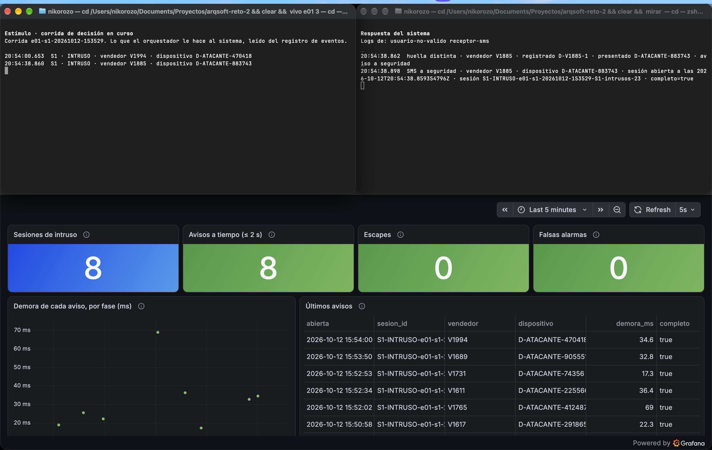

<strong>S2, tres cambios legítimos de dispositivo.</strong> A la izquierda,
los vendedores V1001, V1004 y V1002 abren sesión desde un dispositivo que
acaban de registrar. A la derecha, el Verificador ve que cada huella coincide y
escribe «sin aviso». No sale ningún SMS, y el tablero sigue en 0 falsas
alarmas.

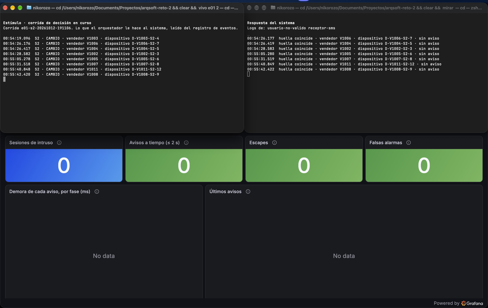

<strong>S3, aperturas pegadas al registro.</strong> Es la toma de la Figura 4,
sin las marcas.

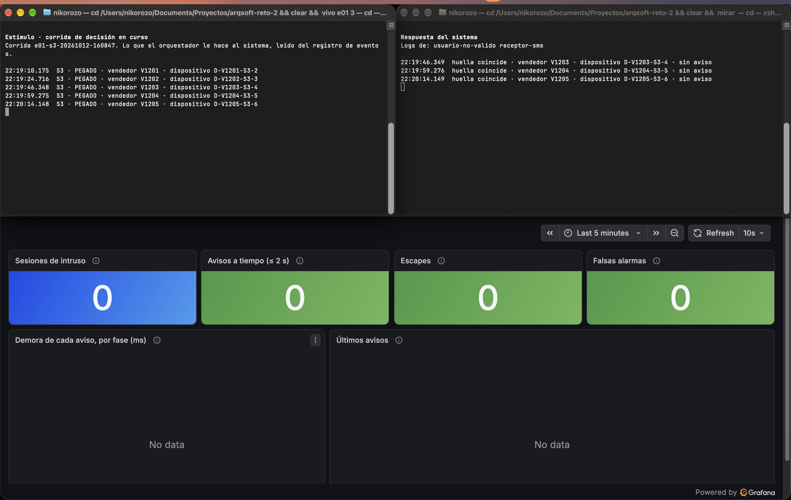

E01 · las tomas de lote de S1, S2 y S3

En cada toma, arriba está el veredicto que calculó la consulta SQL al cerrar
la fase, y abajo, el tablero de E01 sobre toda la ventana de la fase. Los dos
deben decir lo mismo.

<strong>S1.</strong> 50 de 50 intrusos con aviso a tiempo, y ningún aviso en
3 720 sesiones legítimas. En el tablero, cada punto de «Demora de cada aviso» es
un intruso, y todos están en ≤ 52 ms.

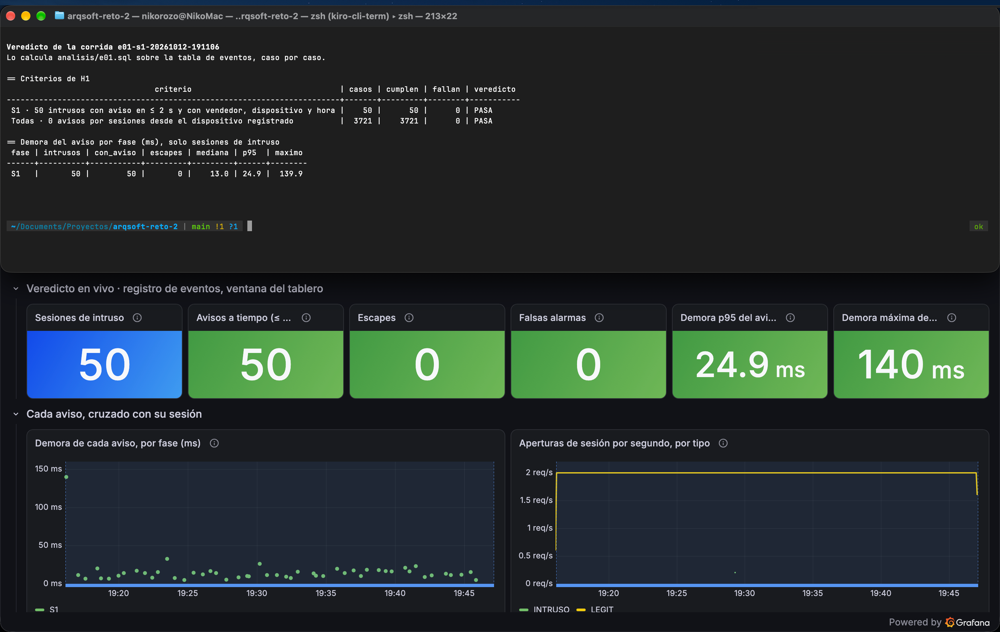

<strong>S2.</strong> Ningún aviso en los 100 cambios legítimos ni en las
2 640 sesiones legítimas de fondo.

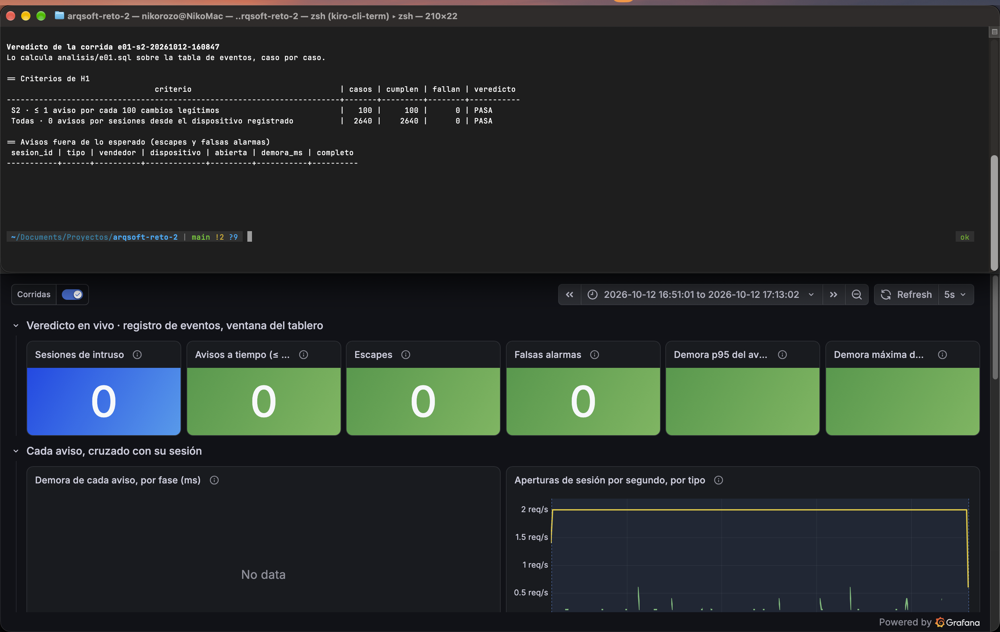

<strong>S3.</strong> Ningún aviso en las 20 aperturas pegadas al registro ni
en las 721 sesiones legítimas de fondo.

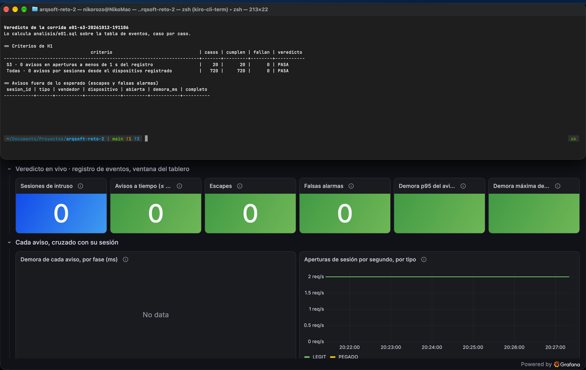

E02 · las tomas en vivo de D2, D3 y D5

<strong>D3, un pedido congelado.</strong> Es la toma de la Figura 8, sin las
marcas.

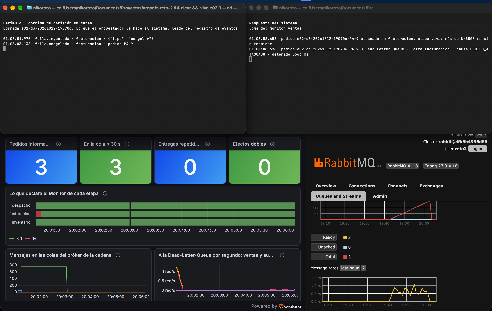

<strong>D5, entregas repetidas.</strong> Es la toma de la Figura 10, sin las
marcas. Los pedidos atascados que aparecen en el tablero son los últimos de D3,
que siguen dentro de su ventana de 5 minutos.

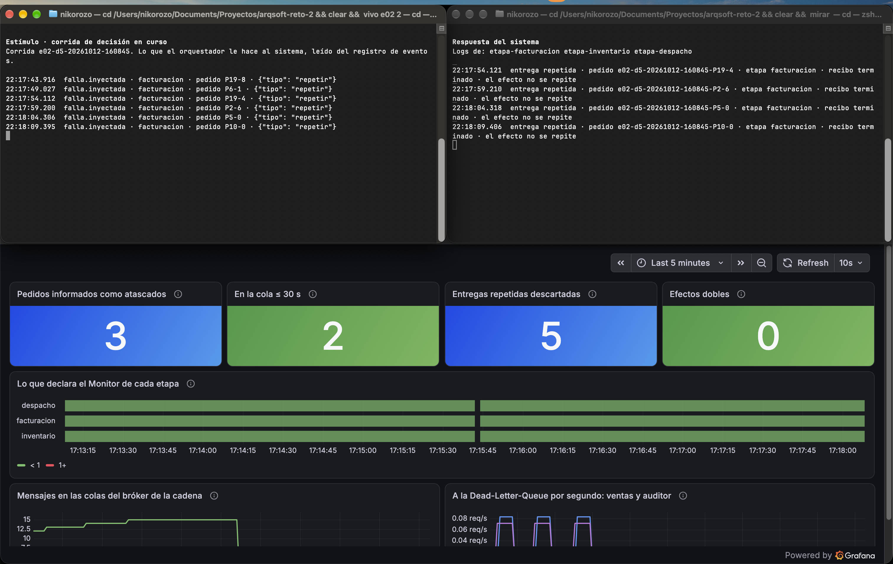

<strong>D2, una etapa caída.</strong> Es la toma de la Figura 9, sin las
marcas.

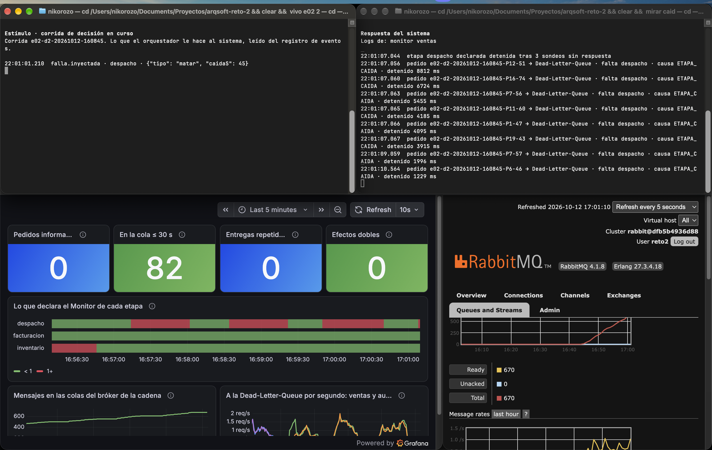

E02 · las tomas de lote de D1, D2, D3 y D5

En cada toma, arriba está el veredicto que calculó la consulta SQL al cerrar
la fase, y abajo, el tablero de E02 sobre toda la ventana de la fase.

<strong>D1.</strong> En 30 minutos sin fallas, ninguna etapa se declaró
detenida y ningún pedido sano se informó como atascado. Todos los contadores de
fallas del tablero están en cero. Los 5 408 pares de pedido y etapa con un solo
efecto incluyen los pedidos que cerraron en el minuto de gracia.

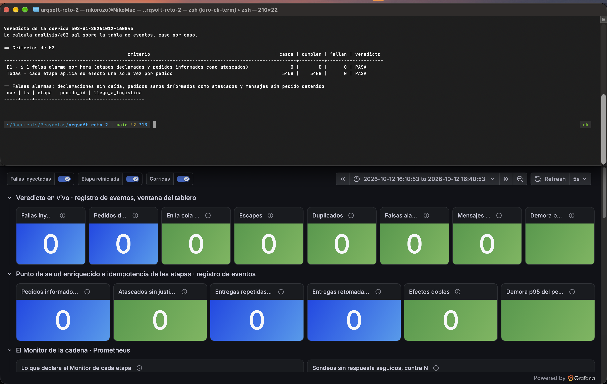

<strong>D2.</strong> Se cumplen los cinco criterios que se evalúan sobre D2. El tablero cuenta
15 caídas, 329 pedidos detenidos y los mismos 329 en la cola a tiempo, sin
pedidos perdidos ni duplicados. Las 38 entregas retomadas son las que el
bróker devolvió a la etapa al reiniciarse. Los 447 «mensajes sin pedido
detenido» son pedidos que se recuperaron solos, como explica el análisis.

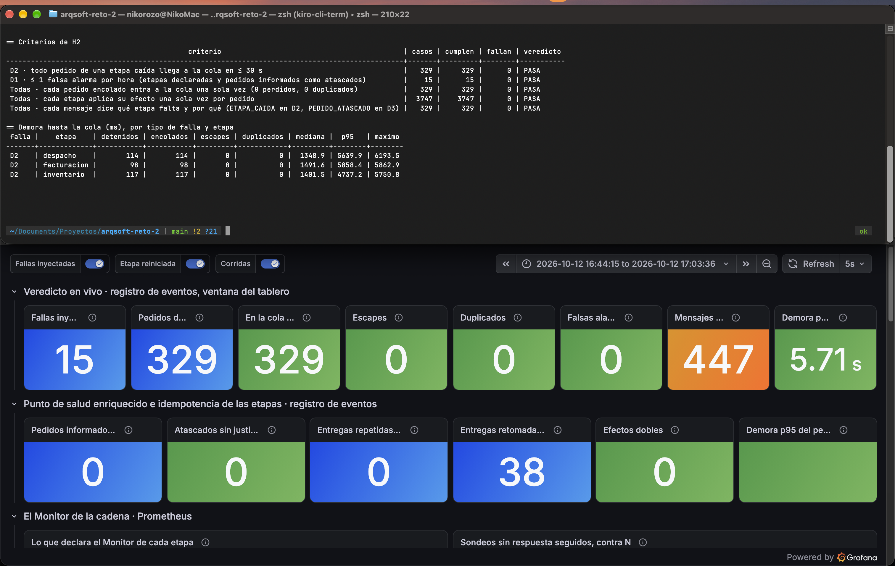

<strong>D3.</strong> Los 15 pedidos congelados llegan a la cola en ≤ 30 s,
una sola vez y con la causa <code>PEDIDO_ATASCADO</code>. Los 15 pedidos que
el punto de salud informó como atascados son los 15 congelados: ninguno es una
falsa alarma.

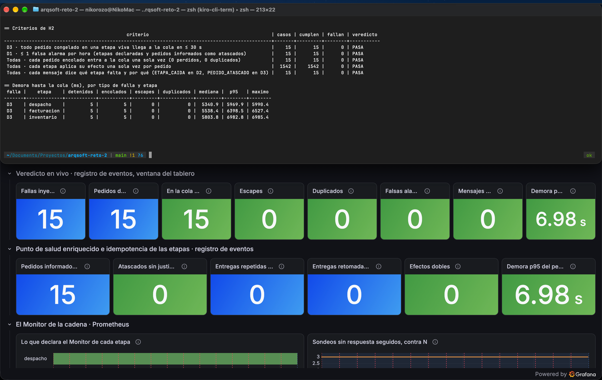

<strong>D5.</strong> Las 60 entregas repetidas, 20 por etapa, se detectan
todas, y ningún pedido queda con un efecto doble.

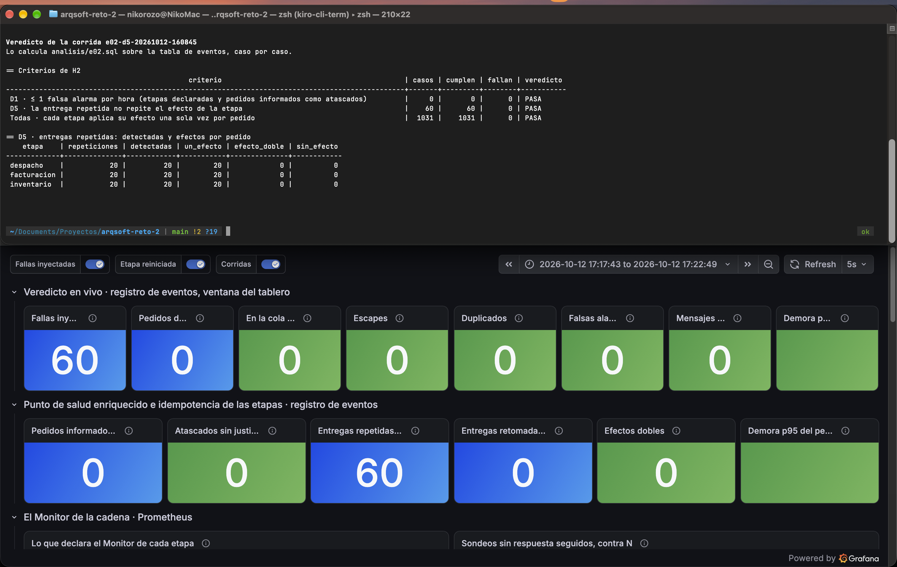

## Anexo B: el veredicto de cada ejecución

Cada ejecución dejó un `veredicto.txt`, la salida de la consulta SQL que cruza la
tabla de eventos caso por caso. Trae la validez de la ejecución, los criterios con
sus casos y su veredicto, y el detalle de cada caso. Cada archivo cubre solo su
fase, así que los criterios de las otras fases aparecen como «NO APLICA». Las
tomas de lote del anexo A muestran cada uno junto a su tablero.

| Fase | Qué probó | Resultado | Veredicto |
|---|---|---|---|
| E01 · S1 | 50 aperturas desde un dispositivo no registrado, a la tasa normal | 50 avisos a tiempo; el más lento tardó 52 ms | [veredicto.txt](https://github.com/MATI-MBIT/arqsoft-reto-2/blob/main/analisis/resultados/e01-s1-20261012-160847/veredicto.txt) |
| E01 · S2 | 100 cambios legítimos de dispositivo, con la sesión abierta entre 6 y 60 s después del registro | 0 avisos | [veredicto.txt](https://github.com/MATI-MBIT/arqsoft-reto-2/blob/main/analisis/resultados/e01-s2-20261012-160847/veredicto.txt) |
| E01 · S3 | 20 aperturas a menos de 1 s del registro del dispositivo nuevo | 0 avisos | [veredicto.txt](https://github.com/MATI-MBIT/arqsoft-reto-2/blob/main/analisis/resultados/e01-s3-20261012-160847/veredicto.txt) |
| E01 · S4, 7 de octubre | 30 aperturas desde un dispositivo no registrado, a 1, 3 y 5 veces la tasa normal | La demora no creció; el más lento tardó 38 ms | [veredicto.txt](https://github.com/MATI-MBIT/arqsoft-reto-2/blob/main/analisis/resultados/e01-s4-20261007-181235/veredicto.txt) |
| E02 · D1 | 30 min de carga normal sin fallas | 0 falsas alarmas | [veredicto.txt](https://github.com/MATI-MBIT/arqsoft-reto-2/blob/main/analisis/resultados/e02-d1-20261012-160845/veredicto.txt) |
| E02 · D2 | 15 caídas de 45 s, 5 por etapa | 329 de 329 detenidos a tiempo y con su causa; 38 entregas retomadas sin efecto doble | [veredicto.txt](https://github.com/MATI-MBIT/arqsoft-reto-2/blob/main/analisis/resultados/e02-d2-20261012-160845/veredicto.txt) |
| E02 · D3 | 15 pedidos congelados, 5 por etapa, en una etapa viva | 15 de 15 en la Dead-Letter-Queue con su causa; demora máxima de 17,0 s | [veredicto.txt](https://github.com/MATI-MBIT/arqsoft-reto-2/blob/main/analisis/resultados/e02-d3-20261012-160845/veredicto.txt) |
| E02 · D5 | 60 entregas repetidas, 20 por etapa | 60 de 60 descartadas; 0 efectos dobles | [veredicto.txt](https://github.com/MATI-MBIT/arqsoft-reto-2/blob/main/analisis/resultados/e02-d5-20261012-160845/veredicto.txt) |
| E02 · D3 de la primera versión | 30 pedidos congelados con el sondeo de solo vida | 0 de 30 llegaron a la Dead-Letter-Queue | [veredicto.txt](https://github.com/MATI-MBIT/arqsoft-reto-2/blob/main/analisis/resultados/e02-d3-20261007-181235/veredicto.txt) |
| E02 · D4 | 12 combinaciones de T y N | 0 declaraciones sin caída; todos los detenidos a tiempo | Un `veredicto.txt` por combinación, en las carpetas [`d4-*-20261008-210507`](https://github.com/MATI-MBIT/arqsoft-reto-2/tree/main/analisis/resultados) |
